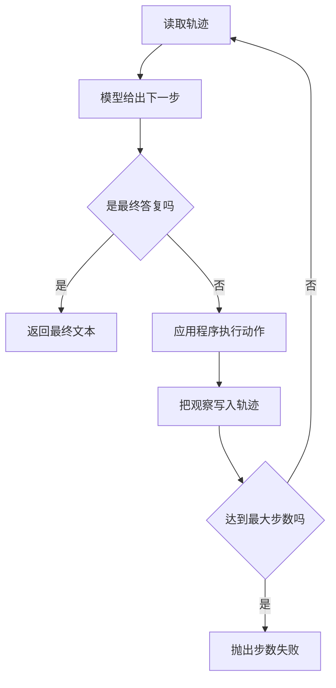

# Agent Loop

Agent Loop 是把「行动、观察、再决策」重复执行的那一层。模型每次只给出下一步，应用负责执行、写回，并在停止条件成立时离开循环。

## 知识点概述

沿用本站的定义：模型提出下一步动作，应用程序执行，再把观察交回，直到停止条件。Loop 就是实现这个「直到」的控制流。它接在 [Agent 基本架构](/agent/architecture.md) 的四块之后：模型选择，工具执行，状态保存观察，停止条件由应用掌握。

一轮里有三件可以分开命名的事。

- **行动**：模型给出的请求。在工具调用里，它是工具名和参数。应用执行函数，模型不执行。
- **观察**：函数返回的文本，或一次可区分的失败说明。它被追加到轨迹里，成为下一轮的输入。
- **停止**：模型给出最终答复，或应用判定不能再继续。本页把最大步数写成硬停止。超过步数是失败，和成功答复用不同的结果表示。

假模型可以替换真实请求。循环的形状先用假决策跑通，再把 `decide` 换成一次模型调用。换的时候保留步数上限。

## 核心原理



图里两个判断都由应用做。模型不负责数步数。一次行动记入轨迹之后，如果这一步已经用尽名额，却还没有最终答复，循环就以失败离开。最终答复走另一条边：即使它出现在允许的最后一步，也仍然是成功。

观察要写进下一轮 `decide` 能读到的轨迹。只打印在日志里、不放进参数，下一步就和没执行一样。失败的观察也要写清楚，例如未知工具。静默跳过会让模型重复同一个请求，直到步数用尽。

成功和步数失败必须能分开。返回字符串，表示任务停在最终答复。抛出 `RuntimeError`，表示步数用尽。若把「超过最大步数」当作普通文本返回，上游会把它显示给用户，并当成任务已经完成。

人取消、工具连续失败，也可以是停止条件。它们和步数上限一样，由应用触发，并使用能和最终答复区分的失败。

## 最小示例

`decide` 是假模型：轨迹为空时返回行动，有了观察后返回结束。`lookup` 是本地函数，不访问网络。

```python
from collections.abc import Callable

Decision = dict[str, str]


def lookup(name: str) -> str:
    return f"observation:{name}"


def fake_decide(observations: list[str]) -> Decision:
    if not observations:
        return {"type": "action", "name": "notes"}
    return {"type": "final", "content": observations[-1]}


def run_loop(decide: Callable[[list[str]], Decision], max_steps: int) -> str:
    observations: list[str] = []
    for _ in range(max_steps):
        decision = decide(observations)
        if decision["type"] == "final":
            return decision["content"]
        if decision["type"] != "action":
            raise ValueError(f"unknown decision type: {decision['type']}")
        observations.append(lookup(decision["name"]))
    raise RuntimeError(f"超过最大步数 {max_steps}")
```

按这段控制流，`run_loop(fake_decide, 4)` 会先执行 `lookup("notes")`，再返回 `observation:notes`。`max_steps` 为 1 时，第一次就是行动，循环没有剩余步数去取得最终答复，于是抛出 `RuntimeError`。这个异常不是字符串结果，调用方可以单独捕获。

一直返回行动的决策也会在步数用尽时抛出同样的异常。观察列表不会被当成最终答复。

```python
def always_act(observations: list[str]) -> Decision:
    return {"type": "action", "name": "notes"}
```

`run_loop(always_act, 2)` 执行两次本地 `lookup` 后抛出 `RuntimeError`。和 `fake_decide` 放在一起，可以确认循环既能完成「第一次行动、第二次结束」，也能在超过步数时失败。

未知的 `type` 会抛出 `ValueError`，并且不会写入观察。非法决策和步数用尽是两种失败，都和成功返回的字符串不同。

## 常见问题

**不设上限，等模型自己说停。** 模型可能反复请求同一个工具。没有步数或其他硬停止时，循环不会自己结束。

**步数用尽后返回一句道歉。** 道歉是成功路径上的文本。调用方若只检查「有没有字符串」，就分不清做完了和被打断了。步数失败用异常，或用单独的失败类型。

**最后一步的观察直接交给用户。** 观察是给下一轮决策的材料。只有决策类型为 `final` 时，文本才是答复。步数刚好在行动后用尽，应走失败，而不是把观察升级成答复。

**在 `decide` 里访问网络或数据库。** 假循环阶段，`decide` 只返回决策。网络、数据库和文件放在应用执行的那一步，便于替换，也便于把权限留在应用里。

## 知识自测

<QuizPanel topic-id="agent-loop" />

## 参考资料

四块结构见 [Agent 基本架构](/agent/architecture.md)。把行动表示成工具名和参数、再由应用执行，见 [Tool Calling](/agent/tool-calling.md)。真实的 `decide` 会变成一次模型请求，请求方式见 [大模型 API 调用](/fundamentals/llm-api.md)。
