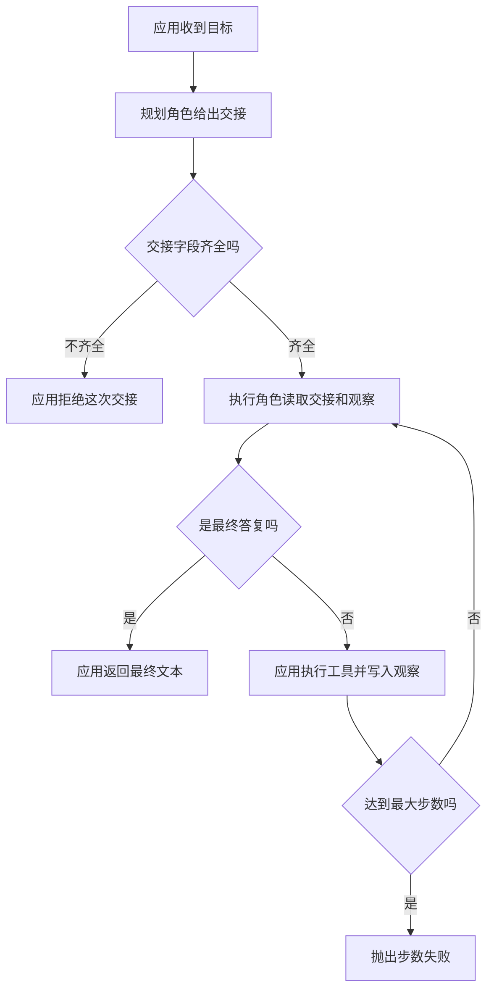

# 多智能体系统

多智能体是把任务分给多个角色。交接由应用完成：它检查上一角色交出的字段，执行工具，再把观察写进下一角色的输入。角色之间不另开一条通道。

## 知识点概述

一个角色也能在 [Agent Loop](/agent/loop.md) 里做完查资料和汇总。角色变多，通常是因为指令、工具或完成标准已经分成几块：有的角色只负责列出要查的名字，有的角色只负责根据观察写最终文本。多出来的是交接，以及交接可能丢失的地方。

两个角色可以是两次模型调用，也可以是两个本地函数。差别在于应用把交接分开保存。几份模型权重都没有自己的信箱。下一角色看见什么，取决于应用这次传给它的参数。

一次交接至少要有三样，都由应用检查。

- **交给谁**：本页用 `to` 标明下一角色。对不上就拒绝，不继续调用工具。
- **做什么**：`tool` 和 `arg` 是请求，不是已经发生的结果。应用看到行动决策后才调用 `lookup`。
- **观察到了什么**：工具的返回值由应用写回，再作为下一轮的 `observation` 传给执行角色。执行角色没有观察时，只能请求行动；有了观察，才可以给出最终文本。

这些字段属于轨迹的一部分，保存方式和 [Agent 状态管理](/agent/state.md) 一样，由应用持有。[Agent 基本架构](/agent/architecture.md) 里的停止条件也仍然只有一份：本页用总步数包住角色之间的来回。某个角色自己的提示词里写「适可而止」，不能代替这个计数。

## 核心原理



规划角色的输出先经过应用。`to`、`tool`、`arg` 缺一，应用抛出 `ValueError`，`lookup` 不会运行。字段齐全之后，应用才把交接和当前观察一起交给执行角色。

执行角色返回的仍是决策，和单角色循环一样。`final` 时，应用返回其中的文本。`action` 时，应用调用 `lookup`，把结果留在自己的变量里，下一轮再传回去。类型两者都不是时，抛出 `ValueError`，并且不写入观察。

步数按执行角色的每一次决策计算。最后一轮若是最终答复，返回文本。最后一轮若是行动，工具结果写下来之后循环结束，抛出 `RuntimeError`。这次观察留在应用里，不升级成给用户的答复。

因此失败点比单角色多了几处：交接缺字段、观察没有传给下一角色、两个角色各写各的循环所以没有总步数。这些都发生在应用把数据从一边交到另一边的时候。

## 最小示例

`planner` 和 `worker` 是两个假模型，只返回字典。`lookup` 查一张本地表，不访问网络。`run_roles` 检查交接、调用工具，并把观察传回 `worker`。

```python
from collections.abc import Callable

Handoff = dict[str, str]
Decision = dict[str, str]


def lookup(name: str) -> str:
    if name == "notes":
        return "议程：评审计划"
    return f"unknown:{name}"


def planner(goal: str) -> Handoff:
    return {"to": "worker", "tool": "lookup", "arg": "notes"}


def worker(handoff: Handoff, observation: str) -> Decision:
    if observation == "":
        return {"type": "action", "name": handoff["tool"], "arg": handoff["arg"]}
    return {"type": "final", "content": observation}


def run_roles(
    plan_role: Callable[[str], Handoff],
    work_role: Callable[[Handoff, str], Decision],
    lookup: Callable[[str], str],
    goal: str,
    max_steps: int,
) -> str:
    handoff = plan_role(goal)
    if handoff.get("to") != "worker" or "tool" not in handoff or "arg" not in handoff:
        raise ValueError("交接缺少 to、tool 或 arg")
    observation = ""
    for _ in range(max_steps):
        decision = work_role(handoff, observation)
        if decision["type"] == "final":
            return decision["content"]
        if decision["type"] != "action":
            raise ValueError(f"unknown decision type: {decision['type']}")
        observation = lookup(decision["arg"])
    raise RuntimeError(f"超过最大步数 {max_steps}")
```

按这段控制流，`run_roles(planner, worker, lookup, "整理议程", 2)` 先检查交接。第一轮 `worker` 看到的观察是空字符串，于是请求行动。应用调用 `lookup("notes")`，得到 `议程：评审计划`。第二轮把这段文本传回 `worker`，它返回最终答复，应用把同一段文本返回给调用方。

`max_steps` 为 1 时，第一轮只有行动。循环在写入观察后结束，抛出 `RuntimeError`。调用方拿到的不是 `议程：评审计划`。

若 `planner` 只返回 `{"to": "worker"}`，`run_roles` 抛出 `ValueError`，并且不会调用 `lookup`。缺字段和步数用尽是两种失败，都和成功返回的字符串不同。

## 常见问题

**两个角色在提示词里互相点名，应用不留交接。** `planner` 的返回值要由 `run_roles` 检查并放进变量，再作为参数传给 `worker`。没有这份数据，下一步就看不到上一角色的决定。

**交接缺字段时仍去调用工具。** `to`、`tool` 或 `arg` 缺失时抛出 `ValueError`。`lookup` 不运行，避免执行角色自己编一个参数。

**在 worker 里直接 lookup。** `worker` 只返回 `action` 或 `final`。本地表只在 `run_roles` 里读取。这样替换角色时，工具权限仍留在应用一侧。

**每个角色单独循环，没有总步数。** `max_steps` 包住交接之后的来回。用尽时抛出 `RuntimeError`。某一角色输出的观察文本，不能因为循环停了就变成最终答复。

## 知识自测

<QuizPanel topic-id="multi-agent" />

## 参考资料

OpenAI Agents SDK 把交接表示成给模型看的工具，运行器再把对话转给下一个角色，并可以过滤它收到的历史，见 [Handoffs](https://openai.github.io/openai-agents-python/handoffs/)。一个角色拆开任务、其他角色分别处理，是 [Building effective agents](https://www.anthropic.com/engineering/building-effective-agents) 里的 orchestrator-workers。本页把其中的转交写成应用代码：检查字段、执行工具、再把观察传下去。

交接字段怎样留在轨迹里，见 [Agent 状态管理](/agent/state.md)。
