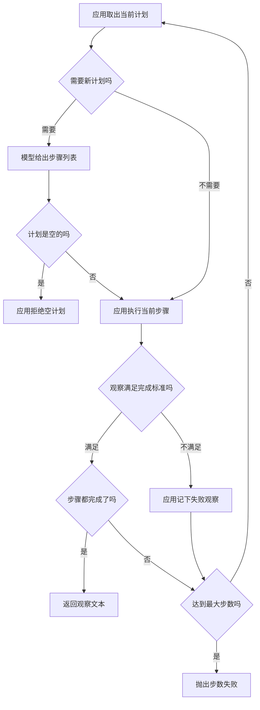

# Planning

Planning 把目标拆成可以检查的子任务。计划是应用保存的步骤数据。模型可以提议或改写这些步骤。工具由应用执行，计划本身不调用函数。

## 知识点概述

一步接一步的循环里，模型每次只看到当前轨迹，然后要一个动作。目标一复杂，这样走容易在失败后重复同一个动作。[ReAct](/agent/react.md) 把思考和行动交替写进轨迹，仍然是走一步看一步。Planning 多保存一份步骤列表：每一步有自己的完成标准。应用按列表执行，失败时把观察交回，让模型改列表，而不是沿用已经失败的那一步。

三件事要分开。

- **计划**：步骤的列表。每一步至少有标识、工具参数和完成标准。它是数据，上面没有可调用的函数。
- **执行**：应用取出当前未完成的步骤，调用本地函数，得到观察。这一步和 [Tool Calling](/agent/tool-calling.md) 一样，模型只提供名字和参数。
- **改计划**：观察不满足完成标准时，应用记下失败文本，下一次把这份文本交给模型。模型返回一份新列表。应用改用新列表，旧步骤的完成标记不再沿用。

停止条件仍由应用掌握，规则和 [Agent Loop](/agent/loop.md) 相同。全部步骤都满足标准，返回拼接后的观察。步数用尽时还有未完成步骤，或者最后一轮仍是失败，就抛出 `RuntimeError`。空列表不是「没有工作可做」，应用直接拒绝。

## 核心原理



「需要新计划」只有两种情况：应用手里还没有列表，或者上一轮的观察没有达到完成标准。中间步骤已经成功时，应用继续执行同一份列表里的下一步，不再问模型。

完成标准是步骤上的一段文本，例如期望观察里出现某个词。应用做包含判断。模型在新列表里写「这一步改好了」，不能代替这次判断。

失败后的新列表整份替换旧列表。已经记下的完成标记和已收集观察会清空，再从新列表的第一步做起。这样失效的参数不会被后面的步骤继续使用。失败文本本身要传给模型，否则它只能重写一份相同的列表。

步数在每一轮尝试上加一，包含失败的那一轮。最后一轮若刚好做完所有步骤，仍然返回观察。最后一轮若只记下失败，或只做完前面的步骤，则抛出 `RuntimeError`。半截观察留在应用里，不作为成功文本返回。

## 最小示例

`draft_plan` 是假模型：失败文本以 `unknown` 开头时，把第一步的参数改成 `notes`，否则第一步会去查一个不存在的名字。`lookup` 只查本地表，不访问网络。`run_plan` 保存计划、执行工具，并在失败时再向假模型要一份新计划。

```python
from collections.abc import Callable

Step = dict[str, str]
Plan = list[Step]


def lookup(name: str) -> str:
    table = {"notes": "议程：评审计划", "mark": "已核对：评审计划"}
    if name not in table:
        return f"unknown:{name}"
    return table[name]


def draft_plan(failure: str) -> Plan:
    first = "notes" if failure.startswith("unknown") else "missing"
    return [
        {"id": "read", "arg": first, "expect": "议程"},
        {"id": "mark", "arg": "mark", "expect": "已核对"},
    ]


def run_plan(
    propose: Callable[[str], Plan],
    lookup: Callable[[str], str],
    max_steps: int,
) -> str:
    failure = ""
    finished: list[str] = []
    observations: list[str] = []
    plan: Plan = []
    for _ in range(max_steps):
        if not plan or failure:
            plan = propose(failure)
            if not plan:
                raise ValueError("计划是空的")
            finished = []
            observations = []
            failure = ""
        pending = [step for step in plan if step["id"] not in finished]
        step = pending[0]
        observation = lookup(step["arg"])
        if step["expect"] not in observation:
            failure = observation
            continue
        finished.append(step["id"])
        observations.append(observation)
        if len(finished) == len(plan):
            return "；".join(observations)
    raise RuntimeError(f"超过最大步数 {max_steps}")
```

按这段控制流，`run_plan(draft_plan, lookup, 3)` 的第一轮查 `missing`，得到 `unknown:missing`，完成标准没有命中。第二轮把失败文本交给 `draft_plan`，新列表的第一步改为 `notes`，观察是 `议程：评审计划`。第三轮执行 `mark`，观察是 `已核对：评审计划`。两步都完成，返回值是这两段用中文分号接起来的文本。

`max_steps` 为 2 时，第二轮只完成改写后的第一步，`mark` 还没执行，于是抛出 `RuntimeError`。已经得到的第一段观察不作为返回值。`max_steps` 为 1 时，第一轮就是失败，同样抛出 `RuntimeError`。

`draft_plan` 若改成始终返回空列表，`run_plan` 在调用 `lookup` 之前抛出 `ValueError`。空计划和步数用尽是两种失败，都和成功返回的字符串不同。

## 常见问题

**让计划在返回时自己调用工具。** `draft_plan` 只返回字典。`lookup` 出现在 `run_plan` 里。步骤上没有函数，模型也碰不到这张本地表。

**失败后用同一参数再查一次。** 失败观察要作为 `propose` 的参数。新列表应改掉没有命中的步骤。应用再按新列表执行。

**步数用尽后返回半截观察。** 还有未完成步骤，或最后一轮仍是失败时，结果是 `RuntimeError`。调用方要能把它和成功字符串区分开。

**没有完成标准，模型说完成就算完成。** 每个步骤带 `expect`。应用用它检查观察。口头的「已完成」若没有写进这套判断，就不能结束任务。

## 知识自测

<QuizPanel topic-id="planning" />

## 参考资料

把任务拆成前后衔接的步骤，并允许在步骤之间做程序检查，是 [Building effective agents](https://www.anthropic.com/engineering/building-effective-agents) 里的 prompt chaining。这篇文章开头说明文中的工具生态后来有变化，本页只借用这种步骤和程序检查的分法。LangGraph 的 [Workflows and agents](https://docs.langchain.com/oss/python/langgraph/workflows-agents) 也把这类工作写成可以核对的小步，核对放在应用的函数里。本页的 `expect` 就是这种核对。

工具仍由应用执行，见 [Tool Calling](/agent/tool-calling.md)。循环和步数上限见 [Agent Loop](/agent/loop.md)。
