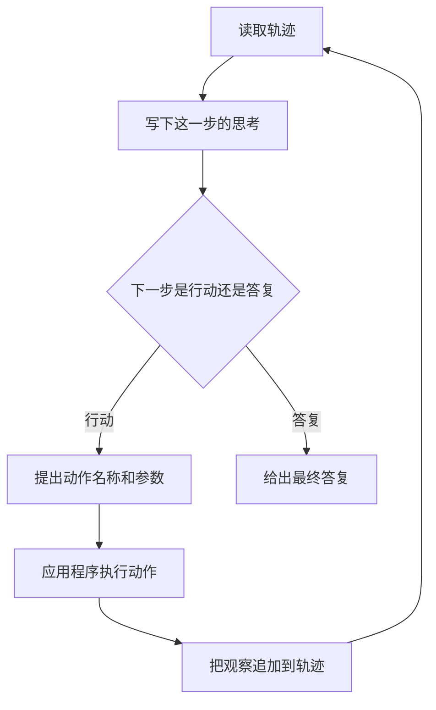

# ReAct

ReAct 把思考和行动交替写进同一次任务。模型留下一步思考；需要外部信息时再提出行动。应用执行行动，把观察放回轨迹，下一步思考可以读到它。

## 知识点概述

普通的工具循环已经是：模型提出动作，应用执行，观察交回，直到停止条件。模型可以只返回工具名和参数，中间不必写出理由。ReAct 多要求一件事：把这一步的思考也放进轨迹。思考给下一步决策看，也给后来排查的人看。

思考和行动的分工不同。思考是语言，不改变外部系统，也不产生观察。行动才请求应用去执行函数。观察只能来自这次执行。下一步把思考、行动和观察一起读进去，再决定继续行动，或给出最终答复。

[ReAct: Synergizing Reasoning and Acting in Language Models](https://arxiv.org/abs/2210.03629) 是 Shunyu Yao 等人提出这一交替方式的论文。本页用它标明来源，对照「思考和行动可以穿插」。不摘录实验分数，也不把论文里的任务成绩当成你的程序已经达标。

交替不必每一步都写成长篇。有的步骤只需要一次行动，有的步骤要先写明为什么查、查到之后计划要不要改。最小循环仍然是 [Agent Loop](/agent/loop.md)：最大步数和其他停止条件由应用掌握。工具名和参数仍由应用执行，见 [Tool Calling](/agent/tool-calling.md)。

## 核心原理



轨迹按时间增长。思考追加之后，外部世界保持原样。只有顺着「行动」那条边，应用才会执行函数并把观察写回。最终答复离开循环，不再请求工具。图里省略了最大步数。步数用尽时走和 Agent Loop 相同的失败出口，不把思考或观察当成最终答复。

和普通工具循环相比，共用的是同一套责任：模型不执行函数，应用执行并把观察交回，停止条件在应用一侧。ReAct 多写进状态的是思考文本。下一步的 `decide` 能看见它。思考若只出现在日志里、没有进入轨迹，就影响不了后续决策。

思考里可以写计划、从观察中摘出的要点，或下一步要改查什么。这些句子仍然是模型的话。观察里的内容才对应一次执行。排查时把两者分开：思考说「已经查到标题」，轨迹里却没有观察，那就还没有查。

本页的示例把「一次决策」算一步。这一步里可以同时有思考和行动，也可以是思考加最终答复。你若把思考和行动分成两次模型请求，步数上限要按那个数法留够。

## 最小示例

假模型不访问网络。第一次决策带思考和行动，第二次带思考和最终答复。

```python
from collections.abc import Callable

Decision = dict[str, str]


def lookup(name: str) -> str:
    return f"observation:{name}"


def fake_decide(trace: list[str]) -> Decision:
    if not any(item.startswith("observation:") for item in trace):
        return {"type": "action", "thought": "还没有观察，先查标题", "name": "notes"}
    return {"type": "final", "thought": "观察已经在轨迹里", "content": "可以回答"}


def run_react(decide: Callable[[list[str]], Decision], max_steps: int = 4) -> str:
    trace: list[str] = []
    for _ in range(max_steps):
        decision = decide(trace)
        thought = decision.get("thought", "")
        if thought:
            trace.append(f"thought:{thought}")
        if decision["type"] == "final":
            return decision["content"]
        if decision["type"] != "action":
            raise ValueError(f"unknown decision type: {decision['type']}")
        trace.append(lookup(decision["name"]))
    raise RuntimeError(f"超过最大步数 {max_steps}")
```

按这段控制流，`run_react(fake_decide)` 的第一次决策会先把 `thought:还没有观察，先查标题` 写入轨迹，再追加 `observation:notes`。第二次决策看见观察，返回 `可以回答`。返回值是最终文本。思考留在轨迹里，没有被当成函数执行。

`max_steps` 为 1 时，第一次只能完成「思考加行动」。循环结束时还没有最终答复，函数抛出 `RuntimeError`。思考文本和观察都不会被当作成功结果返回。

## 常见问题

**思考写了「已查到」，就不再调用工具。** 思考不产生观察。需要外部结果时，仍然要有一次行动，由应用执行。

**把思考文本交给工具分发器。** 分发器只接受已登记的工具名和参数。思考是轨迹的一部分，不是工具名。

**每一步都强制写很长的推理。** 边界清楚的工具调用可以只返回名字和参数。ReAct 适合你希望下一步能读到理由，或人需要事后查看理由的任务。

**用论文里的成绩说明自己的循环已经可用。** 论文用来对照来源。你的停止条件、工具和失败路径要在自己的例子上检查。本页不引用那些实验数字。

## 知识自测

<QuizPanel topic-id="react" />

## 参考资料

- [ReAct: Synergizing Reasoning and Acting in Language Models](https://arxiv.org/abs/2210.03629)：思考与行动交替这一思路的论文。本页不摘录实验分数。
- 循环和最大步数见 [Agent Loop](/agent/loop.md)。工具名和参数由应用执行，见 [Tool Calling](/agent/tool-calling.md)。
