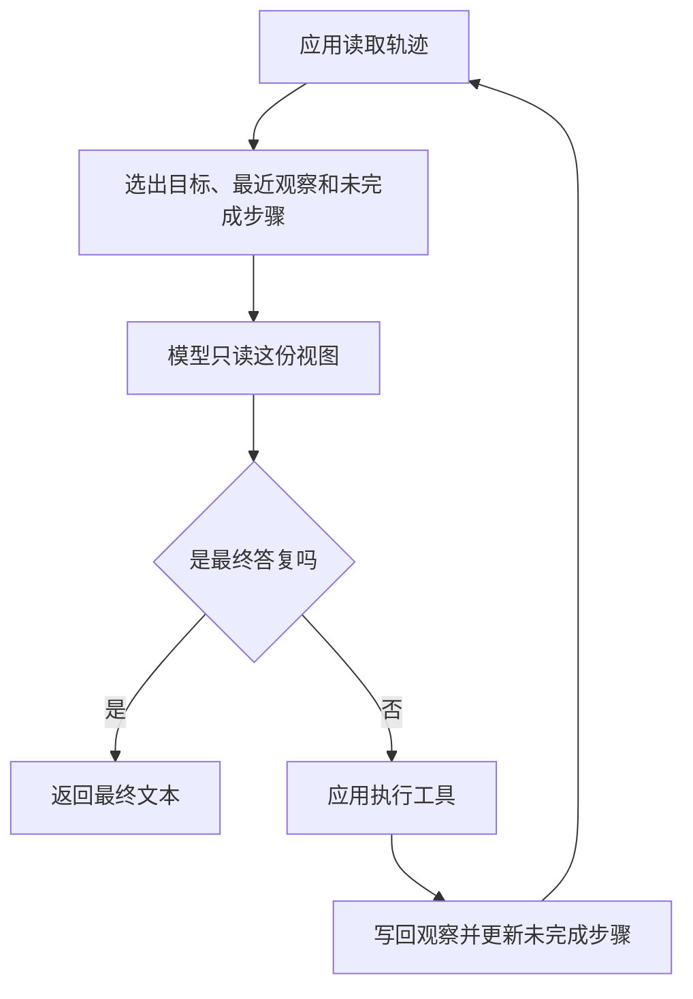

# Agent 状态管理

Agent 状态是这一轮循环要记住的轨迹：消息、工具观察和未完成步骤。应用保存它，并决定下一轮送给模型哪些字段。模型权重是训练之后留在模型里的参数，`record_turn` 不读写它们。

## 知识点概述

[Agent Loop](/agent/loop.md) 每转一圈，下一步都要能看见上一步的结果。[Agent 基本架构](/agent/architecture.md) 把这件事收成「状态」这一块。没有这份轨迹，模型只能重复用户最初的那句话。

轨迹里至少放四样东西。

- **消息**：用户目标，以及应用追加的观察。它留在应用这边，供后面排查某一轮到底写下了什么。
- **工具观察**：每次函数返回的文本，成功和失败都算。只打印在日志里、不写进列表，下一步就和没执行一样。
- **未完成步骤**：还要做的标识。某一步的观察达到标准，应用才把它移出列表。失败的观察要留下，对应步骤继续留在列表里。
- **步数**：应用自己累加的计数，用来和最大步数比较。模型没有义务记得自己被调用了几次。

下一轮不必把上面的全部历史原样塞回模型。应用从轨迹里选一份视图。本页的视图只有目标、最近一条观察、未完成步骤和步数。完整消息仍留在轨迹里。这是一种挑选，不是某个固定的窗口长度；能送进一次请求的上限以服务商文档为准，这里不写具体数字。

两个任务可以共用同一个模型。它们的轨迹是两份数据。换任务时换的是应用手里的这份数据，而不是去改模型文件。

## 核心原理



模型节点的输入是视图，输出是决策。决策为行动时，应用执行工具，再调用一次状态更新：观察追加到消息和观察列表，步数加一。这一步成功，才从 `pending` 里去掉对应标识。失败则 `pending` 保持原样，失败文本仍然写进轨迹，下一轮视图的「最近观察」就是它。

视图里的 `pending` 用一份新列表返回。调用方之后改这份返回值，不会回头改掉轨迹里的未完成步骤。轨迹仍以应用保存的那份为准。

权重不出现在这张图里。模型读视图、给出决策，并不把这次观察写进参数。下一次调用若拿到旧视图，它就看不到新观察，即便用的是同一个模型。

计划里的未完成步骤可以放在 `pending` 里，见 [Planning](/agent/planning.md)。状态页不负责拆目标，只负责这些字段在一轮之后还在，并且下一轮能被选中。

## 最小示例

下面用本地字典演示一轮更新。没有网络，也没有密钥。`fresh_state` 建立轨迹。`record_turn` 写入观察，并按是否成功更新未完成步骤，然后返回给模型的视图。

```python
from typing import TypedDict


class Trajectory(TypedDict):
    goal: str
    messages: list[dict[str, str]]
    observations: list[str]
    pending: list[str]
    steps: int


class ModelView(TypedDict):
    goal: str
    latest: str
    pending: list[str]
    steps: int


def fresh_state(goal: str) -> Trajectory:
    return {
        "goal": goal,
        "messages": [{"role": "user", "content": goal}],
        "observations": [],
        "pending": ["read", "check"],
        "steps": 0,
    }


def record_turn(state: Trajectory, observation: str, succeeded: bool) -> ModelView:
    state["messages"].append({"role": "observation", "content": observation})
    state["observations"].append(observation)
    state["steps"] += 1
    if succeeded and state["pending"]:
        state["pending"].pop(0)
    return {
        "goal": state["goal"],
        "latest": observation,
        "pending": list(state["pending"]),
        "steps": state["steps"],
    }
```

按这段更新，从 `fresh_state("整理议程")` 出发，先以 `unknown:notes` 和 `succeeded=False` 调用 `record_turn`。返回的 `latest` 是这段失败文本，`pending` 仍是 `read` 和 `check`，`steps` 为 1。轨迹里的 `observations` 和 `messages` 各多出这一条，返回的视图不含整份消息。

再用 `议程：评审计划` 和 `succeeded=True` 调用一次。`pending` 去掉 `read`，只剩 `check`，`steps` 为 2，`latest` 换成这次的观察。若接着以成功再调用一次，`pending` 变为空列表，`steps` 为 3。

两次调用改的是同一个 `state`。视图是从它选出来的。函数参数里没有权重，返回值里也没有。

## 常见问题

**把权重和轨迹放进同一次更新。** 轨迹的字段是 `goal`、`messages`、`observations`、`pending` 和 `steps`。`record_turn` 只改这些。换一个任务时，新建或换一份轨迹即可。

**失败了就把步骤从 pending 里划掉。** `succeeded` 为假时，未完成列表保持不动，观察仍然追加。下一步才知道这步还要做，并且能看见失败文本。

**每一轮都把全部消息原样塞回模型。** 本页返回的视图只有目标、最近观察、未完成步骤和步数。完整消息留在轨迹里。要不要把更早的观察也放进视图，由应用另做选择。

**观察只打印，不写入列表。** 下一轮只能从轨迹里选。没写进 `observations` 的文本，不会出现在 `latest` 里。

## 知识自测

<QuizPanel topic-id="agent-state" />

## 参考资料

LangGraph 把 State 定义成应用当前的一份快照，节点函数读入这份快照并返回更新，见 [Graph API overview](https://docs.langchain.com/oss/python/langgraph/graph-api)。检查点是这份快照在步骤之间的保存，见 [Checkpointers](https://docs.langchain.com/oss/python/langgraph/checkpointers)。两者记的都是应用轨迹。本页用这个分工说明消息、观察和未完成步骤放在哪里。

循环怎样反复读取和写回，见 [Agent Loop](/agent/loop.md)。
