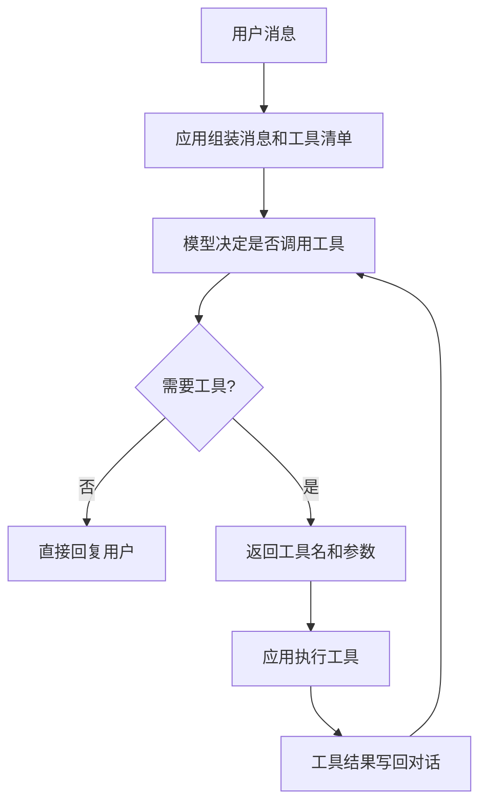

# Tool Calling 工具调用

Tool Calling 是一种约定：模型根据工具说明返回「调用哪个函数、参数是什么」，应用程序执行函数，再把结果写回对话。

## 知识点概述

模型的训练文本里没有你的订单表，也不能访问你的内网。要让它使用这些能力，就不能指望它在回答里「想象」一个查询结果。工具调用把外部能力变成一份清单。模型只负责选择和填参数。查库、发请求、改文件，仍然是你的代码。

它适合边界清楚的动作：查天气、算一笔费用、读取一篇已经切好的文档。它不适合那些你还讲不清输入输出的任务。讲不清的时候，先写成普通函数，再考虑要不要交给模型选择。

## 核心原理

一次完整调用分成四步。

1. 应用程序把目前的消息和工具清单一起发给模型。每个工具有名字、给模型看的说明，以及参数的 JSON 结构。
2. 模型要么直接回复用户，要么返回一个或多个工具调用。调用里是名字和参数，参数通常是一段 JSON 文本。
3. 应用程序按名字找到函数，检查参数，执行它，并把结果当成工具消息追加到对话里。
4. 模型再次被调用。它看到工具结果后，可以继续要别的工具，或给出最终答复。



不同服务商的字段名不一样。OpenAI 的聊天接口把调用放在 `tool_calls` 里，Anthropic 使用 `tool_use` 内容块。名字不同，责任相同：模型不执行函数。实现时把「请求模型」和「执行工具」分成两个函数，换服务商时就只替换前者。

参数是数据，不是可以信任的指令。模型可能编造一个不存在的工具名，或给出类型不对的字段。执行前要检查名字是否已注册、JSON 是否为对象、必填字段是否存在。未知工具应该返回明确错误，而不是静默忽略。

## 最小示例

先看注册表如何执行一次调用。这段代码不访问网络。未知工具、非法 JSON 和非对象参数都会失败。

```python
import json
from collections.abc import Callable

Tool = Callable[..., str]

def dispatch_tool(registry: dict[str, Tool], name: str, arguments_json: str) -> str:
    if name not in registry:
        raise KeyError(f"unknown tool: {name}")
    try:
        arguments = json.loads(arguments_json)
    except json.JSONDecodeError as error:
        raise ValueError(f"invalid tool arguments for {name}") from error
    if not isinstance(arguments, dict):
        raise ValueError(f"tool arguments must be a JSON object for {name}")
    result = registry[name](**arguments)
    if not isinstance(result, str):
        raise TypeError(f"tool {name} must return str")
    return result

def get_time(city: str) -> str:
    return f"{city} 12:00"
```

`dispatch_tool({"get_time": get_time}, "get_time", '{"city": "杭州"}')` 得到 `杭州 12:00`。`[]` 这样的 JSON 数组会被拒绝，因为它不是参数对象。

循环可以先用假模型跑通。下面的 `fake_model` 第一次固定请求 `get_time`，看到工具结果后就停止。它用来验证控制流，不能当成模型能力的证据。

```python
def run_agent(user_text: str) -> str:
    registry = {"get_time": get_time}
    messages: list[dict[str, object]] = [{"role": "user", "content": user_text}]
    for _ in range(4):
        message = fake_model(messages)
        messages.append(message)
        calls = message.get("tool_calls")
        if not calls:
            return str(message["content"])
        for call in calls:
            result = dispatch_tool(registry, call["function"]["name"], call["function"]["arguments"])
            messages.append({"role": "tool", "tool_call_id": call["id"], "content": result})
    raise RuntimeError("agent loop exceeded max steps")
```

仓库里的 `examples/tool_dispatch.py` 是同一思路的完整文件。请在仓库根目录运行：

```bash
python examples/tool_dispatch.py
```

看到 `ok` 表示分发和假模型循环都按断言走完。接入真实接口时，保留 `dispatch_tool` 和最大步数，只替换产生 `tool_calls` 的那一层。工具清单仍然用 JSON 描述参数，例如 `city` 是必填字符串。标准库的解析行为见 [json](https://docs.python.org/3/library/json.html)。

## 常见问题

**参数解析失败后把原始异常直接丢给用户。** 模型需要的是一句能继续决策的说明，例如「city 必须是字符串」。用户需要的是任务是否还能继续。这两种文本不要混成一次未捕获异常。

**工具结果太长。** 把整张表贴回对话会占满上下文。返回摘要，并写上原始结果放在哪里，必要时再提供一个按 id 读取详情的工具。

**在提示词里粘贴 API 密钥，让模型自己去请求。** 密钥会进入日志和上下文。请求应由应用程序发出。

**没有处理重复调用。** 同一参数的查询可以缓存。会写数据的工具要能识别重复请求，避免订两次票。

## 知识自测

<QuizPanel topic-id="agent-tool-calling" />

## 参考资料

- [OpenAI Function calling](https://platform.openai.com/docs/guides/function-calling)：`tool_calls` 的字段说明
- [Anthropic Tool use](https://docs.anthropic.com/en/docs/agents-and-tools/tool-use/overview)：另一种内容块写法，便于对照责任边界
- [Python json](https://docs.python.org/3/library/json.html)：参数文本的解析

下一节可以继续看结构化输出，或先把这个循环放进 [实战项目](/projects/multi-tool-agent.md)。
