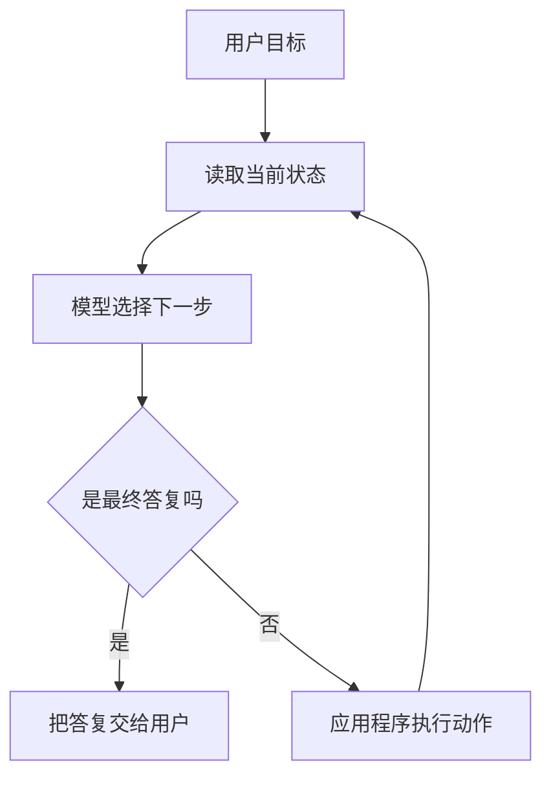

# 什么是 AI Agent

一个 AI Agent，在本站里指这样的程序：模型可以提出下一步动作，应用程序执行这个动作，再把观察结果交回模型，直到满足停止条件。

## 知识点概述

一次普通的模型调用是「文本进去，文本出来」。调用结束时，程序并不知道模型还想查资料、跑函数或再问一个澄清问题。Agent 把这次调用放进一个由你控制的循环里，于是模型的输出可以是给用户的话，也可以是一次行动请求。

这个词比大模型更早。经典人工智能里，agent 就是能感知环境并采取行动的系统。本站不展开那个更宽的定义，只固定工程上需要写进代码的四个部分：

- **模型**：根据当前消息决定说什么，或请求哪一个工具
- **工具**：程序真正执行的函数，例如查时间、搜文档、写一条记录
- **状态**：到目前为止的消息、工具结果和任务进度
- **停止条件**：模型给出最终答复、步数用尽，或人取消了任务

如果步骤顺序完全由人写死，模型只负责最后一段文字，那更适合叫流水线。流水线往往更稳。能用流水线解决的问题，不必先做成 Agent。

## 核心原理

下面这张图把一次任务收成循环，而不是单次补全。



模型不拥有你的数据库，也看不到你没有写进消息的变量。它只能根据这次请求里的消息和工具说明做选择。真正的权限在应用程序：哪个函数可以调用、超时多久、失败时把什么文本交回去，都由你写。

因此调试时要分开看两件事。模型选错了工具，是决策问题。工具选对了但函数抛错，是执行问题。把两者记成同一条「模型坏了」，后面会无法定位。

## 最小示例

下面用一个假的决策函数表示循环。它不是模型，只固定「第一次要行动，第二次就停止」。替换 `decide` 之后，循环本身不用改。

```python
def decide(state: dict[str, str]) -> dict[str, str]:
    if "observation" not in state:
        return {"type": "action", "name": "lookup"}
    return {"type": "final", "content": f"查到了 {state['observation']}"}

def lookup() -> str:
    return "路书第 1 节"

def run(goal: str) -> str:
    state = {"goal": goal}
    for _ in range(4):
        decision = decide(state)
        if decision["type"] == "final":
            return decision["content"]
        state["observation"] = lookup()
    raise RuntimeError("超过最大步数")
```

`run("这一节在讲什么")` 会先得到一次行动，再把 `lookup` 的结果放进状态，然后停在最终答复。真实系统里的 `decide` 是一次模型请求，`lookup` 可能是搜索或数据库查询。停止条件仍然要写在循环外面，不能假设模型总会主动结束。

## 常见问题

**把带 if 的脚本都叫做 Agent。** 分支本身只是控制流。只有模型在运行时选择动作，才用本站的这个词。

**期望模型直接执行本地函数。** 模型输出的是行动请求。执行发生在你的进程里，所以密钥和权限边界也在这里。

**不写最大步数。** 模型可能反复请求同一个工具。循环需要上限，超过上限时要告诉用户停在了哪里，而不是一直转。

**一开始就上多个 Agent。** 多个角色会增加交接和状态不一致。先让一个循环能稳定完成一个小任务。

## 知识自测

<QuizPanel topic-id="what-is-agent" />

## 参考资料

本页使用的是工程定义，用来统一后面的章节。工具调用的具体消息格式见 [Tool Calling](/agent/tool-calling.md)。若要核对行业文档里的说法，可以从 [OpenAI Function calling](https://platform.openai.com/docs/guides/function-calling) 看一个实现，从 [Anthropic Tool use](https://docs.anthropic.com/en/docs/agents-and-tools/tool-use/overview) 看另一种消息形状。两者都是应用程序执行工具，模型负责提出调用。
