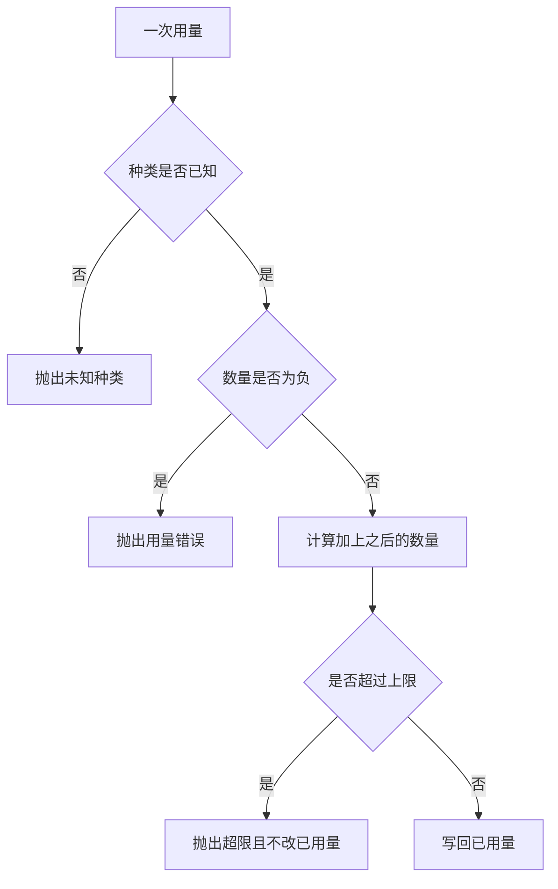

# 成本与性能优化

一次任务的开销，先看成四类计数：输入、输出、重试、检索。计数超过上限时抛出 `RuntimeError`，已用数量停在超限之前，后续的读取函数也不会被调用。本页不把计数换算成金额，也不给出吞吐或耗时。

## 知识点概述

[Token 与上下文窗口](/fundamentals/token-context.md) 说明输入和输出都占窗口。[大模型 API 调用](/fundamentals/llm-api.md) 说明每一次请求都是一次真实调用。开销变大，通常是因为这几件事发生得更多：

- **input**：这一次送给模型的量。历史整段重发，输入计数就上去。
- **output**：模型写回来的量。
- **retry**：同一次调用又做了一遍。失败后的重试也要先记账。
- **retrieval**：又查了一次外部或本地资料。同一次查询做两遍，就记两笔。

少记一次，就少一次后续工作。调用方看见的是预算字典里的 `used`，以及超限时的 `RuntimeError`。示例里的 `limit` 只是这份字典自己的上限，用来把超限变成看得见的失败。它不是某次运行测出来的速度，也不是价格。

## 核心原理



顺序是先记账，再做事。`guarded_retrieval` 先调用 `spend`，成功后才调用 `fetch`。`spend` 抛出时，`fetch` 没有执行，调用方也不会收到一份看起来正常的检索结果。

未知种类和负数是 `ValueError`。超限是 `RuntimeError`。两种异常分开，调用方才知道是记账参数不合法，还是这次任务该停了。缺 `used` 或 `limit` 同样是 `ValueError`，不会被当成「上限是零所以刚刚好没超」。

重试不因为「上一次没成功」就免费。每一次重试在发出之前记一笔 `retry`。这笔把 `used` 推过上限时，这次重试不会开始。

## 最小示例

```python
from collections.abc import Callable


def spend(budget: dict[str, int], kind: str, units: int) -> None:
    if "used" not in budget or "limit" not in budget:
        raise ValueError("预算缺少 used 或 limit")
    if kind not in {"input", "output", "retry", "retrieval"}:
        raise ValueError(f"未知的开销种类: {kind}")
    if units < 0:
        raise ValueError(f"{kind} 的用量不能为负")
    used = budget["used"] + units
    if used > budget["limit"]:
        raise RuntimeError(f"{kind} 使用量 {used} 超过上限 {budget['limit']}")
    budget["used"] = used


def guarded_retrieval(budget: dict[str, int], fetch: Callable[[str], str], query: str) -> str:
    spend(budget, "retrieval", 1)
    return fetch(query)
```

`budget = {"used": 0, "limit": 3}` 时，`spend(budget, "input", 2)` 之后 `used` 为 2。再 `spend(budget, "retry", 2)` 抛出 `RuntimeError`，`used` 仍是 2。`spend(budget, "other", 1)` 抛出 `ValueError`，已用量不变。

`guarded_retrieval` 在上限已满时不会调用 `fetch`。本地的 `fetch` 可以是 `lambda query: query`，不访问网络。`fetch` 自己抛出异常时，这次 `retrieval` 已经记入 `used`，调用方同时看得到异常和增加后的计数。

## 常见问题

**超限后返回空字符串。** 空字符串会像一次没有命中的检索。超限用 `RuntimeError`，调用方单独捕获。

**重试写在记账前面。** 重试已经发出，超限才被发现。先 `spend(..., "retry", 1)`，异常抛出时调用还没发生。

**把同一次检索记成零。** 第二次调用如果也走 `guarded_retrieval`，计数会再加一。省掉重复调用，才会少一笔 `retrieval`。

**用一份价格或耗时评价这次修改。** 本页的数字只存在于例子里的 `limit`。真实环境里输入有多大、重试有多少，用你自己的 `used` 看。

## 知识自测

<QuizPanel topic-id="cost-performance" />

## 参考资料

计数对应的上下文见 [Token 与上下文窗口](/fundamentals/token-context.md)。每一次模型请求为什么都要算进去，见 [大模型 API 调用](/fundamentals/llm-api.md)。
