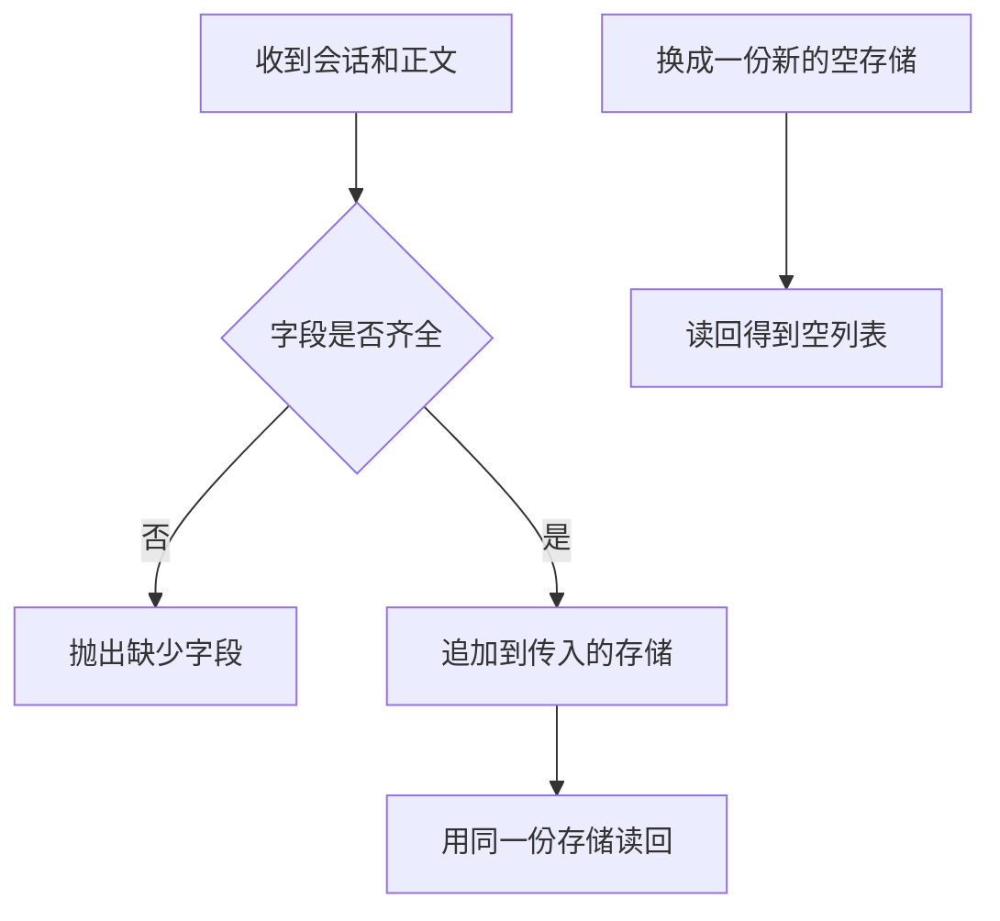

# 数据库存储

会话和消息若只留在进程内存里，进程一换，调用方再读就得到空列表。要跨请求保留，就把同一份存储交给读写函数。缺字段时在写入前抛出 `ValueError`，存储内容保持原样。

## 知识点概述

[FastAPI 服务开发](/engineering/fastapi.md) 里的一次请求结束之后，局部变量就没了。[Memory 存储与检索](/memory/storage.md) 讨论记忆要放在哪里。这一页只解决一件事：消息列表的读写是否还能在下一次调用里看见。

调用方能区分三种读取结果。

- **有消息**：同一个存储对象里，该 `session_id` 下有按写入顺序排列的文本。
- **确实没有消息**：存储还在，但这个会话没有行。返回空列表。
- **不能读**：缺少 `session_id`，或存储本身失败。这是异常，不是空列表。

空列表只表示「查过了，没有行」。连接失败、缺字段如果也被收成 `[]`，调用方会以为这个会话从来没说过话。

标准库 `sqlite3` 可以把同一组规则放到一个文件上。下面的最小示例用字典把规则先写清楚，不创建文件，也不连接网络。字典做不到的那件事，就是进程重新开始之后仍然留着上一份数据。

## 核心原理



写入函数收到的 `store` 是调用方持有的对象。服务如果每次请求都新建一个字典，效果和「重新打开」一样：上一次的 `save_message` 不在这份字典里，`load_messages` 返回 `[]`。

文件型数据库换的是连接，不是规则。校验仍然在 `INSERT` 之前。校验失败时异常直接出去，表里不会多出一行空会话。`sqlite3` 的 `:memory:` 每个连接各自一份库，关掉再新建，读回也是空的。同一个文件路径上提交过的行，新连接还能读到。

## 最小示例

```python
def save_message(store: dict[str, list[str]], session_id: str, text: str) -> None:
    if not session_id:
        raise ValueError("缺少 session_id")
    if not text:
        raise ValueError("缺少 text")
    store.setdefault(session_id, []).append(text)


def load_messages(store: dict[str, list[str]], session_id: str) -> list[str]:
    if not session_id:
        raise ValueError("缺少 session_id")
    return list(store.get(session_id, []))
```

```python
store: dict[str, list[str]] = {}
save_message(store, "s1", "你好")
```

`load_messages(store, "s1")` 得到 `["你好"]`。`load_messages({}, "s1")` 得到 `[]`，因为这是另一份存储。`save_message(store, "", "你好")` 抛出 `ValueError`，`store` 里不会出现空字符串键。缺 `text` 时同样不写入。

换成 SQLite 时保持这个顺序：先检查字段，再执行插入，成功后才 `commit`。参数用占位符传入，不把会话号拼进 SQL 字符串。`path` 可以是本地文件名，也可以是 `:memory:`。连接失败让异常继续往上，不要在 `except` 里返回空列表。

```python
import sqlite3


def open_db(path: str) -> sqlite3.Connection:
    connection = sqlite3.connect(path)
    connection.execute(
        "CREATE TABLE IF NOT EXISTS messages (session_id TEXT NOT NULL, text TEXT NOT NULL)"
    )
    return connection


def save_row(connection: sqlite3.Connection, session_id: str, text: str) -> None:
    if not session_id:
        raise ValueError("缺少 session_id")
    if not text:
        raise ValueError("缺少 text")
    connection.execute(
        "INSERT INTO messages (session_id, text) VALUES (?, ?)",
        (session_id, text),
    )
    connection.commit()
```

## 常见问题

**用请求里的局部列表当会话历史。** 下一个请求拿到的是新列表。调用方看到的是空历史，即使上一句刚刚写过。存储对象要活得比单次请求长，或者落到文件里。

**出错时返回空列表。** 空列表和「数据库打不开」变成同一种结果。缺字段用 `ValueError`，连接和 SQL 错误继续抛出。

**把密钥和消息写在同一列里。** 读会话的人会读到密钥。消息文本只放用户和助手该看的内容。密钥留在 [FastAPI 服务开发](/engineering/fastapi.md) 的环境字典里。

**为了省事把会话号拼进 SQL。** 会话号是数据。上面的 `save_row` 用 `?` 占位，数据库收到的是参数，不是一段被改写过的语句。

## 知识自测

<QuizPanel topic-id="database-storage" />

## 参考资料

- [sqlite3](https://docs.python.org/3/library/sqlite3.html)：标准库里的本地数据库，用来把同一组读写放到文件上
