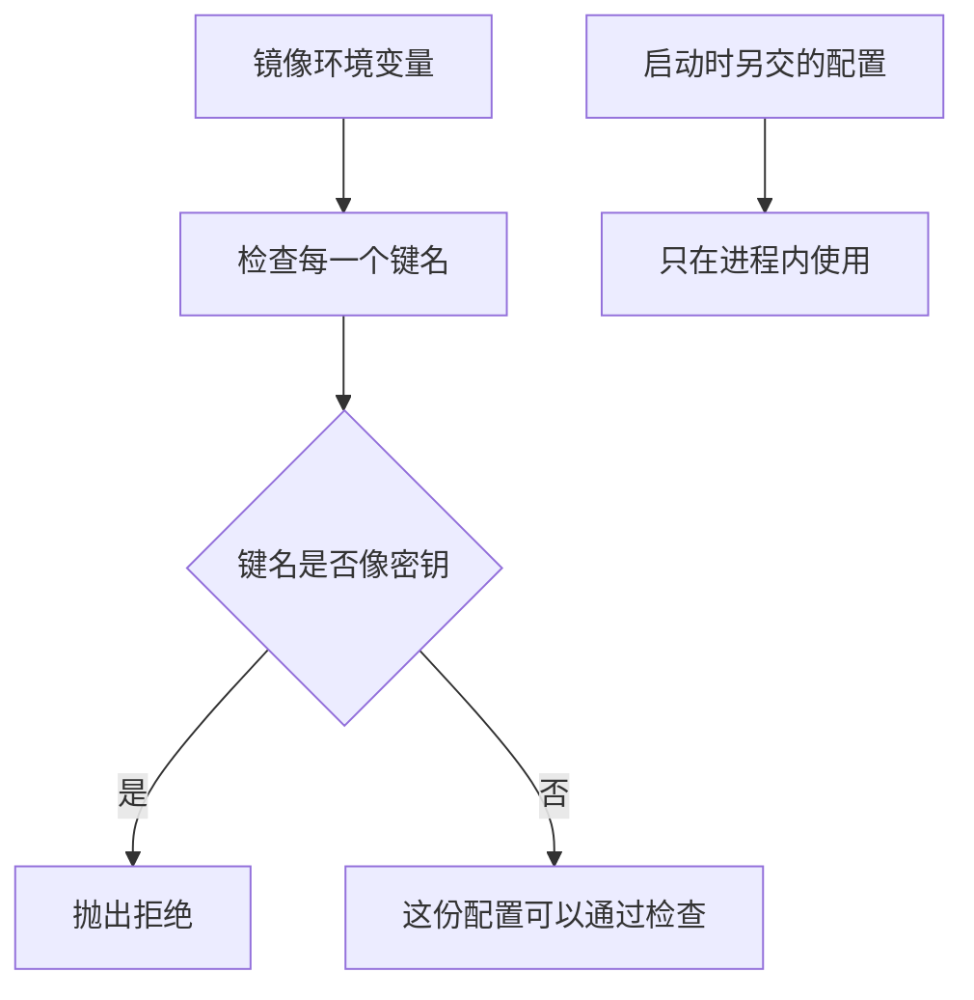

# Docker 部署

镜像里放运行服务需要的代码和依赖。密钥不进镜像配置。检查函数看到像密钥的环境变量名时抛出 `ValueError`，调用方知道这份镜像配置被拒绝了。

## 知识点概述

[FastAPI 服务开发](/engineering/fastapi.md) 把密钥留在环境字典里，不写进源码。打成镜像之后又多了一层：写进镜像的环境变量会跟着镜像走，拿到镜像的人可以读到镜像配置。

所以要分开两份环境。

- **镜像环境**：构建时写进镜像、会随镜像分发的那些变量。这里不放密钥。
- **启动环境**：容器启动时才注入的变量。密钥如果必须交给进程，只出现在这一份里，并且不写进仓库。

下面的 Dockerfile 只说明镜像里有工作目录、一份程序和启动命令。它没有仓库地址，也没有密钥。`reject_baked_secrets` 是调用方在构建前就能执行的本地检查，不访问网络。

Docker 文档里的构建密钥，用来在构建过程中提供凭证。那和 `ENV` 不是同一件事。`ENV` 留在镜像配置里。本地函数拒绝的是后一种写法。

## 核心原理



键名按 `_` 或 `-` 拆开。某一段是 `SECRET`、`TOKEN` 或 `PASSWORD`，或者同时有 `API` 和 `KEY`，就拒绝，即使值为空。空值仍然告诉读镜像的人：这里本该有一份密钥。整段的 `TOKENIZER` 不等于 `TOKEN`，不会被误伤。错误文本只包含键名，不包含值。

启动环境不交给这个函数。函数拒绝的是「准备写进镜像的那一份」。两份字典混在一起检查，会把合法的启动配置也打成构建失败；分开之后，调用方看得清失败发生在镜像配置上。

这页不描述把镜像送到某台机器的步骤。检查通过，只说明这份字典里没有像密钥的键。

## 最小示例

```dockerfile
FROM python:3.12-slim
WORKDIR /app
COPY app.py .
CMD ["python", "app.py"]
```

```python
def reject_baked_secrets(image_env: dict[str, str]) -> None:
    for key in image_env:
        parts = key.upper().replace("-", "_").split("_")
        has_api_key = "API" in parts and "KEY" in parts
        has_marker = any(part in {"SECRET", "TOKEN", "PASSWORD"} for part in parts)
        if has_api_key or has_marker:
            raise ValueError(f"密钥不能写进镜像环境变量: {key}")
```

`reject_baked_secrets({"PATH": "/usr/bin"})` 正常返回。`{"TOKENIZER": "local"}` 也正常返回，因为整段不是 `TOKEN`。`reject_baked_secrets({"API_KEY": "test-secret"})` 抛出 `ValueError`，文本里有键名 `API_KEY`，没有 `test-secret`。`{"PASSWORD": ""}` 同样抛出，因为键名本身已经说明这是密钥位置。

调用方把这个异常当成构建前的失败。不要捕获之后继续把同一份字典写进镜像。

## 常见问题

**用 `ENV` 把密钥写进 Dockerfile。** 值会进入镜像配置。检查函数就是为了在写入之前让调用方看到 `ValueError`。

**把真实密钥放进示例来证明检查有效。** 示例值用 `test-secret` 这种一眼能看出是假的字符串。错误信息不要把值再打印一遍。

**检查失败后仍继续构建。** 异常被吃掉时，调用方只看到构建结束。拒绝必须留在异常上，构建步骤才不会把这份额外环境写进去。

**把内网地址和启动命令一起写进镜像说明。** 镜像定义只保留运行程序需要的文件和命令。机器地址、仓库登录和密钥都不属于这份文件。

## 知识自测

<QuizPanel topic-id="docker-deploy" />

## 参考资料

- [Dockerfile 参考](https://docs.docker.com/reference/dockerfile/)：镜像指令，包括会进入镜像配置的环境变量
- [Docker Build secrets](https://docs.docker.com/build/building/secrets/)：构建过程中的凭证，和写进镜像的环境变量分开
