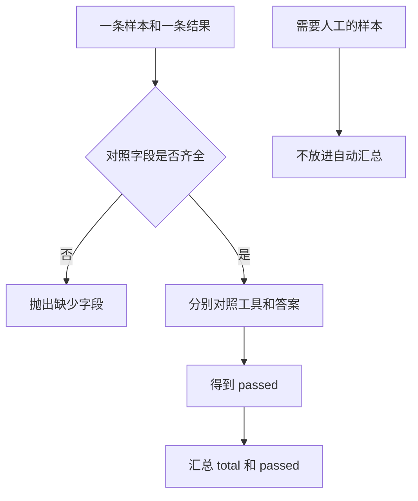

# Agent Evaluation

评估把「样本期待什么」和「这次结果是什么」分开对照。字段齐全时得到工具是否选对、答案是否一致，以及两者是否都通过。字段缺失时抛出 `ValueError`，不会产生一条通过记录。汇总只数你交进去的那些行。

## 知识点概述

[Agent 日志与可观测性](/engineering/observability.md) 留下每一步的 `name` 和 `status`。评估读的是已经发生的结果，不重新请求模型。一次自动检查看两件事。

- **工具选择**：结果里的 `tool` 是否等于样本的 `expected_tool`。
- **最终答案**：结果里的 `final` 是否等于样本的 `expected_answer`。

`passed` 只有两项都为真时才为真。只选对工具、答案不同，调用方看到 `tool_ok` 为真、`answer_ok` 为假、`passed` 为假。

样本或结果缺字段时，没有可对照的值。`grade_case` 抛出 `ValueError`，不要把这条算成失败样本，也不要算成通过。缺字段是检查本身不能进行。

人工抽查是另一条路径。样本标了 `needs_human` 为 `yes` 时，不要放进 `summarize`。汇总函数只数自动评分行，返回 `total` 和 `passed`。它不计算百分比，页面也不引用任何外部评测的分数。

## 核心原理



`summarize` 收到空列表时抛出 `ValueError`。空列表如果被收成「通过 0 条」，调用方会以为评估已经跑完、只是没有通过。检查还没开始，和「跑完了且都没过」必须分开。

公开评测里也有同样的拆分：题目是一份，怎样算通过是另一份。本站只借用这个结构，不引用那些评测的结果，也不把它们的题目抄进来。你自己的样本仍是本地字典。

## 最小示例

```python
def grade_case(case: dict[str, str], result: dict[str, str]) -> dict[str, bool]:
    if "expected_tool" not in case or "expected_answer" not in case:
        raise ValueError("样本缺少 expected_tool 或 expected_answer")
    if "tool" not in result or "final" not in result:
        raise ValueError("结果缺少 tool 或 final")
    tool_ok = result["tool"] == case["expected_tool"]
    answer_ok = result["final"] == case["expected_answer"]
    return {"tool_ok": tool_ok, "answer_ok": answer_ok, "passed": tool_ok and answer_ok}


def summarize(rows: list[dict[str, bool]]) -> dict[str, int]:
    if not rows:
        raise ValueError("没有可汇总的样本")
    passed = sum(1 for row in rows if row["passed"])
    return {"total": len(rows), "passed": passed}
```

样本 `{"expected_tool": "lookup_note", "expected_answer": "本地笔记"}`，结果 `{"tool": "lookup_note", "final": "本地笔记"}`，`grade_case` 返回三项都为真。结果的 `tool` 换成 `other` 时，`tool_ok` 为假，`passed` 为假，`answer_ok` 仍为真。

样本去掉 `expected_tool` 时抛出 `ValueError`，文本是「样本缺少 expected_tool 或 expected_answer」。结果去掉 `final` 时，文本是「结果缺少 tool 或 final」。

`summarize` 收到一条 `passed` 为真和一条为假的记录时，返回 `{"total": 2, "passed": 1}`。传入 `[]` 时抛出 `ValueError`。这些数字只描述传入的列表，不是一份外部榜单。

标了人工抽查的样本先留在外面。`needs_human` 为 `yes` 的条目不调用 `grade_case` 之后再混进通过数。

## 常见问题

**缺字段时记成未通过。** 未通过表示对照已经做了，而且不一致。字段不在，对照还没做。用 `ValueError` 让调用方看见检查无法进行。

**把人工抽查算进自动通过。** 两种结论会叠在同一个 `passed` 上。需要人看的样本不要放进 `summarize`。

**空跑得到通过为零。** 零条通过可以是真的全没过，也可以是还没有样本。没有行时抛出「没有可汇总的样本」。

**引用一次评测的分数来说明自己的循环。** 分数属于别人的题目和当时的运行。这里只对照你传入的 `expected_*` 和 `result`。

## 知识自测

<QuizPanel topic-id="agent-evaluation" />

## 参考资料

- [SWE-bench](https://arxiv.org/abs/2310.06770)：把待解决的问题和是否通过检查分开。本站不引用论文里的分数
- [OpenAI Evals](https://github.com/openai/evals)：公开仓库里题目和评分放在一起。本站不转载其中的题目
- 步骤记录见 [Agent 日志与可观测性](/engineering/observability.md)
