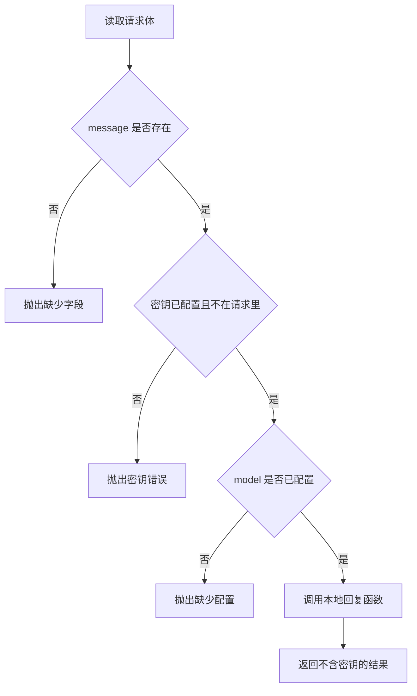

# FastAPI 服务开发

一次 Agent 调用要变成 HTTP 接口时，请求体、服务配置和密钥是三份数据。缺字段、没配密钥，或请求里夹带了密钥，调用方看到的是失败；本地回复函数不会被调用，响应里也没有密钥。

## 知识点概述

[HTTP / REST API](/fundamentals/http-rest.md) 负责把一次调用看成请求和响应。[大模型 API 调用](/fundamentals/llm-api.md) 负责真正去问模型。这一页把两者接在服务边界上：FastAPI 收到 HTTP 请求，你的处理函数决定能不能继续，以及响应里允许出现什么。

三份数据不要混在同一个字典里。

- **请求**：调用方这次送来的内容，例如 `message`。它不可信，不能当成配置，更不能当成密钥。
- **配置**：模型名这类可以写进日志、也可以出现在响应里的项。缺了它，服务不知道按哪份设置工作。
- **密钥**：只从服务自己的环境字典读入。它不来自请求体，不写进源码，不出现在返回值里。

示例里的 `reply` 是本地函数，不访问网络。以后把它换成真实的模型客户端时，这三份数据的边界仍然留在处理函数里。

## 核心原理



图里的判断都发生在 `reply` 之前。任何一条失败都抛出 `ValueError`，并且错误文本不包含密钥本身。调用方用异常区分「这次没有回复」和「这次有一份正常结果」。

FastAPI 把 HTTP 正文交给你的函数。请求体对不上模型时，框架用 `RequestValidationError` 表示。官方错误处理文档里，覆盖这个异常的示例返回状态码 422，正文是校验细节。那时候你的业务函数还没有机会把一句道歉写成看起来成功的回答。

密钥检查是业务函数自己的责任。框架不知道哪一段文本算密钥。所以即使正文通过了字段校验，`message` 里一旦出现密钥，仍然要在调用 `reply` 之前拒绝。

## 最小示例

`echo` 代表本地回复。`handle_turn` 接收已经分开的请求、配置和密钥。

```python
from collections.abc import Callable


def echo(message: str) -> str:
    return f"收到:{message}"


def handle_turn(
    request: dict[str, str],
    config: dict[str, str],
    secret: str,
    reply: Callable[[str], str],
) -> dict[str, str]:
    message = request.get("message", "")
    if not message:
        raise ValueError("请求缺少 message")
    if not secret:
        raise ValueError("密钥未配置")
    if secret in message:
        raise ValueError("请求正文里出现了密钥")
    model = config.get("model", "")
    if not model:
        raise ValueError("配置缺少 model")
    return {"model": model, "reply": reply(message)}
```

`handle_turn({"message": "你好"}, {"model": "local"}, "test-secret", echo)` 返回 `{"model": "local", "reply": "收到:你好"}`。返回值里没有 `test-secret`。

`request` 是 `{}` 时抛出 `ValueError`，文本是「请求缺少 message」。`echo` 不会被调用。`message` 为「请使用 test-secret」时同样在调用 `echo` 之前抛出，文本是「请求正文里出现了密钥」，异常里不回显这串密钥。`secret` 为 `""` 或 `config` 里没有 `model` 时，也是 `ValueError`，分别说明密钥未配置和配置缺少 model。

这些异常都不是成功字典。调用方只要捕获 `ValueError`，就知道响应不该写成一次正常回答。

## 常见问题

**把密钥写进源码或请求示例。** 读到仓库的人就读到了密钥。密钥放在调用方传入的环境字典里，示例只用明显的假值 `test-secret` 来演示拒绝逻辑。

**缺字段时返回一句道歉。** 道歉如果是普通返回值，上游会把它当成这次调用已经完成。缺字段要抛出 `ValueError`，或者交给框架的校验错误。两种都让调用方看到失败。

**为了排错把密钥放进响应或异常文本。** 客户端和日志会留下它。异常只说明「请求正文里出现了密钥」，不把值拼进去。响应字典只有 `model` 和 `reply`。

**先调用模型，返回之后再检查字段。** 检查失败时，模型调用已经发生。`reply` 必须放在全部判断之后，这样失败路径上没有回复文本。

## 知识自测

<QuizPanel topic-id="fastapi-service" />

## 参考资料

- [FastAPI 文档](https://fastapi.tiangolo.com/)：把处理函数接成 HTTP 服务的官方入口
- [FastAPI Settings](https://fastapi.tiangolo.com/advanced/settings/)：配置从环境读入，而不是写死在代码里
- [FastAPI 错误处理](https://fastapi.tiangolo.com/tutorial/handling-errors/)：`RequestValidationError` 的处理示例返回 422
