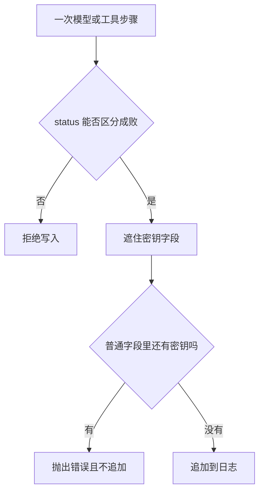

# Agent 日志与可观测性

日志要让人回放每一次模型调用和工具调用。每一步都有名字，并且用 `ok` 或 `error` 写明结果。密钥字段写成 `[redacted]`。密钥若出现在普通字段里，这一步不会写入日志，调用方看到 `ValueError`。

## 知识点概述

[Agent Loop](/agent/loop.md) 里，一次行动和一次观察是两步。[FastAPI 服务开发](/engineering/fastapi.md) 要求密钥不出现在响应里。日志是第三条出口：写进日志的内容，排错的人也能读到。

一条能回放的记录至少有：

- **name**：这一步是哪次模型调用或哪个工具。
- **status**：`ok` 或 `error`。读日志的人靠它区分做完和失败。
- **其余字段**：参数摘要、观察或错误说明。密钥字段要遮住。

只有最终回答、没有步骤的日志，调用方看不出是模型没选工具，还是工具返回了失败。`status` 缺失时，这一条不能入库。

标准库 `logging` 负责把记录打到你配置的处理器。写入之前先做遮盖。一条 trace 上的多个 span 可以表示同一次任务里的这些步骤；失败的那一步带着错误状态，回放时才知道断在哪里。本页的例子用列表代替真实的日志后端，不访问网络。

## 核心原理



遮盖只处理字段名：`api_key`、`authorization`、`secret`、`token`、`password`。值被换成 `[redacted]`。`detail` 这类普通字段如果本身含有密钥，遮盖不会碰到它。所以调用时要把密钥传进来。发现残留就抛出 `ValueError`，日志长度不变。

`status` 用两个固定字符串。写成 `failed` 或留空，都会在追加前被拒绝。否则回放的人无法用同一种判断读完所有行。

## 最小示例

```python
def record_step(log: list[dict[str, str]], step: dict[str, str], secret: str = "") -> None:
    hidden = {"api_key", "authorization", "secret", "token", "password"}
    name = step.get("name", "")
    status = step.get("status", "")
    if not name or status not in {"ok", "error"}:
        raise ValueError("日志缺少 name 或无法区分的 status")
    cleaned: dict[str, str] = {}
    for key, value in step.items():
        if key.lower() in hidden:
            cleaned[key] = "[redacted]"
        else:
            cleaned[key] = value
    if secret and any(secret in value for value in cleaned.values()):
        raise ValueError("日志里出现了密钥")
    log.append(cleaned)
```

从空列表开始。步骤 `{"name": "lookup", "status": "ok", "api_key": "test-secret"}` 并且传入同一串密钥时，日志里的 `api_key` 是 `[redacted]`，看不到 `test-secret`。

`detail` 为 `see test-secret` 时抛出 `ValueError`，列表仍是空的。只有 `name`、没有 `status` 时也抛出，文本说明缺少 name 或无法区分的 status。

工具失败要记成 `status` 为 `error` 的一条，例如 `{"name": "lookup", "status": "error", "detail": "未知笔记"}`。读日志的人看到的是错误步骤，而不是一份只含最终回答的成功记录。

## 常见问题

**只在最后打印模型的回答。** 工具失败和模型没调用工具，在这份输出里长得一样。每一步单独记 `name` 和 `status`。

**把密钥原样写进日志来对照请求。** 日志会变成第二份密钥存储。密钥字段写成 `[redacted]`。普通字段里还出现密钥时，拒绝这一条。

**捕获工具异常后不记 `error`。** 循环可能继续，日志里却全是 `ok`。失败步骤用 `error`，回放时才找得到那一步。

**用空日志表示没有出错。** 空列表也可能是还没开始记。没有步骤和「全部成功」要靠记录本身区分，不要靠「文件是空的」。

## 知识自测

<QuizPanel topic-id="agent-observability" />

## 参考资料

- [logging](https://docs.python.org/3/library/logging.html)：标准库日志。写入前先遮住密钥
- [OpenTelemetry Traces](https://opentelemetry.io/docs/concepts/signals/traces/)：用一条 trace 上的 span 表示同一次任务里的多步
