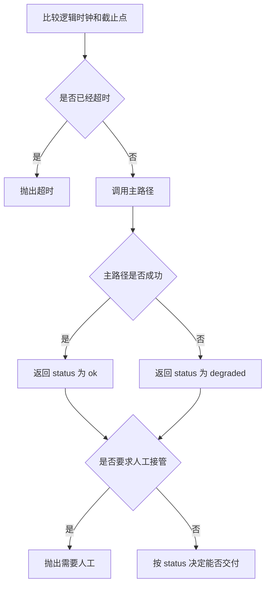

# 生产环境实践

上线前先把四件事变成调用方能区分的结果：超时、降级、人工接管，以及检查清单里还缺什么。超时抛出 `TimeoutError`，主路径不会执行。降级返回的字典里 `status` 是 `degraded`。这些结果都不是一份已经上线的证明。

## 知识点概述

[Docker 部署](/engineering/docker.md) 要求密钥不进镜像。[Agent 日志与可观测性](/engineering/observability.md) 要求失败步骤能回放。[安全与权限控制](/engineering/security.md) 要求工具有允许列表。生产环境实践把它们收成同一次任务里看得见的出口。

`clock` 和 `deadline` 是调用方传入的逻辑时钟，两个整数比大小。它们不是某次环境里测得的耗时。

调用方按异常和 `status` 区分：

- **超时**：`clock` 大于 `deadline` 时抛出 `TimeoutError`。`work` 和 `backup` 都不会被调用。
- **主路径成功**：返回 `status` 为 `ok`，`source` 为 `primary`。
- **主路径失败且备份有值**：返回 `status` 为 `degraded`，`source` 为 `backup`。这不是成功文本。
- **需要人工**：`accept_result` 看到 `needs_human` 为 `yes` 时抛出 `RuntimeError`，不把 `value` 交给下游当完成。
- **清单未齐**：`release_ready` 返回仍为假的检查名。空列表只表示你传入的四项都为真。

配置放在环境里，不写进仓库。这和密钥不进镜像是同一条边界，只是检查发生在发布清单上。

## 核心原理



降级路径再失败时，备份函数的异常直接出去。调用方看到的不是 `status` 为 `ok` 的字典。不要在这里把异常收成一句空回答。

清单上的四项对应前面的页面：超时、密钥不在镜像里、工具允许列表、日志已遮盖。某一项没准备好，名字就留在返回的列表里。调用方拿到非空列表，就知道还不能把这次检查当成通过。

## 最小示例

```python
from collections.abc import Callable


def run_task(
    work: Callable[[], str],
    backup: Callable[[], str],
    clock: int,
    deadline: int,
) -> dict[str, str]:
    if clock > deadline:
        raise TimeoutError(f"任务在 {deadline} 之前没有完成")
    try:
        value = work()
    except Exception as error:
        return {
            "status": "degraded",
            "source": "backup",
            "value": backup(),
            "reason": type(error).__name__,
        }
    return {"status": "ok", "source": "primary", "value": value}


def accept_result(result: dict[str, str]) -> str:
    if result.get("needs_human") == "yes":
        raise RuntimeError("需要人工接管")
    if result.get("status") != "ok":
        raise RuntimeError(f"结果状态不是 ok: {result.get('status', '')}")
    return result["value"]


def release_ready(checks: dict[str, bool]) -> list[str]:
    required = ("timeout", "secret_not_in_image", "tool_allowlist", "logs_redacted")
    return [name for name in required if not checks.get(name, False)]
```

`run_task(lambda: "主", lambda: "备", 1, 5)` 返回 `status` 为 `ok`、`value` 为 `主`。`clock` 为 6、`deadline` 为 5 时抛出 `TimeoutError`，两个函数都不会执行。主路径抛出 `RuntimeError`、备份返回 `备` 时，结果的 `status` 是 `degraded`，`source` 是 `backup`，`reason` 是 `RuntimeError`。

`accept_result` 遇到 `needs_human` 为 `yes` 时抛出 `RuntimeError`，文本是「需要人工接管」。`status` 为 `degraded` 时抛出的文本里有 `degraded`。只有 `status` 为 `ok` 且不需要人工时，才返回 `value`。

四项都为真时，`release_ready` 返回 `[]`。只做了超时一项时，返回的列表里还有 `secret_not_in_image`、`tool_allowlist` 和 `logs_redacted`。空列表不是「已经部署」。

## 常见问题

**超时后仍返回主路径的文本。** 调用方会以为任务在截止点前完成了。`clock` 大于 `deadline` 时首先抛出 `TimeoutError`。

**备份结果写成和成功一样的字符串。** 下游只看有没有文本，就分不清降级。`status` 使用 `degraded`，`accept_result` 拒绝交付它。

**需要人工时把草稿直接发出。** 草稿可能在 `value` 里。`needs_human` 为 `yes` 时抛出「需要人工接管」，`value` 不会成为返回值。

**清单为空就视为可以发布。** `release_ready` 的空列表只覆盖那四个键。它不连接机器，也不表示服务已经在运行。

## 知识自测

<QuizPanel topic-id="production-practice" />

## 参考资料

- [The Twelve-Factor App: Config](https://12factor.net/config)：配置放在环境里，不写进代码
- 镜像和密钥见 [Docker 部署](/engineering/docker.md)。步骤回放见 [Agent 日志与可观测性](/engineering/observability.md)。工具允许列表见 [安全与权限控制](/engineering/security.md)。
