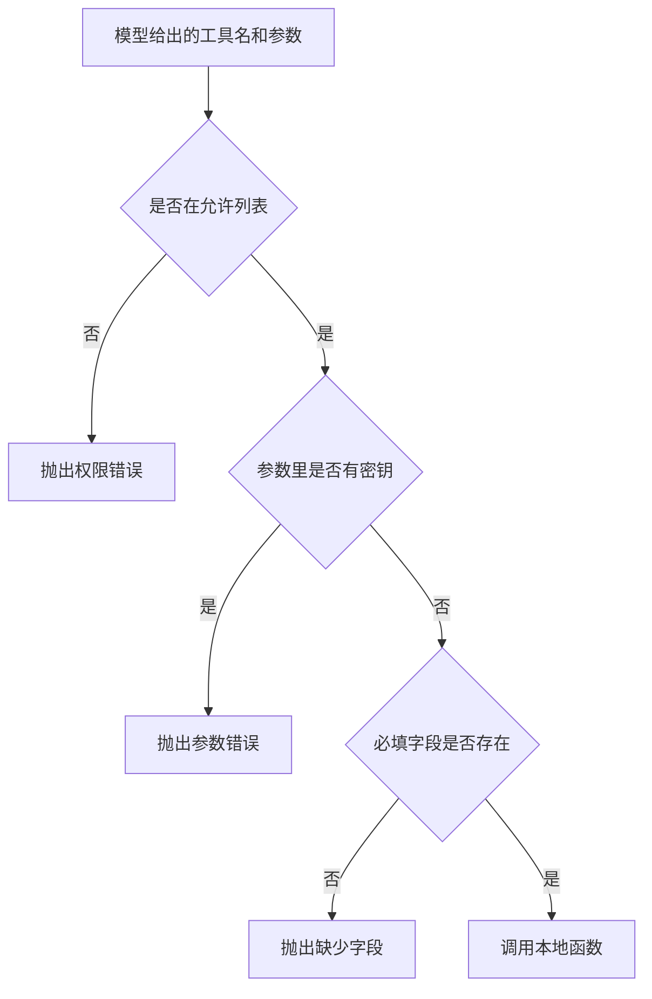

# 安全与权限控制

模型可以提出工具名和参数，不能决定这些名字能不能执行。工具不在允许列表里时抛出 `PermissionError`。参数里出现密钥，或缺了必填字段，抛出 `ValueError`。用户输入只作为本地函数的数据，不拼进系统命令。

## 知识点概述

[Tool Calling 工具调用](/agent/tool-calling.md) 里，应用执行模型点名的函数。[FastAPI 服务开发](/engineering/fastapi.md) 把密钥留在服务侧。权限控制是执行之前的那一层。

调用方能看到的失败要分开。

- **不在允许列表**：`PermissionError`。没有任何工具函数运行。
- **参数不合法**：密钥混进了参数，或缺少 `note_id`。`ValueError`。密钥不会出现在异常文本里。
- **工具自己的失败**：允许列表里的 `lookup_note` 找不到笔记时抛出 `KeyError`。这和「不允许执行」不是同一种结果。

源码行若把密钥写成赋值，`reject_committed_secret` 抛出 `ValueError`，异常里不包含那一行。这样密钥不会借错误信息再离开函数。

## 核心原理



允许列表是应用写死的集合，不是模型返回的名单。模型说出 `shell` 也只是一个字符串。`run_tool` 在进入任何本地函数之前就拒绝它。

参数是数据。`lookup_note` 用笔记编号去字典里取文本。编号对不上就抛出 `KeyError`，不会把编号交给系统命令去解析。标准库在不经过 shell 时，用参数列表启动进程；防御页的做法更窄：能用本地函数完成的事，不启动子进程。

## 最小示例

```python
NOTES = {"n1": "本地笔记"}


def lookup_note(note_id: str) -> str:
    if note_id not in NOTES:
        raise KeyError(note_id)
    return NOTES[note_id]


def run_tool(name: str, arguments: dict[str, str], secret: str) -> str:
    allowed = {"lookup_note"}
    if name not in allowed:
        raise PermissionError(f"工具不在允许列表: {name}")
    blob = " ".join(arguments.values())
    if secret and secret in blob:
        raise ValueError("工具参数里出现了密钥")
    if name == "lookup_note":
        note_id = arguments.get("note_id", "")
        if not note_id:
            raise ValueError("缺少 note_id")
        return lookup_note(note_id)
    raise PermissionError(f"工具不在允许列表: {name}")


def reject_committed_secret(line: str) -> None:
    compact = line.replace(" ", "").upper()
    markers = ("API_KEY=", "SECRET=", "TOKEN=", "PASSWORD=")
    for marker in markers:
        if marker in compact and not compact.endswith(marker):
            raise ValueError("源码行里写了密钥赋值")
```

`run_tool("lookup_note", {"note_id": "n1"}, "test-secret")` 返回 `本地笔记`。`run_tool("shell", {"note_id": "n1"}, "test-secret")` 抛出 `PermissionError`，`lookup_note` 没有执行。参数值里含有 `test-secret` 时抛出 `ValueError`，文本是「工具参数里出现了密钥」。`note_id` 为空时抛出「缺少 note_id」。`note_id` 为 `missing` 时抛出 `KeyError`。

`reject_committed_secret("API_KEY=test-secret")` 抛出 `ValueError`，异常文本里没有 `test-secret`。说明行「不要把 API_KEY 写进仓库」不含赋值，函数正常返回。

## 常见问题

**模型点名的工具都执行。** 名字来自模型输出。不在 `allowed` 里就抛出 `PermissionError`，调用方看到的是权限失败，不是工具结果。

**把用户输入拼进一条系统命令。** 命令字符串会被 shell 解析。这里的防御是：输入只传给允许列表里的本地函数。不要为了演示去拼一条命令。

**异常里带回密钥或整行源码。** 错误信息会进日志。上面两个拒绝函数都只说明发生了什么，不把值放进异常。

**找不到笔记时当成权限错误。** `KeyError` 表示这个工具跑了，但编号没有对应笔记。`PermissionError` 表示工具根本不该跑。调用方要能分开处理。

## 知识自测

<QuizPanel topic-id="agent-security" />

## 参考资料

- [subprocess](https://docs.python.org/3/library/subprocess.html)：参数列表和经过 shell 的区别。本页优先使用本地函数
- [OWASP Secrets Management Cheat Sheet](https://cheatsheetseries.owasp.org/cheatsheets/Secrets_Management_Cheat_Sheet.html)：密钥不进仓库、不进日志
- [OWASP OS Command Injection Defense Cheat Sheet](https://cheatsheetseries.owasp.org/cheatsheets/OS_Command_Injection_Defense_Cheat_Sheet.html)：避免把输入交给系统命令
