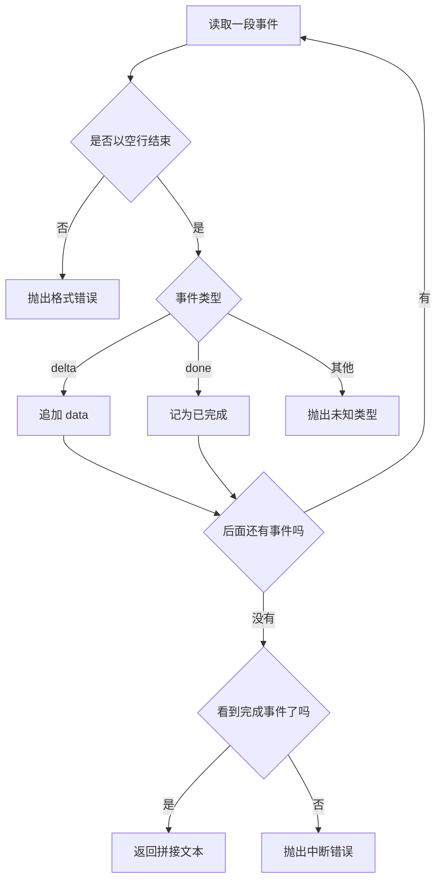

# Streaming / SSE

服务器发送事件（SSE）把同一次回复切成多段推给客户端。只有收到完成事件，调用方才拿到完整字符串。流在完成前断开时抛出 `RuntimeError`，已经到达的片段不会变成成功返回值。

## 知识点概述

[流式输出](/fundamentals/streaming.md) 说明一次模型响应怎样被切成片段。[FastAPI 服务开发](/engineering/fastapi.md) 说明这些片段从哪个 HTTP 响应离开服务。SSE 规定片段在文本里的形状：一块事件以字段行组成，事件和事件之间用空行分开。

本页固定调用方能看见的三种结果。

- **完整文本**：每一段都是 `delta`，最后有一个 `done`。函数返回拼接后的字符串。
- **格式错误**：某一段没有以空行结束，类型未知，或 `delta` 缺少 `data`。抛出 `ValueError`，不返回半截字符串。
- **中途断开**：片段格式正确，但直到输入结束都没有 `done`。抛出 `RuntimeError`。成功路径上不会出现这个异常。

示例只处理本地字符串，不打开网络连接，也不读取密钥。FastAPI 的 `StreamingResponse` 负责把这些字符串写进响应体。媒体类型用 `text/event-stream`。构造响应之前，先把事件文本在本地收齐规则。

## 核心原理



`delta` 的 `data` 是给用户看的增量。`done` 只表示这串事件结束，它的 `data` 不进入正文。完成之后又出现 `delta`，说明流的顺序坏了，抛出 `ValueError`。

半截文本可以留在界面上当失败现场，但必须和成功字符串分开。`collect_events` 选择抛出：调用方拿不到返回值，就不会把残句写进会话，当成模型已经说完。

## 最小示例

```python
def format_event(text: str, event: str = "delta") -> str:
    return f"event: {event}\ndata: {text}\n\n"


def collect_events(chunks: list[str]) -> str:
    parts: list[str] = []
    done = False
    for chunk in chunks:
        if not chunk.endswith("\n\n"):
            raise ValueError("事件没有以空行结束")
        kind = ""
        data = ""
        data_seen = False
        # 只去掉分隔用的空行。strip 会把空的 data 收成「data:」。
        for line in chunk[:-2].splitlines():
            if line.startswith("event: "):
                kind = line[len("event: ") :]
            elif line.startswith("data: "):
                if data_seen:
                    raise ValueError("一段事件里有多行 data")
                data = line[len("data: ") :]
                data_seen = True
            else:
                raise ValueError(f"无法识别的事件行: {line}")
        if done and kind == "delta":
            raise ValueError("完成事件之后又出现了 delta")
        if kind == "done":
            done = True
            continue
        if kind != "delta":
            raise ValueError(f"未知事件类型: {kind}")
        if not data_seen:
            raise ValueError("delta 事件缺少 data")
        parts.append(data)
    if not done:
        raise RuntimeError("流在完成事件之前中断")
    return "".join(parts)
```

`collect_events([format_event("你"), format_event("好"), format_event("", "done")])` 返回 `你好`。拿掉最后的 `done` 时抛出 `RuntimeError`，返回值不是 `你`。一段只写到 `event: delta\ndata: 你`、末尾没有空行时，抛出 `ValueError`。

未知类型、完成后再来 `delta`，同样是 `ValueError`。它们和「没写完」不是同一种失败：前者是事件本身不合法，后者是合法片段没有等到结束标记。

## 常见问题

**没有 `done` 就把已收到的字返回。** 调用方会把残句存成助手消息。下一次请求会把这句当成已经说完的话。缺完成事件时抛出 `RuntimeError`。

**连接断开后补一个成功的空响应。** 空字符串看起来像模型决定什么都不说。断开是失败，用异常表示，不要伪造 `done`。

**把密钥写进 `data` 来确认流是通的。** 事件正文会进入客户端。密钥的边界在 [FastAPI 服务开发](/engineering/fastapi.md)，不因为改成流式就放宽。

**每一段都当成一次新的用户请求。** 这些 `delta` 共享同一次回复。拼完才是这一轮的助手文本。

## 知识自测

<QuizPanel topic-id="streaming-sse" />

## 参考资料

- [HTML 服务器发送事件](https://html.spec.whatwg.org/multipage/server-sent-events.html)：事件字段和空行分隔的规范
- [FastAPI Responses](https://fastapi.tiangolo.com/reference/responses/)：用 `StreamingResponse` 把文本持续写给客户端
