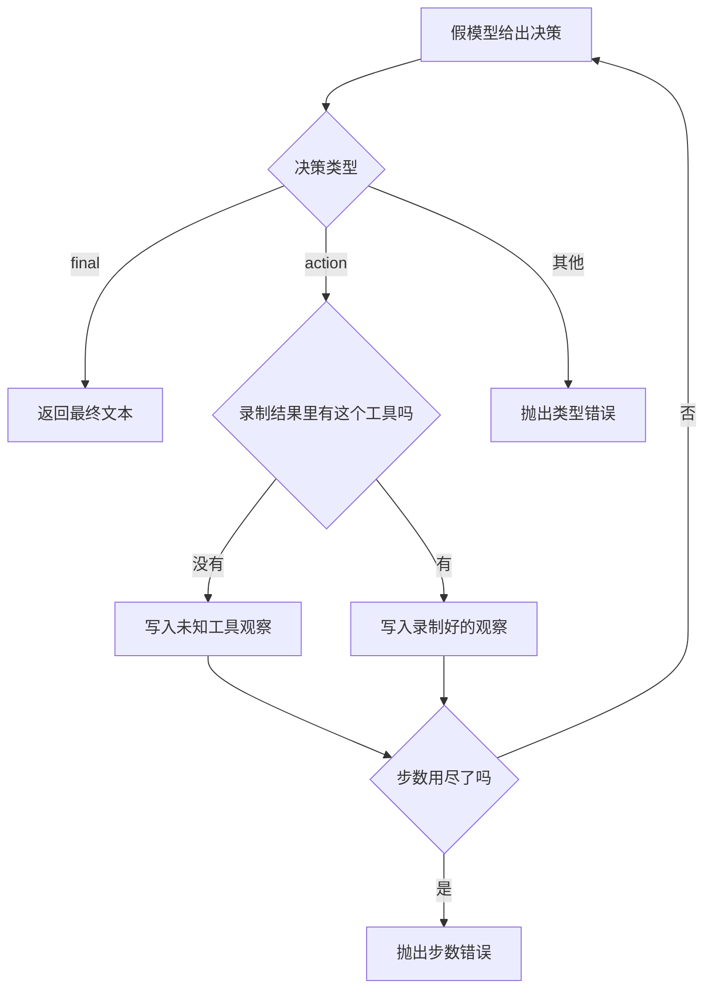

# Agent 测试与调试

测试循环时，用假决策代替模型，用已经写好的函数代替工具。成功时返回最终文本。步数用尽时抛出 `RuntimeError`。未知工具写成一条观察，下一步假决策能读到，而不是静默消失。

## 知识点概述

[Tool Calling 工具调用](/agent/tool-calling.md) 把工具名和参数交给应用。[Agent Loop](/agent/loop.md) 规定行动、观察和步数上限。测试要固定这两头：决策函数不访问网络，工具函数返回你事先写好的字符串。

调用方断言的是结果的种类。

- **final**：返回值是最终文本。测试看到这份字符串。
- **step-limit**：循环用尽步数，抛出 `RuntimeError`。这和返回一段道歉文本不同。
- **bad-decision**：决策类型既不是 `final` 也不是 `action`，抛出 `ValueError`。
- **未知工具**：不抛出。观察里写入 `error:unknown tool <名字>`，假模型下一步还能看见。

录制函数自己抛出的异常不会被改写成观察。那是测试装置坏了，调用方直接看到原来的异常。希望模型看见失败时，让录制函数返回 `error:` 开头的文本。

`unittest` 里用断言表达「这里应该抛出 `RuntimeError`」。页面上的 `classify_stop` 用返回值把三种停法分开，方便本地阅读，不发起请求。

## 核心原理



观察一旦写入，就在下一轮交给 `decide`。只打印、不放进列表，假模型和没执行一样。未知工具如果改成抛出，测试就分不清「应用拒绝了这个名字」和「循环还能把错误交回模型」。本页把未知工具留在观察里，把步数用尽留在 `RuntimeError` 里。

## 最小示例

```python
from collections.abc import Callable


def run_with_fakes(
    decide: Callable[[list[str]], dict[str, str]],
    tools: dict[str, Callable[[str], str]],
    max_steps: int,
) -> str:
    observations: list[str] = []
    for _ in range(max_steps):
        decision = decide(observations)
        if decision["type"] == "final":
            return decision["content"]
        if decision["type"] != "action":
            raise ValueError(f"unknown decision type: {decision['type']}")
        name = decision["name"]
        if name not in tools:
            observations.append(f"error:unknown tool {name}")
            continue
        observations.append(tools[name](decision.get("argument", "")))
    raise RuntimeError(f"超过最大步数 {max_steps}")


def classify_stop(
    decide: Callable[[list[str]], dict[str, str]],
    tools: dict[str, Callable[[str], str]],
    max_steps: int,
) -> str:
    try:
        run_with_fakes(decide, tools, max_steps)
    except RuntimeError:
        return "step-limit"
    except ValueError:
        return "bad-decision"
    return "final"
```

假决策第一次返回 `{"type": "action", "name": "lookup", "argument": "n1"}`，第二次返回 `{"type": "final", "content": observations[-1]}`。工具 `lookup` 返回 `笔记`。`max_steps` 为 4 时，`run_with_fakes` 返回 `笔记`，`classify_stop` 返回 `final`。

决策每次都是行动，`max_steps` 为 2 时，抛出 `RuntimeError`，`classify_stop` 返回 `step-limit`。工具字典里没有 `shell` 时，下一次若把最后一条观察当作最终文本，返回值是 `error:unknown tool shell`。调用方由此知道未知工具被写进了轨迹，而不是被跳过。

## 常见问题

**测试里直接请求真实模型。** 结果会随模型变化，失败时也分不清是循环写错还是响应不同。决策和工具都用本地函数。

**步数用尽时期望一个字符串。** 字符串是成功路径。`classify_stop` 在 `RuntimeError` 上返回 `step-limit`，测试断言这个值，或让测试框架断言异常类型。

**未知工具时让循环崩溃，却没有观察。** 下一步假模型看不到自己点了一个不存在的名字。把 `error:unknown tool ...` 放进观察列表。

**录制函数里访问网络补一条「更真实」的结果。** 测试就又依赖外部系统。结果写在函数返回值里。

## 知识自测

<QuizPanel topic-id="agent-testing" />

## 参考资料

- [unittest](https://docs.python.org/3/library/unittest.html)：用断言检查返回值，并用断言检查应当抛出的异常
- 循环和步数见 [Agent Loop](/agent/loop.md)。工具名和参数见 [Tool Calling 工具调用](/agent/tool-calling.md)。
