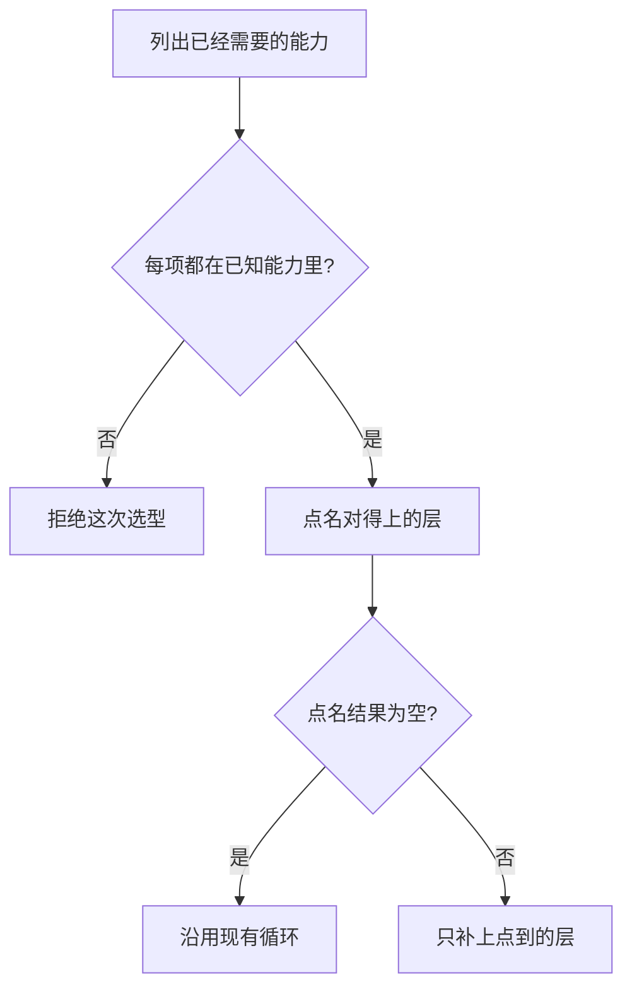

# Agent 框架选型

要不要引入框架，看你已经需要哪一种能力。组件链、状态图、统一的工具协议、技能包和多步交接，各自组织不同的东西。还没有这种需要时，沿用现有循环。本页按能力点名，不给框架排名。

## 知识点概述

一轮工具循环里，应用已经负责提出请求之后的执行、观察和停止。官方工程文章建议从能看懂的简单调用做起，只有在需要时再增加结构；文章开头说明文中的工具名单后来有变化，本页只采用这个顺序。框架能少写一些样板，也会多一层必须看得懂的抽象。

已经需要的能力，对应到前面几页：

- **同一套形状接不同模型，并把提示词和工具组成调用链。** 这是 [LangChain](/frameworks/langchain.md) 那一层组件。官方概览把它写成模型和一套套件。
- **分支、循环和人的确认要写成显式状态。** 这是 [LangGraph](/frameworks/langgraph.md) 那一层图。官方概览把它放在底层编排，并写明可以单独使用；同一页也写明 LangChain 的智能体建在 LangGraph 之上。这是层次，两层可以叠在一起，也可以只取图。
- **工具描述要交给不同宿主。** 用 [MCP](/frameworks/mcp.md)。协议不代替宿主决定是否执行。
- **一套做法要在以后的任务里复用。** 用 [Skills](/frameworks/skills.md)。技能包不提供另一个模型。
- **多个步骤要交接。** 用 [多智能体编排](/frameworks/orchestration.md) 里的流水线、主管或对等交接。交接可以先写在自己的函数里，也可以画进图。

可控性、团队熟悉度和部署方式放在能力旁边，仍然不产生名次。可控性是指你能指出哪一步是代码、哪一步是模型。熟悉的是调用链还是状态图，决定维护落在哪一层。进程怎样部署、密钥放在哪，仍由应用决定；框架概览不替你做这个决定。

## 核心原理



点名之前先拒绝不认识的能力。这样不会在一份混有未知需求的集合上返回半份清单。全部认识之后，某一项在需求里，对应的层才出现。一项都没有，结果是空列表，表示这些层都还不需要。

列表里的顺序来自检查的顺序。同时需要组件和图时，两个名字都在，靠前的那一个不是更好的框架。官方概览里的层次关系也按这个读法：组件可以建在图运行时上，图运行时也可以单独存在。

## 最小示例

`missing_layers` 接收你已经需要的能力。返回值是还缺的层，空列表表示先不要加这些层。

```python
def missing_layers(needs: set[str]) -> list[str]:
    known = {
        "shared-model-interface",
        "explicit-state-graph",
        "shared-tool-protocol",
        "reusable-skill",
        "multi-step-handoff",
    }
    unknown = needs - known
    if unknown:
        raise ValueError("有尚未列入的能力")
    layers: list[str] = []
    if "shared-model-interface" in needs:
        layers.append("components")
    if "explicit-state-graph" in needs:
        layers.append("state-graph")
    if "shared-tool-protocol" in needs:
        layers.append("tool-protocol")
    if "reusable-skill" in needs:
        layers.append("skill-package")
    if "multi-step-handoff" in needs:
        layers.append("handoff")
    return layers
```

按函数写法，`needs` 为空集合时返回 `[]`。只有 `shared-tool-protocol` 时，返回 `["tool-protocol"]`。同时包含 `shared-model-interface` 和 `explicit-state-graph` 时，返回 `["components", "state-graph"]`。这个顺序是上面两个 `if` 的书写顺序。集合里夹有未知字符串时，函数抛出 `ValueError`，不会返回其中已经认识的那些层。

这段代码没有在当前环境执行。它把选型收成一次集合判断，避免用名次代替需求。

## 常见问题

**按别人的排名选择框架。** 排名不告诉你已经需要的是可替换的模型接口、显式状态，还是跨宿主的工具描述。先写需求集合。

**只需要一次工具调用，却先引入整套编排。** 空的需求集合对应空列表。循环本身已经能表达行动、观察和停止。

**把「组件建在图之上」读成必须两层一起上。** 官方写的是层次。只需要显式状态时，点名结果里可以只有 `state-graph`。

**用协议或技能包代替部署和密钥管理。** 这两样组织的是工具描述和可复用做法。进程、配置和密钥仍由应用处理。

## 知识自测

<QuizPanel topic-id="framework-choice" />

## 参考资料

- [LangChain 概览](https://docs.langchain.com/oss/python/langchain/overview)：组件层是模型和套件，并且这层智能体建在 LangGraph 之上。本页把它当作层次，不当作名次。
- [LangGraph 概览](https://docs.langchain.com/oss/python/langgraph/overview)：图运行时负责有状态的编排，可以不与 LangChain 一起使用。
- [Model Context Protocol 介绍](https://modelcontextprotocol.io/introduction)：协议连接应用和外部系统。选型时它对应跨宿主的工具描述。
- [Building effective agents](https://www.anthropic.com/engineering/building-effective-agents)：先使用能看懂的简单调用，需要时再增加结构。本页不引用文中的框架名单。
