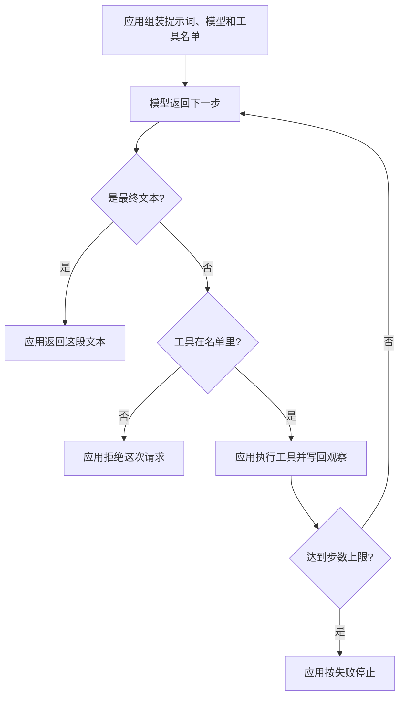

# LangChain

LangChain 把模型、提示词和工具收成可组合的组件，再放进一条调用链。链规定这些组件怎样衔接。工具函数仍由应用实现，也仍由应用执行。

## 知识点概述

[大模型 API 调用](/fundamentals/llm-api.md) 解决的是一次请求怎样发出去。[Agent Loop](/agent/loop.md) 解决的是行动、观察和停止怎样重复。LangChain 加的是中间这一层零件：同一种形状可以换模型，提示词和工具名单可以单独替换，再由一条链把它们串起来。

官方概览把这层写成模型和一套套件。套件里是提示词、工具，以及你加进去的中间步骤。本页只拆开前三样，中间步骤留在选型时再谈。

- **模型**：调用的形状。换服务商时，周围的链尽量保持不动。本页用一个只返回字典的函数代替真实请求，不访问网络。
- **提示词**：这一轮的目标，作为参数交给模型步骤。它描述要做什么，自己不执行函数。
- **工具**：应用提供的函数，以及链上允许请求的名字。名字出现在名单里，只表示模型可以提出这次请求。
- **调用链**：应用的循环。模型返回最终文本，链就返回这段文本。模型返回工具请求，链先核对名字，再执行函数，把观察交给下一步。

因此层次是：组件是零件，链是装配。装配不会在名单写好时就把副作用做完。步数上限仍然由应用掌握，和循环那一页是同一条责任。

## 核心原理



模型节点只产出下一步的字典。`type` 为 `final` 时，应用读取 `content`。`type` 为 `tool` 时，应用用 `name` 去名单里找函数。两种都不是，应用拒绝，函数不会运行。

观察是函数的返回值，由链写回，再作为下一轮的参数。模型函数若在返回字典之前自己去调用工具，这条链就失去了「请求」和「执行」的分界，也和 [Tool Calling](/agent/tool-calling.md) 的责任划分冲突。

步数在每一轮工具执行之后检查。最后一轮若只完成了工具、还没有最终文本，链以失败停止。观察留在这次调用的局部变量里，不会被当成成功的返回值。

## 最小示例

下面三个函数都在本地。`lookup` 只认识 `agenda`。`fake_model` 在还没有观察时提出工具请求，有了观察就返回最终文本。`run_chain` 负责装配和执行。

```python
from collections.abc import Callable


Step = dict[str, str]


def lookup(note: str) -> str:
    if note == "agenda":
        return "周三评审"
    return f"unknown:{note}"


def fake_model(prompt: str, names: list[str], observation: str) -> Step:
    if observation:
        return {"type": "final", "content": observation}
    return {"type": "tool", "name": "lookup", "arg": "agenda"}


def run_chain(
    goal: str,
    model: Callable[[str, list[str], str], Step],
    tools: dict[str, Callable[[str], str]],
    max_steps: int,
) -> str:
    prompt = f"目标：{goal}"
    observation = ""
    for _ in range(max_steps):
        step = model(prompt, list(tools), observation)
        if step.get("type") == "final":
            content = step.get("content", "")
            if not content:
                raise ValueError("最终文本是空的")
            return content
        if step.get("type") != "tool":
            raise ValueError("模型步骤既不是最终文本也不是工具请求")
        name = step.get("name", "")
        if name not in tools:
            raise ValueError("工具不在这条链上")
        observation = tools[name](step.get("arg", ""))
    raise RuntimeError("链没有在步数内结束")
```

按 `run_chain` 的写法，`fake_model` 第一次只返回工具请求。`lookup` 在名单里，应用才调用它，观察变成「周三评审」。下一步模型返回最终文本，链返回这句观察。`max_steps` 至少要有 2，这两步才都走得完。`max_steps` 为 1 时，工具结果写进观察后循环结束，函数抛出 `RuntimeError`，调用方拿不到这段观察。

工具名不在 `tools` 里时，函数抛出 `ValueError`，观察保持空字符串。`type` 不是 `final` 或 `tool` 时同样抛出，名单里的函数不会运行。`content` 为空字符串时，链拒绝把空文本当成完成。

这段代码只说明组件怎样接上。它不导入 LangChain，也没有在当前环境执行。

## 常见问题

**工具放进名单就当作已经调用。** 名单是允许请求的边界。执行发生在链看到 `tool` 并且名字对得上之后。

**让模型函数直接调用工具再返回最终文本。** 调用链会少掉观察这一步，下一步也无法区分「还没查」和「查过了」。模型步骤只返回字典。

**换模型时把密钥写进提示词。** 模型组件换的是调用形状。密钥仍从应用的环境读取，不进入 `prompt`。

**没有步数上限，把最后一次观察当成回答。** `max_steps` 用尽仍没有 `final` 时，结果是 `RuntimeError`。观察不是返回值。

## 知识自测

<QuizPanel topic-id="langchain" />

## 参考资料

- [LangChain 概览](https://docs.langchain.com/oss/python/langchain/overview)：官方把这层写成模型和一套套件，套件包含提示词、工具和可选的中间步骤。本页只用本地函数说明这层装配，不复制其中的安装和调用示例。
