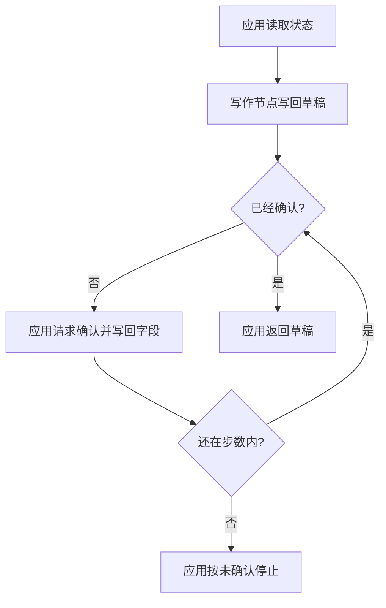

# LangGraph

LangGraph 把步骤画成一张有状态的图。状态是应用当前的快照，节点是读这份快照并返回更新的函数，边按状态决定下一步。分支、循环和人的确认都写在这张图上。图不代替应用执行工具，也不代替人做确认。

## 知识点概述

[LangChain](/frameworks/langchain.md) 组织的是模型、提示词和工具怎样接成一条链。链上的下一步若要随状态改变，控制流就会挤在同一个循环里。图把控制流摊开：每一站是一个节点，站与站之间的选择是一条边。

[Agent 状态管理](/agent/state.md) 已经把轨迹放在应用手里。图沿用这件事。官方 Graph API 把状态定义成应用当前的快照，节点函数读入这份快照并返回更新，边决定下一个节点。节点和边都只是函数：里面可以调用模型，也可以只是普通代码。

- **状态**：这一轮要记住的字段。本页用目标、草稿、是否已确认和步数。模型权重里没有这份快照。
- **节点**：做一步工作并写回状态。写作节点只填草稿，不把 `approved` 改成已确认。
- **边**：固定边总是走向同一节点。条件边读取状态再选择。本页用是否已确认区分完成和等待。
- **人的确认**：确认是状态上的布尔值。应用把草稿交给确认函数，再把返回值写回。人还没确认时，图停在等待，不把草稿当成已完成。

官方概览把 LangGraph 放在底层编排运行时，用来混合固定步骤和由模型决定的步骤，并支持在中途查看和修改状态。同一页写明可以不使用 LangChain。本页的例子不导入这两个库。持久执行也列在这层运行时里；这里只把确认写进字段，不接入保存后端。

## 核心原理



写作节点每次都把草稿设为「草案：」加上目标，并把步数加一。它不读取确认函数。确认发生在条件边走向等待之后，由应用调用你传入的函数，再写回 `approved`。

条件边只看当前字段。`approved` 为真时走到完成，返回草稿。为假时进入等待。等待之后如果还没超过步数，边回到同一次判断，这就是循环。步数用尽仍然为假，应用抛出错误，草稿留在状态里，不作为成功返回值。

所以人的确认不是提示词里的一句「请你自己判断」。它是应用写进状态、边能够读取的字段。模型节点如果以后加进来，也只是另一个返回更新的函数，不能绕过这条边。

## 最小示例

`write_draft` 是节点。`next_step` 是条件边，返回 `finish` 或 `wait`。`run_until_confirmed` 持有状态，并在等待时调用确认函数。

```python
from collections.abc import Callable
from typing import TypedDict


class DraftState(TypedDict):
    goal: str
    draft: str
    approved: bool
    steps: int


def write_draft(state: DraftState) -> DraftState:
    return {
        "goal": state["goal"],
        "draft": f"草案：{state['goal']}",
        "approved": state["approved"],
        "steps": state["steps"] + 1,
    }


def next_step(state: DraftState) -> str:
    if state["approved"]:
        return "finish"
    return "wait"


def run_until_confirmed(
    state: DraftState,
    confirm: Callable[[str], bool],
    max_steps: int,
) -> str:
    state = write_draft(state)
    for _ in range(max_steps):
        if next_step(state) == "finish":
            return state["draft"]
        state = {
            "goal": state["goal"],
            "draft": state["draft"],
            "approved": confirm(state["draft"]),
            "steps": state["steps"] + 1,
        }
        if next_step(state) == "finish":
            return state["draft"]
    raise RuntimeError("草稿在步数内没有得到确认")
```

按这些函数的写法，初始 `approved` 为假时，条件边先进入等待。确认函数第一次返回假、第二次返回真，并且 `max_steps` 为 2：第一次写回假，第二次写回真。写回为真之后，函数会再看一次条件边，于是返回「草案：」加上目标。确认函数始终返回假、`max_steps` 为 1 时，循环结束抛出 `RuntimeError`，调用方得不到草稿字符串。

写作节点不会把 `approved` 改成真。只有确认函数的返回值会改这个字段。这段代码没有在当前环境执行，也不需要安装图框架才能读懂结构。

## 常见问题

**把节点的返回值直接交给用户。** 写作节点的职责是更新草稿。是否完成由条件边读取 `approved` 之后决定。

**在提示词里写「确认后再继续」，却不写状态字段。** 下一步无法用同一个判断读到人的决定。确认要写进应用持有的状态。

**用图代替步数上限。** 循环会回到条件边。没有 `max_steps`，未确认的草稿可以一直等待。用尽步数是失败，不是把草稿发布出去。

**为了画图而先装上一整套组件库。** 官方说明图运行时可以单独使用。状态、节点和边用普通函数就能表达。

## 知识自测

<QuizPanel topic-id="langgraph" />

## 参考资料

- [LangGraph 概览](https://docs.langchain.com/oss/python/langgraph/overview)：底层编排运行时，用来混合固定步骤和由模型决定的步骤，并支持在中途查看和修改状态。本页不复制其中的安装示例。
- [LangGraph Graph API](https://docs.langchain.com/oss/python/langgraph/graph-api)：状态是应用当前的快照，节点函数返回更新，边决定下一个节点。本页只用本地字典表达这三样，不复制页面里的图算法说明。
