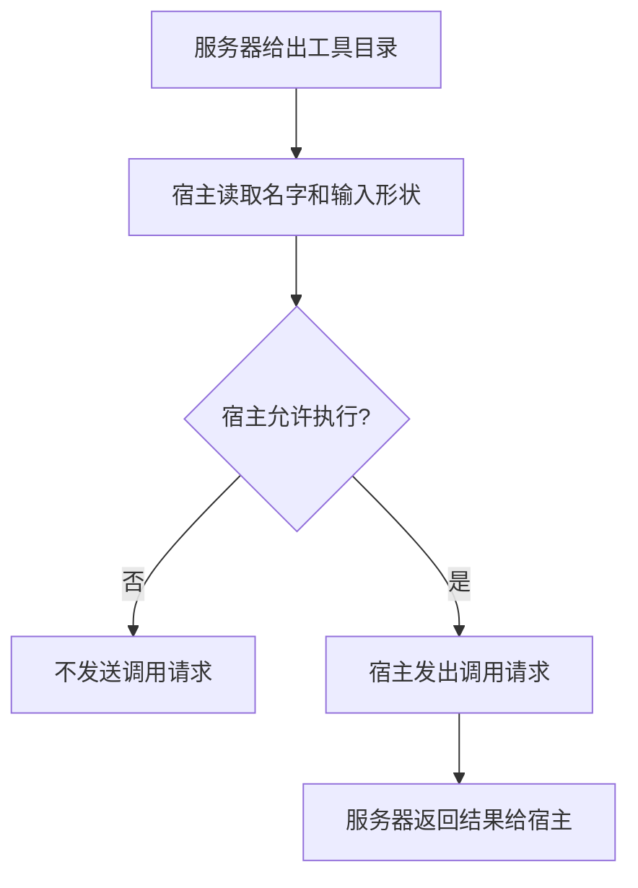

# MCP

MCP（Model Context Protocol，模型上下文协议）规定工具怎样向宿主描述自己，以及宿主若决定调用时，请求和结果怎样交换。目录里出现一个工具，只说明它可以被请求。要不要发出调用，仍由宿主决定。

## 知识点概述

[Tool Calling](/agent/tool-calling.md) 里，模型提出工具名和参数，应用执行函数，再把观察交回。不同宿主若各自发明一份描述格式，同一个工具就要写多套说明。MCP 把这份描述和随后的调用收成同一套协议，使多个宿主能读懂同一台服务器。

官方介绍把 MCP 定义为连接 AI 应用和外部系统的开放协议。官方架构把参与者分成三方，并写明协议只处理上下文怎样交换，不规定应用怎样使用模型，也不规定应用怎样处置拿到的上下文。

- **宿主**：使用模型的应用。它协调一个或多个客户端，并决定目录里的工具这次用不用。
- **客户端**：宿主为每一台服务器维持的连接，负责把服务器提供的上下文拿回来。
- **服务器**：提供上下文的程序。它可以暴露工具、资源或提示模板。本页只讨论工具。
- **描述**：工具的名字、说明和输入形状。客户端通过列出工具的请求拿到目录。
- **执行**：另一次调用请求。服务器在收到这次请求之后才执行对应函数，并把结果交回宿主。

因此协议规定的是目录和调用的形状。它不规定宿主必须执行目录中的每一项，也不把执行权交给服务器自行启动。模型仍然只提出请求；发出调用的是宿主。

## 核心原理



列出工具和调用工具是两次动作。第一次的结果是目录，里面还没有观察。宿主可以因为策略、用户确认或参数不合法而停在目录这一步。停在这里时，服务器上的函数不会运行。

宿主允许之后，才发出调用。服务器按请求执行，并把结果交回。结果写进宿主的轨迹，下一步模型才能读到。服务器不能从「我被列进目录」推断「宿主已经调用了我」。

客户端负责连接，不负责替宿主做允许或拒绝。一台宿主可以连接多台服务器；每台服务器的目录都要回到这一个决定点。

## 最小示例

`tool_spec` 只描述工具。`lookup` 是服务器侧的函数。`host_call` 先看目录，再看宿主是否允许，允许之后才调用传入的函数。

```python
from collections.abc import Callable


ToolSpec = dict[str, str]


def tool_spec() -> ToolSpec:
    return {"name": "lookup", "input": "note"}


def lookup(note: str) -> str:
    if note == "agenda":
        return "周三评审"
    return f"unknown:{note}"


def host_call(
    catalog: list[ToolSpec],
    allow: bool,
    invoke: Callable[[str], str],
) -> str:
    names = {item["name"] for item in catalog}
    if "lookup" not in names:
        raise ValueError("目录里没有 lookup")
    if not allow:
        raise ValueError("宿主拒绝执行")
    return invoke("agenda")
```

按 `host_call` 的写法，目录里有 `lookup` 但 `allow` 为假时，函数抛出 `ValueError`，文本是「宿主拒绝执行」。`invoke` 写在这次抛出之后，所以拒绝时不会调用它。目录为空时，函数先抛出「目录里没有 lookup」，同样不会调用。`allow` 为真且目录里有 `lookup` 时，返回值就是 `invoke("agenda")` 的结果；把 `lookup` 传进去时，这段结果是「周三评审」。

`tool_spec()` 本身不调用 `lookup`。描述和执行留在两个函数里。这段代码没有在当前环境执行，也不依赖某个 MCP 库。

## 常见问题

**把目录响应当成工具结果。** 目录只有名字和输入形状。观察来自之后的调用请求。

**服务器在被连接时就执行工具。** 连接和列出目录只让宿主看见描述。执行要等宿主发出调用。

**协议一旦接上，模型就必须使用每个工具。** 协议不规定应用怎样使用这些上下文。允许或拒绝是宿主的策略。

**用 MCP 代替应用里的步数和参数检查。** 协议统一的是描述和请求的形状。参数是否合法、循环何时停止，仍由宿主检查。

## 知识自测

<QuizPanel topic-id="mcp" />

## 参考资料

- [Model Context Protocol 介绍](https://modelcontextprotocol.io/introduction)：把 MCP 定义为连接 AI 应用和外部系统的开放协议。本页不展开其中的产品场景。
- [MCP 架构概览](https://modelcontextprotocol.io/docs/learn/architecture)：宿主协调客户端，服务器提供工具等上下文；协议不规定应用怎样使用模型或这些上下文。本页只用本地目录和一次允许检查说明这个边界。
