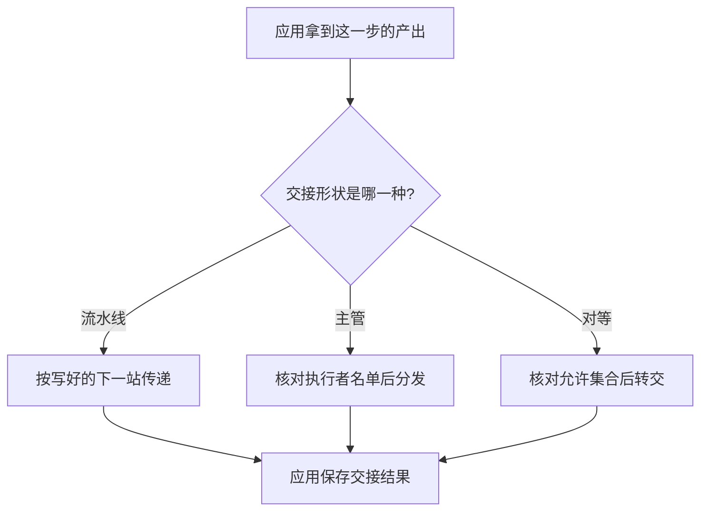

# 多智能体编排

编排是多步任务怎样交接。主管分发、对等交接和固定流水线是三种交接形状。应用检查交给谁、交了什么，再把结果留在自己手里。三种形状对应不同的任务，本页不给它们排名。

## 知识点概述

[多智能体系统](/agent/multi-agent.md) 说明角色之间没有另一条隐藏通道，交接由应用完成。[LangGraph](/frameworks/langgraph.md) 说明这种交接可以画成状态上的边。编排要先决定边是事先写死的，还是这一步临时选的。

- **固定流水线**：下一站写在代码里。上一步的产出原样成为下一步的输入。子任务和顺序都已经能拆开时，用这种形状。Anthropic 的工程文章把预定路径上的连续步骤称作提示链，并说明文中的工具名单后来有变化；本页只采用「顺序事先写好」这一点。LangGraph 的工作流说明也把工作流定义成按既定代码路径运行。
- **主管分发**：一个主管决定把哪一段交给哪个执行者。执行者没有自己的信箱。子任务要看这次输入才能确定时，主管可以临时点名。同一篇文章里的 orchestrator-workers 就是这种形状：中间角色拆分、委托，再汇总。应用仍要检查点名是否在执行者名单里。
- **对等交接**：当前角色提出把工作转给另一个角色。OpenAI Agents SDK 把这种交接表示成给模型看的工具，由运行器完成转交，并可以过滤下一角色看见的历史。模型提出转交，不直接改写另一角色的状态。应用核对目标在允许集合里。

三种都可以画进图，也可以先写成普通函数。选择取决于任务：顺序已经固定，用流水线；下一步要由一个角色按这次输入分派，用主管；对等角色之间转交，并且要控制对方看见什么，用交接。需要同时满足时可以组合，组合之后的检查仍然只有应用这一处。

## 核心原理



流水线的下一站不来自模型的点名，所以本页的例子不查名单。主管和对等都要查：目标不在允许集合里，应用拒绝，不产生交接结果。

对等交接返回的是下一角色的名字。这个名字不是工具观察，也不是已经写好的成稿。主管分发返回的是「交给谁」加上这段产出，执行者此后怎样处理，仍由应用调用对应函数。流水线返回的是按固定格式接好的下一步文本。

未知形状直接拒绝。应用不猜测该靠哪一种。

## 最小示例

`handoff` 用 `kind` 区分三种形状。`allowed` 是应用掌握的名单。流水线不读取它；主管和对等要求其中有 `notes`。

```python
def handoff(kind: str, payload: str, allowed: set[str]) -> str:
    if kind == "pipeline":
        return f"成稿：{payload}"
    if kind == "supervisor":
        if "notes" not in allowed:
            raise ValueError("主管找不到执行者")
        return f"notes:{payload}"
    if kind == "peer":
        if "notes" not in allowed:
            raise ValueError("对等交接的目标不在允许集合")
        return "notes"
    raise ValueError("未知的交接形状")
```

按 `handoff` 的写法，`kind` 为 `pipeline`、`payload` 为「提纲」时，返回「成稿：提纲」。名单是空的也不影响这条路径。`kind` 为 `supervisor` 且 `notes` 不在 `allowed` 里时，抛出 `ValueError`，文本是「主管找不到执行者」，不会返回 `notes:` 开头的字符串。`kind` 为 `peer` 且名单里有 `notes` 时，返回值只有 `notes`，不包含 `payload`。`kind` 为其他字符串时，抛出「未知的交接形状」。

这段代码没有在当前环境执行。它只把三种交接的检查放在同一个函数里，方便对照。

## 常见问题

**先选一个「最强」的编排再往上填任务。** 顺序固定、临时分派和对等转交要的检查不一样。先看任务已经需要哪一种交接。

**主管点名之后，执行者自己保存一份只有它能读的状态。** 交接结果由应用保存。下一角色看见什么，取决于应用这次传入的参数。

**把对等交接的角色名当成任务已经完成。** `peer` 的返回值是下一角色。成稿要等那个角色的工作真正写回。

**流水线中途让模型改写下一站，却不改变形状。** 下一站一旦改为临时决定，检查就应改成主管或对等那一支，名单也要生效。

## 知识自测

<QuizPanel topic-id="multi-agent-orchestration" />

## 参考资料

- [Building effective agents](https://www.anthropic.com/engineering/building-effective-agents)：预定路径上的连续步骤，以及由一个角色分派给其他角色。文章开头说明文中的工具生态后来有变化，本页不引用其中的框架名单。
- [Workflows and agents](https://docs.langchain.com/oss/python/langgraph/workflows-agents)：工作流按既定代码路径运行，智能体则自己决定过程和工具使用。本页不复制其中的模型调用代码。
- [Handoffs](https://openai.github.io/openai-agents-python/handoffs/)：交接表示成给模型看的工具，由运行器转交，并可以过滤下一角色看见的历史。本页只用允许集合表达这个检查。
