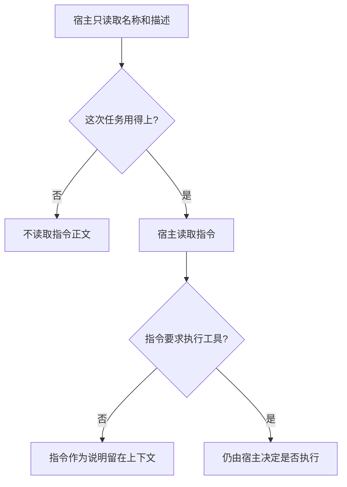

# Skills

Skill（技能）是一份可复用的能力包：名称、何时使用的描述，以及任务对上之后才读取的指令。它给现有模型补一份可以反复取用的做法。读到这份包，不会得到另一个模型，也不会自动完成一次工具调用。

## 知识点概述

[Tool Calling](/agent/tool-calling.md) 里的一次调用，是「请执行这个函数」的请求。应用执行后得到观察。技能包先回答另一件事：遇到这类任务时，按什么步骤使用哪些能力。步骤写在指令里。真要执行工具时，仍然回到宿主的决定，和 [MCP](/frameworks/mcp.md) 里「目录不是调用」是同一条边界。

官方的 Agent Skills 说明把发现信息和操作指令分开。名称和描述可以先放进目录，用来判断这次任务用不用得上。用得上，宿主再读取指令正文。正文里可以提到工具或附带材料。提到它们，只是说明；执行仍由宿主发起。

- **目录**：只有名称和描述。宿主可以据此跳过一份用不上的技能，不去读正文。
- **指令**：任务对上之后读取的文本。它进入这次上下文，告诉模型按什么步骤做。
- **工具**：指令可以点名。点名之后，宿主仍要决定是否执行，并自己写入观察。
- **模型**：还是原来的那一个。技能包是应用能读取的文本和材料，不改模型权重。

官方说明还会把更细的材料和脚本留到用到时再取。本页不写各段占用多少 token，只保留「先目录、后正文」这个顺序。

## 核心原理



匹配发生在正文之前。用不上时，指令留在包里，不进入这次上下文。用得上时，宿主读取的仍是文本。文本可以要求某个工具；宿主看到这个要求之后，再按自己的允许规则决定发不发出调用。

因此技能包组织的是可复用的做法。协议组织的是工具怎样被描述。一次工具调用组织的是某一次执行。三件事可以出现在同一次任务里，但读技能正文不会代替后两件。

## 最小示例

`catalog` 只复制名称和描述。`load_instructions` 先看这次是否用得上，再用名字取出指令。

```python
from typing import TypedDict


class Skill(TypedDict):
    name: str
    description: str
    instructions: str


def catalog(skills: list[Skill]) -> list[dict[str, str]]:
    return [{"name": item["name"], "description": item["description"]} for item in skills]


def load_instructions(skills: list[Skill], name: str, needed: bool) -> str:
    if not needed:
        raise ValueError("任务用不上这份技能")
    for item in skills:
        if item["name"] == name:
            return item["instructions"]
    raise ValueError("目录里没有这份技能")
```

按这两个函数的写法，`catalog` 的每一项只有 `name` 和 `description`，没有 `instructions`。`needed` 为假时，`load_instructions` 抛出 `ValueError`，文本是「任务用不上这份技能」，即使列表里已经有同名正文。`needed` 为真但名字对不上时，抛出「目录里没有这份技能」。名字对上且 `needed` 为真时，返回值是 `instructions` 里的字符串。

这个字符串是做法说明。它不是新的模型，也不是工具观察。这段代码没有在当前环境执行。

## 常见问题

**把技能当成第二个模型。** 包里是名称、描述和指令。模型仍然是宿主原来调用的那一个。

**读取描述之后就执行工具。** 描述只用于判断用不用得上。工具执行要等宿主另作决定。

**每次对话都把全部指令放进提示词。** 目录可以先筛选。用不上的正文留在包里，这次上下文只带走用得上的那一份。

**把技能和一次工具调用当成同一条记录。** 技能可以覆盖多个步骤和多个工具。一次工具调用只有一个函数请求和随后的一次观察。

## 知识自测

<QuizPanel topic-id="skills" />

## 参考资料

- [Agent Skills 概览](https://docs.anthropic.com/en/docs/agents-and-tools/agent-skills/overview)：技能是可复用的资源，名称和描述用于发现，指令在用到时再读取。本页不复制其中的产品教程，也不引用各段的 token 数量。
