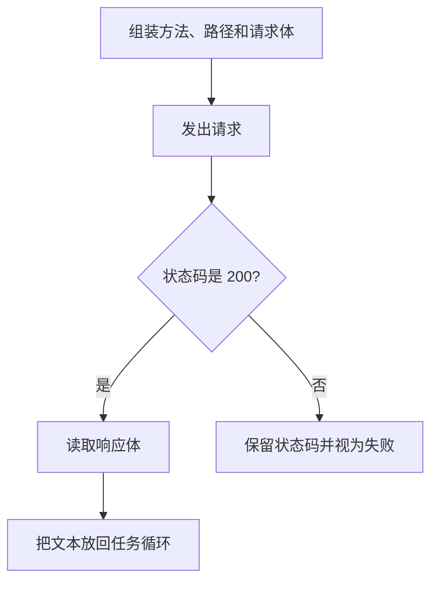

# HTTP / REST API

调用模型，就是你的程序作为客户端发出一次 HTTP 请求，服务端返回一次响应。这一节按 [HTTP 概述](https://developer.mozilla.org/zh-CN/docs/Web/HTTP/Overview) 把报文读懂，好接上下一节的 JSON。REST 在这里指：用方法表达动作，用路径指向目标，用状态码表达结果。

## 知识点概述

HTTP 是客户端—服务器协议。请求由客户端发出，响应由服务端返回。请求里有方法、路径、协议版本、可选的标头，以及可选的请求体。响应里有状态码、状态说明、标头，以及可选的响应体。

概述里的例子用 `GET` 获取资源，用 `POST` 提交一段数据。模型调用要把消息放进请求体，因此常见写法是 `POST`。路径和字段名以你选用的服务商文档为准，这一页不绑定某一家。

协议是无状态的：同一条连接上，两次成功的请求之间没有内在联系。网页可以用 Cookie 把请求串成会话。模型这边的对话历史要由应用程序放进这一次的请求体，不能假设服务端还记着上一句。

## 核心原理

一次调用可以收成下面几步。示例里只把状态码 `200` 当成成功，因为概述中的响应示例就是 `200`。其他状态先保留数字，当作失败。



你的进程是客户端。模型服务不会自己来读你的本地变量。密钥放在标头或你自己的运行环境里，由这段程序附到请求上。状态码用来判断要不要把响应体当成模型回复。失败时把状态码写进错误信息，调用方才能区分「请求没有被接受」和「请求被接受了但正文不是预期的数据」。

标头携带类型和认证这类附加信息。请求体才是消息本身。把正文和状态码分开看，解析 JSON 才有意义：失败响应的正文可能是错误说明，不一定是对话文本。

## 最小示例

下面只组装请求并解释状态码，不建立连接。

```python
def build_chat_request(path: str, user_text: str) -> dict[str, object]:
    if not path.startswith("/"):
        raise ValueError("path must start with /")
    if not user_text:
        raise ValueError("user text is empty")
    return {
        "method": "POST",
        "path": path,
        "headers": {"content-type": "application/json"},
        "body": {"messages": [{"role": "user", "content": user_text}]},
    }


def classify_status(status: int) -> str:
    if status == 200:
        return "success"
    if status < 100 or status > 599:
        raise ValueError(f"status out of range: {status}")
    return "failure"
```

`build_chat_request` 得到一份还没发送的描述。`classify_status` 只在状态码是 `200` 时返回 `"success"`。拿到失败时，先停下解析「模型回复」的那一步，把状态码留在异常或结果里。

## 常见问题

**连接成功就当作模型已经回答。** 传输完成只说明响应到了。还要看状态码，再决定正文是回复还是错误。

**每次只发送最新一句。** 无状态协议不会自动补上更早的对话。需要上下文时，把那些消息放进这一次的请求体。

**把密钥写进路径或日志。** 认证信息放在标头或环境里，请求日志要能去掉它。模型只应看到你准备放进消息的文本。

## 知识自测

<QuizPanel topic-id="http-rest" />

## 参考资料

- [HTTP 概述](https://developer.mozilla.org/zh-CN/docs/Web/HTTP/Overview)：请求与响应、方法、状态码，以及无状态
