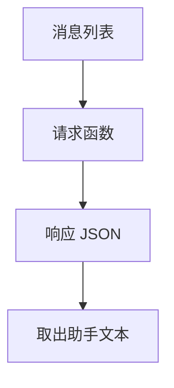

# 大模型 API 调用

一次聊天补全做两件事：把到目前为止的消息列表交给模型，再从响应里取出助手文本。密钥只从环境变量读取，不写进源码，也不写进消息。

## 知识点概述

调用方准备的核心数据是消息列表。每条消息至少有角色和内容。用户消息是这次的问题，开发者或系统消息是规则，助手消息是上一轮已经生成的回复。多轮对话要把新的用户消息追加到这份列表上，而不是只发送最后一句、丢掉前文。前文是否还放得下，由 [Token 与上下文窗口](/fundamentals/token-context.md) 决定。

响应是一份 JSON。助手文本嵌在其中，但嵌套位置不是行业统一标准。一家服务商的聊天补全接口使用 `messages`，并在完成对象里返回助手消息。同一家的另一套文本生成接口使用 `input`，文本在 `output` 里，官方说明明确写了不要假定它一定在 `output` 的第一个固定下标。其他厂商的字段名还会不同。学习时先固定一个你自己写明的形状，换接口时只替换解析函数。

密钥是调用凭证。官方示例从环境变量读取它，再放到请求的认证头里。变量名因工具而异，本页的函数使用 `LLM_API_KEY`，避免把某一家的名字写成唯一写法。进程环境变量的映射见 Python 的 `os.environ`。

## 核心原理

请求和解析要分成两个函数。请求函数接收消息列表，返回响应文本。解析函数只认你约定的 JSON，缺字段就失败。这样换服务商时，消息的组织方式可以留下，改的是请求和解析。

下面是这一页约定的教学形状，用来练习解析。它接近一种常见的聊天补全响应，但不是所有接口的响应：

```json
{"choices":[{"message":{"role":"assistant","content":"助手文本"}}]}
```

`choices` 为空、没有 `message`、没有 `content`、`content` 不是字符串，或角色不是 `assistant`，都要拒绝。不要把缺字段换成空字符串继续往下走。空字符串和「字段不存在」对调用方是两种结果。



真实请求还会带上模型名、认证头和超时。那些参数属于你接入的那份文档。这一页的请求函数是假的，方便在没有密钥、没有网络时看清消息和解析。

## 最小示例

密钥单独读取。没设置环境变量时，函数失败，并且不会去访问网络。

```python
import os


def read_api_key() -> str:
    """只从环境变量读取密钥。真实请求把它放进认证头，不放进消息。"""
    key = os.environ.get("LLM_API_KEY")
    if not key:
        raise RuntimeError("读取环境变量 LLM_API_KEY 失败")
    return key
```

下面的请求和解析都不调用 `read_api_key()`，因此没有密钥也能读懂、也能在本地运行。`fake_chat` 用最后一条用户消息拼出教学 JSON。

```python
import json
from typing import TypedDict


class ChatMessage(TypedDict):
    role: str
    content: str


def fake_chat(messages: list[ChatMessage]) -> str:
    """返回教学用的响应 JSON。不访问网络。"""
    user_text = ""
    for message in reversed(messages):
        if message["role"] == "user":
            user_text = message["content"]
            break
    payload = {
        "choices": [
            {"message": {"role": "assistant", "content": f"收到：{user_text}"}}
        ]
    }
    return json.dumps(payload, ensure_ascii=False)


def assistant_text(payload_json: str) -> str:
    """取出助手文本。缺字段、类型不对或角色不对时拒绝。"""
    try:
        payload = json.loads(payload_json)
    except json.JSONDecodeError as error:
        raise ValueError("聊天响应不是合法 JSON") from error
    if not isinstance(payload, dict):
        raise ValueError("聊天响应必须是 JSON 对象")
    try:
        message = payload["choices"][0]["message"]
        content = message["content"]
        role = message["role"]
    except (KeyError, IndexError, TypeError) as error:
        raise ValueError("聊天响应缺少助手文本") from error
    if role != "assistant" or not isinstance(content, str):
        raise ValueError("聊天响应缺少助手文本")
    return content


messages: list[ChatMessage] = [
    {"role": "user", "content": "用一句话说明消息列表"},
]
print(assistant_text(fake_chat(messages)))
```

打印结果是 `收到：用一句话说明消息列表`。接入真实接口时，保留消息列表和 `assistant_text` 这种「缺字段就失败」的检查，把 `fake_chat` 换成发送 `read_api_key()` 的请求。认证头的具体写法以那份接口文档为准。

## 常见问题

**把密钥写进源码、前端或用户消息。** 密钥留在环境变量里。提交到仓库或发给模型，都会扩大泄露范围。

**把 `choices[0].message.content` 写成所有厂商的唯一路径。** 这只是本页的教学形状。另一套官方接口把文本放在别的结构里，并提醒不要写死下标。

**缺字段时返回空字符串。** 调用方会把它当成模型确实说了空话。缺字段应抛出可以区分的错误，并保留原来的解析异常。

**示例跑通后直接复制成生产请求。** 假函数没有超时、没有状态码、也没有用量。接上网络之前，先定密钥来源和解析失败时的行为。

## 知识自测

<QuizPanel topic-id="llm-api" />

## 参考资料

- [OpenAI Chat API](https://platform.openai.com/docs/api-reference/chat)：`messages` 组成对话的一种聊天补全接口
- [OpenAI Text generation](https://platform.openai.com/docs/guides/text-generation)：同一家服务商的另一种请求形状，以及不要假定文本在固定下标
- [Python os](https://docs.python.org/3/library/os.html)：`os.environ` 是进程环境变量的映射
