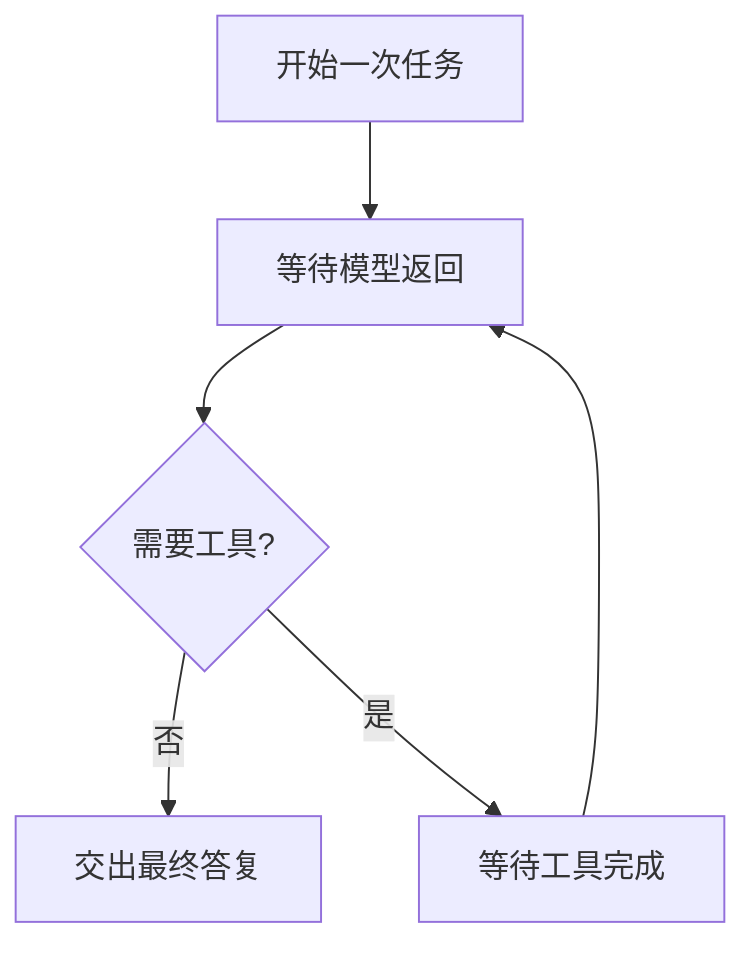

# Python 异步编程

模型请求的大部分时间花在等待响应。标准库 [asyncio](https://docs.python.org/3/library/asyncio.html) 用 `async` / `await` 写这种并发：等待输入输出时，事件循环可以去推进别的协程。Agent 里的「先问模型，再执行工具」经常就写成这种形状。

## 知识点概述

协程函数用 `async def` 定义。直接调用它，得到的是协程对象，函数体还没有执行。`await` 表示在这里等待那个协程完成，等待期间把控制权交回事件循环。`asyncio.run` 用来启动循环，并跑到最外层协程结束。

这和多线程不是同一件事。这里要看懂的是等待点：模型那一次往返、工具如果还要再发一次请求，都是等待。文档说明 asyncio 适合 IO 密集的网络代码。计算本身很重的工作，不会因为加上 `async` 就变快。

一次用户请求里，顺序通常仍是：等待模型，看它要不要工具，再等待工具，然后回到模型。异步改变的是「等待时循环还能做别的事」，步骤的先后还是由你的代码决定。

## 核心原理

下面按一次任务的等待顺序来看。节点上的「等待」在真实客户端里是网络往返；这一页用立刻返回的假实现把顺序写清楚。



`await` 只出现在协程里。漏写 `await` 时，变量里是协程对象，后面的代码如果把它当成字符串去拼接，类型会对不上。工具函数如果写成了普通的阻塞调用，例如同步的网络请求，它会占住整个线程，循环在这段时间里调度不了其他协程。

最外层用 `asyncio.run` 进入循环。循环已经在跑的时候，再次调用 `asyncio.run` 会失败。服务框架通常已经持有循环，业务函数只负责 `await`，不再自己启动一次。

## 最小示例

两个内部函数都立刻返回，用来看 `await` 的先后，不访问网络。

```python
import asyncio


async def fake_model(prompt: str) -> str:
    if not prompt:
        raise ValueError("prompt is empty")
    return f"draft:{prompt}"


async def fake_lookup() -> str:
    return "section-3"


async def run_task(prompt: str) -> str:
    draft = await fake_model(prompt)
    found = await fake_lookup()
    return f"{draft}|{found}"


def start(prompt: str) -> str:
    return asyncio.run(run_task(prompt))
```

`run_task` 先等待 `fake_model`，再等待 `fake_lookup`，然后把两段文本拼起来。`start` 是给同步入口用的。如果这段代码本身已经跑在事件循环里，就直接 `await run_task(...)`，不要再套一层 `asyncio.run`。

## 常见问题

**调用了协程却没有 await。** 函数体没有执行。日志里如果出现协程对象的表示，先检查是不是漏了 `await`。

**在协程里做同步阻塞。** 文档把 asyncio 放在 IO 场景里。把会一直占着线程的调用放进 `async def`，其他任务只能等它返回。

**每个工具都新开一个事件循环。** 一次任务里的模型和工具应共用调用方已经在跑的循环，用 `await` 串起来。

## 知识自测

<QuizPanel topic-id="python-async" />

## 参考资料

- [asyncio](https://docs.python.org/3/library/asyncio.html)：`async` / `await` 和面向 IO 的并发
