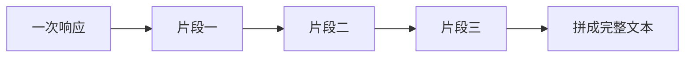

# 流式输出

流式输出把同一次模型响应切成多段陆续交给调用方。调用方按到达顺序拼接，得到和一次返回完整文本相同的那段回答。它不增加模型能读到的上下文，也不表示模型在执行你的函数。

## 知识点概述

默认的聊天调用会等模型生成完整段落后，再给你一份响应。输出很长时，界面会一直空白。流式改成边生成边发送已经写好的开头，调用方可以先显示这部分。段与段之间是同一次回答的切片，不是多次独立提问。

切片怎样在网络上传输，各家不同。有的聊天接口在打开流式参数后，用服务器发送事件把数据推过来。另一套接口则发送带类型的事件：增量文本事件会到很多次，完成事件表示这次响应结束，错误事件表示没有完成。事件的字段名要按你用的文档读，不能把某一家的 `type` 写成唯一标准。

本页只固定调用方的责任：按顺序收集属于正文的片段，拼成一个字符串。控制信息、完成标记和错误不要拼进正文。中途失败时，已经拿到的文字是不完整的。

## 核心原理

一次非流式响应可以看成数组里已经放好的全文。流式是这个数组被拆开，逐段到达。拼接就是按原顺序把它们接回去。少一段、多按一次最后一段，或把顺序打乱，得到的都不是模型这次写完的文本。



调用方通常维护一个缓冲区。每来一段正文，就追加到缓冲区并刷新界面。完成之后，缓冲区里的字符串才是这轮助手消息，可以写回 [大模型 API 调用](/fundamentals/llm-api.md) 里的消息列表。只把最后一段写回去，历史里会缺掉开头。

流若在中途断开，缓冲区里的内容停在半截。这时不要把它当成成功的助手消息再发给模型，否则下一轮会把残句当成模型已经说完的话。应把这次调用记成失败，或明确标记文本不完整。

官方说明还指出，流式输出更难做内容审核，因为半截文本更难判断。若同时请求审核分数，分数要等完整输出后才到达。先显示给用户的片段，还不是审核完成的全文。

## 最小示例

下面用一份片段列表代替网络。没有请求，也没有密钥。三段按顺序接成一句。

```python
def join_chunks(chunks: list[str]) -> str:
    """把同一次响应的正文片段按顺序拼起来。"""
    return "".join(chunks)


chunks = ["上下文", "窗口", "有限"]
print(join_chunks(chunks))
```

`join_chunks(chunks)` 得到 `上下文窗口有限`。若只取 `chunks[-1]`，结果是 `有限`，开头已经丢了。若在第二段之后停止，结果是 `上下文窗口`，这是不完整的回答，不能写回对话历史当作模型的完整回复。

真实接口还会夹着完成标记或错误标记。那些标记不是正文，不要放进 `chunks`。本页的列表只保留已经选出来的文本片段。

## 常见问题

**界面只更新最后一段。** 每一段通常只是新增加的几个字。显示和保存都要追加，不能覆盖。

**把每个片段当成一次新的补全。** 片段共享同一次请求的上下文。它们合起来才是这一轮助手消息。

**连接断开后仍保存半截文本。** 半截文本可以展示为失败现场，但写回消息列表前要标成不完整，避免下一轮把残句当成已完成的回答。

**为了看流式效果把密钥写进示例。** 流式只改变响应的送达方式。密钥仍然只从环境变量读取，和普通调用相同。

## 知识自测

<QuizPanel topic-id="streaming" />

## 参考资料

- [OpenAI Streaming API responses](https://platform.openai.com/docs/guides/streaming)：一次响应如何分成增量文本、完成和错误事件
- [OpenAI Chat API](https://platform.openai.com/docs/api-reference/chat)：聊天补全打开流式后，用服务器发送事件返回数据
