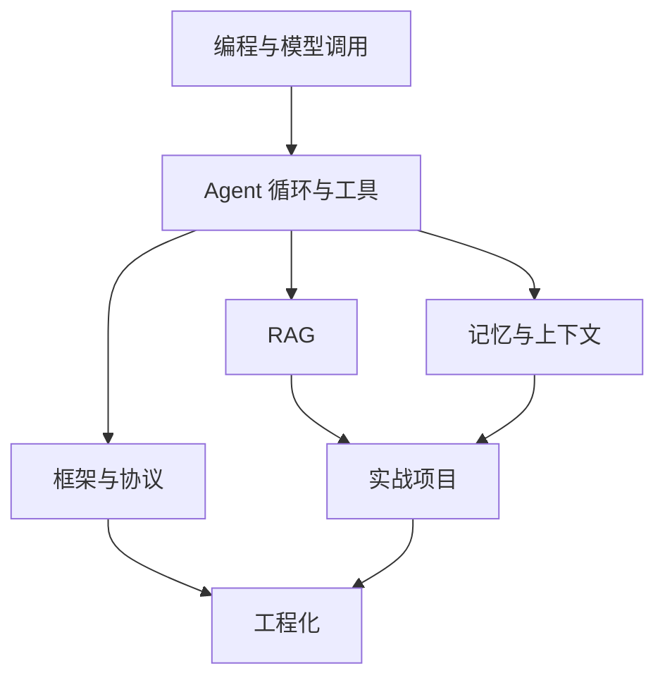

# Agent 开发学习路线

路线按「先能调用模型，再让它使用工具，然后接上你自己的资料」排列。还没写完的章节留在地图上，但不挡住已经能读的部分。

## 建议的第一段

如果你想先看到完整的讲解和练习，按这个顺序读：

1. [什么是 AI Agent](/agent/what-is-agent.md)，建立本站使用的定义
2. [Tool Calling](/agent/tool-calling.md)，看清模型和应用程序各做哪一半
3. [基础 RAG](/rag/basics.md)，把外部资料放进回答过程

这三节尽量自洽。它们列出的前置章节里，有些仍是待编写。缺的名词会在正文里补一句，你不必等全部基础课写完。

## 整张地图

阅读时可以这样理解每一段：

| 顺序 | 模块 | 你应该获得的能力 |
| --- | --- | --- |
| 00 | [开始学习](/guide/intro.md) | 知道站点怎么用 |
| 01 | [编程与大模型基础](/fundamentals/python-basics.md) | 能发一次模型请求并读懂 JSON |
| 02 | [Agent 核心原理](/agent/what-is-agent.md) | 能实现一个有停止条件的工具循环 |
| 03 | [RAG 与知识库](/rag/basics.md) | 能解释检索失败为什么会变成胡编 |
| 04 | [Memory 与上下文工程](/memory/conversation-history.md) | 能决定什么留在上下文里 |
| 05 | [框架与协议](/frameworks/langchain.md) | 能说明框架和 MCP 各解决什么 |
| 06 | [Agent 工程化](/engineering/fastapi.md) | 能把循环放进可观察的服务 |
| 07 | [实战项目](/projects/index.md) | 能按验收标准做完一个小项目 |
| 08 | [学习资源](/resources/index.md) | 知道去哪份官方文档核对 |

## 怎么跳着学

已经会写 HTTP 和 JSON 的人，可以从 Agent 三节直接开始。做项目时如果卡在某个词，再回到对应的待编写页，看它将来要解决什么，然后用资源导航里的官方文档补上。

不建议一上来同时学框架、RAG 和多智能体。先让一个工具循环在本地跑通，再加资料库。
