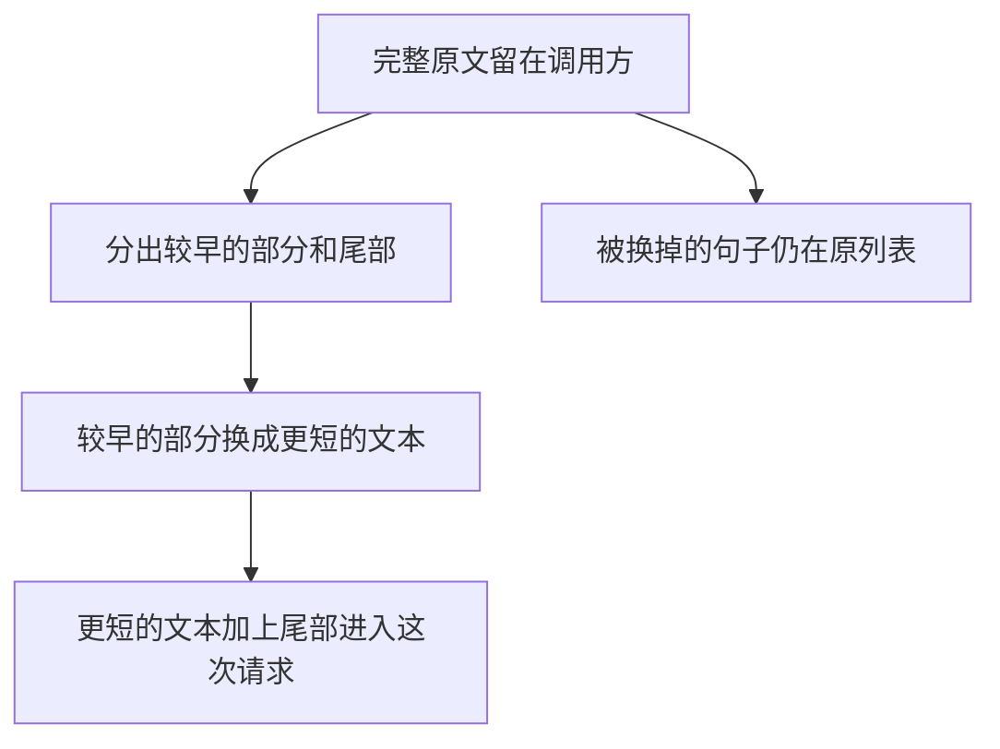

# 上下文裁剪与压缩

压缩用更短的文本换出空间。放进这一轮请求的是这段更短的文本加上保留下来的尾部。它不是被换掉的原文。原文若还需要，留在请求外面。

## 知识点概述

[Context Engineering](/memory/context-engineering.md) 决定这一轮带哪些材料。[Token 与上下文窗口](/fundamentals/token-context.md) 说明装不下时，接口可能从较早的内容截断，也可能直接拒绝。压缩是发送之前的另一种处理：应用主动丢掉较早部分的细节，换一段更短的说明，让请求还能装下尾部。

官方文档里的压缩，是把变长的对话摘要之后换进新的上下文；另一种编辑会用占位说明换掉较早的工具结果。文档也写明，客户端可以继续保留完整原文。因此请求里的那一版是整理之后的，不能拿去当原文存档。

本页不调用模型来写摘要。`summary` 由调用方传入，函数只检查它没有把被替换的原文原样放回来。`keep_tail` 是这个例子保留的尾部条数，不是某个模型的窗口长度。

## 核心原理



尾部按原句保留，因为当前问题通常依赖最近几句。较早的部分不逐句进入返回值。返回值的第一项是 `summary`。它不能等于被丢掉的任何一条，也不能等于把那些条用换行拼回去的结果。这样调用方无法把原文伪装成压缩结果。

什么都不用换时，也就是尾部条数已经盖住全部消息，函数返回原列表的副本，不插入摘要。传入的原列表始终不改。被换掉的句子留在那里，供以后核对。这一轮请求若只发送返回值，那些句子不在请求里。

## 最小示例

```python
def compress_head(messages: list[str], keep_tail: int, summary: str) -> list[str]:
    """用 summary 换掉头部。keep_tail 是保留的尾部条数，不是窗口长度。"""
    if keep_tail < 0:
        raise ValueError("keep_tail 不能为负")
    if keep_tail >= len(messages):
        return list(messages)
    if not summary:
        raise ValueError("缺少 summary")
    dropped = messages[: len(messages) - keep_tail]
    if summary in dropped or summary == "\n".join(dropped):
        raise ValueError("压缩文本不能是被替换的原文")
    tail = messages[-keep_tail:] if keep_tail else []
    return [summary, *tail]
```

按这段代码，消息是 `["订了周一", "改到周二", "最终周三"]`。`compress_head(messages, 1, "日期改过两次")` 得到 `["日期改过两次", "最终周三"]`。「日期改过两次」不是「订了周一」，也不是「改到周二」。传入的 `messages` 仍然是三句。

`summary` 若是「订了周一」，或是把两句旧消息用换行拼成的原文，函数抛出 `ValueError`，不返回那份列表。`keep_tail` 大于等于 3 时，返回值是三句原文的副本，摘要不会插进去。`keep_tail` 为 0、摘要是「只剩摘要」时，返回值只有这一句摘要。`keep_tail` 为负数时抛出 `ValueError`。

这一轮请求若发送返回值，模型读到的是摘要和尾部。周一和周二的原句只存在于调用方的 `messages`。

## 常见问题

**把压缩结果存成唯一副本。** 返回值丢掉了头部的措辞。还要核对原话时，保存传入的那份列表，或保存存储里的原文。

**摘要直接复述被删掉的句子。** 那样并没有丢掉细节，只是换了个位置。函数会拒绝和被替换原文相同的 `summary`。

**认为模型仍然读得到没放进返回值的句子。** 请求里只有返回值。原列表留在应用侧，不会自动跟着进请求。

**用一个固定 token 数触发压缩。** `keep_tail` 只数这个例子的条数。什么时候接近窗口上限，看所用模型的计数，本页不写那个数字。

## 知识自测

<QuizPanel topic-id="context-compression" />

## 参考资料

- [Effective context engineering for AI agents](https://www.anthropic.com/research/effective-context-engineering-for-ai-agents)：压缩是把变长对话摘要后换进新的上下文，用来继续长任务。本页不摘录文中的长度和步数。
- [Context editing](https://docs.anthropic.com/en/docs/build-with-claude/context-editing)：清理或压缩会换掉较早的内容；客户端仍可保留完整原文。本页不引用阈值、价格或具体模型的默认策略。
