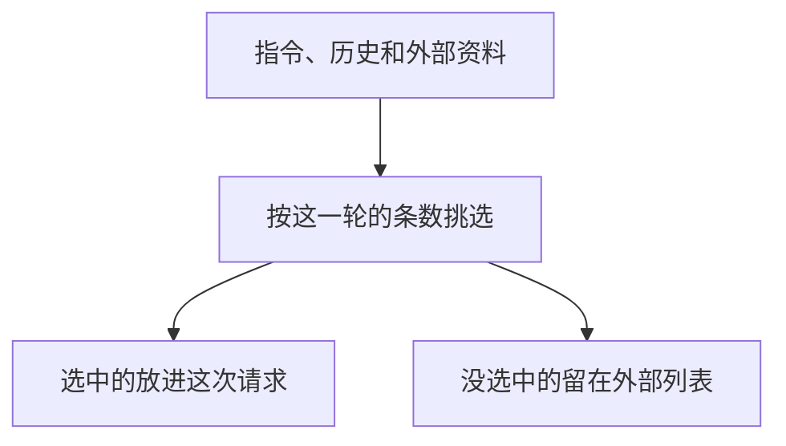

# Context Engineering

上下文工程决定这一轮请求里放什么。指令、历史和外部资料都在候选里。没被选中的留在请求外面，模型这次看不到。

## 知识点概述

[Prompt Engineering](/fundamentals/prompt-engineering.md) 负责把任务、约束和输出格式写清楚。那是指令本身怎么写。上下文工程看的是另一次选择：这次调用除了指令，还带上哪些历史、哪些记忆、哪些资料。官方对这个词的用法，是每次推理时整理要送进模型的那一组内容。

候选通常比窗口能装的更多。[Token 与上下文窗口](/fundamentals/token-context.md) 说明装不下时会发生截断或拒绝。挑选要发生在发送之前，由应用来做。模型收不到你留在外部的那一份。

本页的 `slots` 是例子自己的条数上限，用来看清「选中的进请求，其余留下」。它不是任何模型的窗口长度，也不能换算成 token。

## 核心原理



指令先占一个位置。后面的材料按给定顺序往后排，位置满了就停止。停止时循环不再读取后面的材料，那些材料仍在调用方的原列表里。

顺序是应用的决定。把最需要的材料放在前面，它们才会在条数用尽前进入返回值。返回值是这一轮请求的内容。原列表是外部库存，下一步可以重新挑选，不受上一次返回值的限制。

材料里若混着别的用户的记录，应在挑选之前完成归属检查。挑选函数只负责位置，不负责识别用户。

## 最小示例

```python
def assemble_request(instruction: str, materials: list[str], slots: int) -> list[str]:
    """slots 是这个例子的条数，不是模型窗口。指令占第一个位置。"""
    if not instruction:
        raise ValueError("缺少 instruction")
    if slots < 1:
        raise ValueError("至少要给指令留一个位置")
    chosen = [instruction]
    for item in materials:
        if len(chosen) >= slots:
            break
        chosen.append(item)
    return chosen
```

按这段代码：

```python
materials = ["偏好无糖", "旧工单", "无关新闻"]
chosen = assemble_request("只根据给定材料回答", materials, 2)
```

`chosen` 是 `["只根据给定材料回答", "偏好无糖"]`。这一轮请求里只有这两项。「旧工单」和「无关新闻」仍在 `materials` 里，不在 `chosen` 里。`slots` 为 1 时，返回值只有指令。`slots` 小于 1，或指令为空，都抛出 `ValueError`，并且不会返回一份半成品列表。

函数不访问网络，也不测量 token。材料列表原样保留，供下一次重新挑选。

## 常见问题

**每次都把库存全部附在指令后面。** 库存会一直变长。这一轮用得上的往往只是其中几项。先选出要进请求的，其余留在外部。

**改了提示词里的形容词，就认为上下文已经整理过。** 提示词是指令文本。历史和资料进不进这一次请求，是另一次选择。

**用一个固定的大数字当作所有模型的窗口。** `slots` 只属于这个例子。真实预算看所用模型的计数，并且要给即将生成的回复留位置。

**挑选时把别的用户的记忆一并放进去。** 条数够不够和归属对不对是两件事。归属在进入 `materials` 之前就应该核对完。

## 知识自测

<QuizPanel topic-id="context-engineering" />

## 参考资料

- [Effective context engineering for AI agents](https://www.anthropic.com/research/effective-context-engineering-for-ai-agents)：上下文工程是在每次推理时挑选要送进模型的内容，范围大于单次提示词怎么写。本页不摘录文中的长度、步数或文件数量。
- 指令怎么写，见 [Prompt Engineering](/fundamentals/prompt-engineering.md)。预算见 [Token 与上下文窗口](/fundamentals/token-context.md)。
