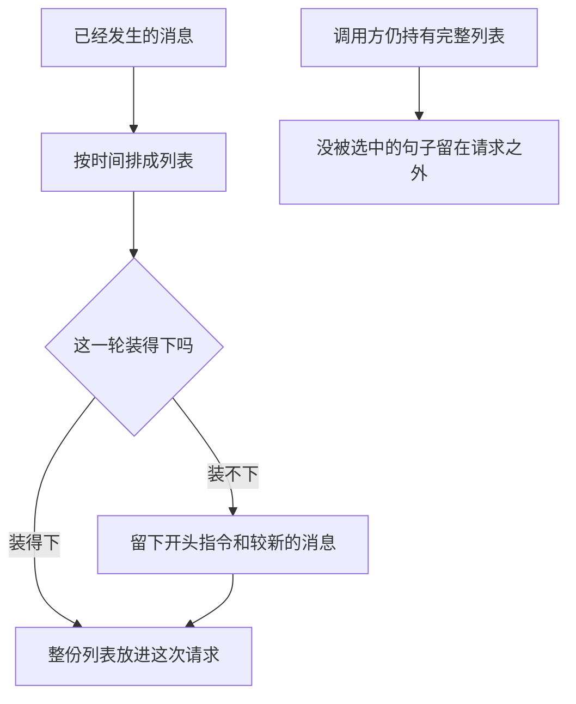

# 对话历史管理

对话历史是一份按发生顺序排列的消息列表。这一轮请求里放的是你决定带上的那一段；没放进列表的句子留在调用方手里，模型这次读不到。

## 知识点概述

[大模型 API 调用](/fundamentals/llm-api.md) 里，一次请求的核心数据就是消息列表。服务商把单次文本生成写成无状态的：上一轮没有再次放进参数的内容，这一轮不会自动出现。要让对话接得上，就把已经发生的用户消息和助手消息按时间顺序放进这一次请求。

本页把一条消息收成两个字段：`role` 和 `content`。角色只有四种约定。

- **system**：整段对话的指令，放在列表开头。裁剪时它留在原位。
- **user**：用户这次说的话。
- **assistant**：模型已经给出的回复，或一次工具调用的说明。
- **tool**：应用执行工具后的结果。它必须紧跟在提出这次调用的助手消息后面。

工具结果的字段名因接口而异，顺序的责任相同。应用执行工具、再把结果写回列表，见 [Tool Calling](/agent/tool-calling.md)。列表有多长才算装得下，见 [Token 与上下文窗口](/fundamentals/token-context.md)。本页不写任何模型的窗口长度。

## 核心原理



追加只发生在末尾。新的用户消息不能插到已经写好的助手消息前面，否则顺序不再是发生顺序。工具结果若写到助手消息之前，阅读的人会先看见结果、后看见请求，下一轮模型也会按这个错误顺序阅读。

装不下时，`trim_history` 做的是按条数裁剪，不是按某个模型的 token 预算。`keep` 只表示这个例子留下几条非指令消息。真实请求的长度以所用模型的计数为准。裁剪返回新列表。传入的原列表还在，被丢掉的句子留在调用方，不在这次返回值里。

## 最小示例

两个函数都不访问网络。`system` 写在列表开头，不从回合里追加。`append_message` 只接收 `user`、`assistant` 和 `tool`，并检查工具结果的位置。`trim_history` 从较新的一侧保留消息。

```python
def append_message(history: list[dict[str, str]], role: str, content: str) -> None:
    if role not in {"user", "assistant", "tool"}:
        raise ValueError(f"unknown role: {role}")
    if not content:
        raise ValueError("缺少 content")
    if role == "tool" and (not history or history[-1]["role"] != "assistant"):
        raise ValueError("工具结果必须跟在助手消息后面")
    history.append({"role": role, "content": content})


def trim_history(messages: list[dict[str, str]], keep: int) -> list[dict[str, str]]:
    """保留开头的 system，再保留最后 keep 条其余消息。keep 是条数，不是窗口长度。"""
    if keep < 0:
        raise ValueError("keep 不能为负")
    if messages and messages[0]["role"] == "system":
        head = messages[:1]
        body = messages[1:]
    else:
        head = []
        body = messages
    if keep == 0:
        return list(head)
    if keep >= len(body):
        return list(head) + list(body)
    return list(head) + list(body[-keep:])
```

按 `append_message` 的检查，空列表上先追加 `tool` 会抛出 `ValueError`，列表仍为空。先追加用户消息「查日程」，再追加助手消息「发起查询」，然后追加工具结果「周三有空」，列表长度是 3，角色顺序是 `user`、`assistant`、`tool`。空的 `content` 也会抛出 `ValueError`，并且不会追加。

再看裁剪。原列表四条：system「只回答日程」、user「周一」、assistant「记下周一」、user「改到周三」。`trim_history(history, 2)` 返回三条：system、assistant「记下周一」、user「改到周三」。传入的 `history` 仍然是四条。「周一」留在调用方的原列表里，不在返回值里，因此也不会出现在拿这份返回值发出的请求中。`keep` 为 0 时，返回值只剩开头的 system。`keep` 为负数时抛出 `ValueError`。

## 常见问题

**每一轮只发送最后一句用户消息。** 请求本身不保留上一轮。更早的约定和更正若没有再次放进列表，这一轮就看不到。

**把工具结果插到助手消息前面。** 结果先于请求出现，顺序就不再是发生顺序。本页的 `append_message` 会拒绝这种追加。

**裁完之后丢掉调用方的原列表。** 返回值是这一轮要发送的视图。原列表仍是完整记录。需要旧句子时从原列表取，而不是从裁过的视图里找。

**把 `keep` 当成某个模型的窗口长度。** 这里的 `keep` 只数消息条数。token 预算随模型变化，不能写死在这个函数里。

## 知识自测

<QuizPanel topic-id="conversation-history" />

## 参考资料

- [Conversation state](https://platform.openai.com/docs/guides/conversation-state)：一次文本生成请求本身不保留上一轮；多轮对话要把已经发生的用户和助手消息按顺序放进这一次请求。本页不引用其中的窗口长度或保留期限。
- 工具结果如何写回，见 [Tool Calling](/agent/tool-calling.md)。长度预算见 [Token 与上下文窗口](/fundamentals/token-context.md)。
