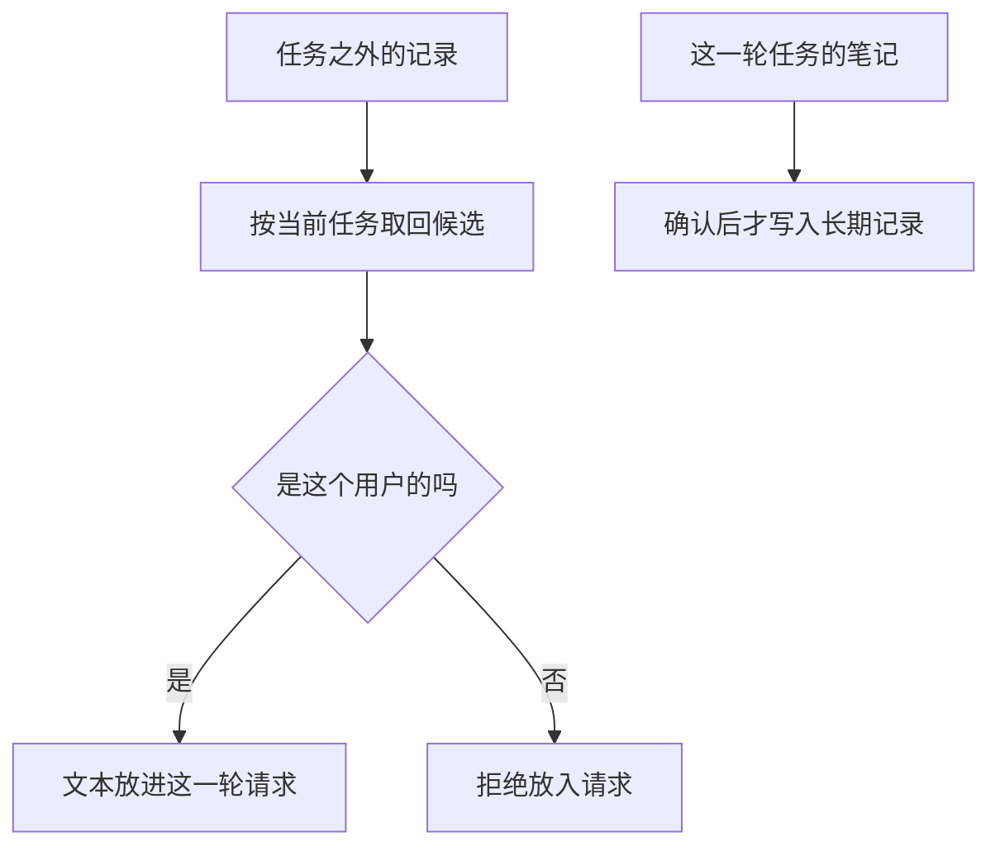

# 长期记忆

长期记忆写在这一轮任务之外，以后换一个会话还能按用户取回。取回之后先核对是不是这个用户的，再决定要不要放进这次请求。

## 知识点概述

[短期记忆](/memory/short-term.md) 的列表随这一轮任务走。用户下次打开另一个会话，那份列表不在了。还要记得的稳定事实，例如偏好和已经确认的约定，要写到调用方持有的存储里。新会话拿到同一份存储，才能再读到。

取回不等于可以原文放进请求。[Embedding](/rag/embedding.md) 能按相近程度找出候选，相近只说明文本接近，不说明记录属于当前用户。宽一点的查询还可能带上别的命名空间。应用在抄进请求之前，用记录上的用户标识和当前用户比较。对不上就拒绝，这段文字不会成为这次请求的一部分。

有的官方记忆工具也把文件放在应用自己的存储上，由应用把记忆路径映射到该用户的目录或数据库键。隔离是应用做的，不是模型看过文本之后再补的。

## 核心原理



写入和读取用的是调用方传入的存储，不是函数内部新建的字典。新建一份字典，上一会话写入的键就不在里面。记录至少带 `user_id` 和 `text`。缺文本、或用户对不上，都是失败，函数不返回那段文字。

这一轮请求里最终出现的，是通过核对的 `text`。没通过的记录留在存储里，供排查，但不进入这次请求。任务笔记里未经确认的句子也不要直接晋升成长期记录。

## 最小示例

```python
def accept_memory(record: dict[str, str], user_id: str) -> str:
    owner = record.get("user_id", "")
    if owner != user_id:
        raise ValueError(f"记忆不属于用户 {user_id}")
    text = record.get("text", "")
    if not text:
        raise ValueError("缺少 text")
    return text
```

存储由调用方保留，才能跨过两次调用：

```python
store = {
    "m1": {"user_id": "u1", "text": "偏好无糖"},
    "m2": {"user_id": "u2", "text": "偏好红茶"},
}
```

按 `accept_memory`，用 `"u1"` 接受 `store["m1"]` 得到「偏好无糖」。这段文字可以放进 u1 的这一次请求。用 `"u1"` 接受 `store["m2"]` 抛出 `ValueError`，函数没有返回「偏好红茶」，因此不能把它放进 u1 的请求。`store["m2"]` 仍在字典里，只是这次没有被抄走。

缺少 `text` 的记录同样抛出 `ValueError`。空字符串用户标识对不上 `"u1"`，也会被拒绝。函数不访问网络，也不计算向量。

## 常见问题

**取回之后按相似度直接拼进提示词。** 相似的句子可能属于另一个用户。先做 `accept_memory` 这种归属检查，通过之后才进入请求。

**每个会话新建一个字典再读取。** 新字典里没有上一会话写入的键。跨会话指的是同一份调用方持有的存储。

**核对失败时返回空字符串。** 空字符串和「这段不是这个用户的」变成同一种结果。归属不对、文本缺失都抛出 `ValueError`。

**把这一轮的全部笔记都晋升成长期记忆。** 笔记里有临时步骤和未确认的猜测。只有准备跨会话保留的事实才写入存储，并带上用户标识。

## 知识自测

<QuizPanel topic-id="long-term-memory" />

## 参考资料

- [LangGraph Stores](https://docs.langchain.com/oss/python/langgraph/stores)：跨线程的记录放在命名空间里，文档示例用用户标识作为其中一段。换一条线程后，同一用户标识仍能取到自己的记录。本页不引用默认条数或嵌入维度。
- [Memory tool](https://docs.anthropic.com/en/docs/agents-and-tools/tool-use/memory-tool)：记忆文件由应用在自己的存储上读写，路径可以映射到按用户分开的位置。本页只采用这个隔离责任，不复制工具命令。
