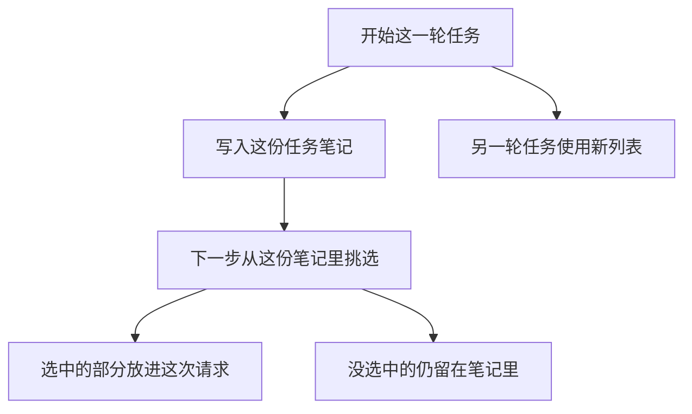

# 短期记忆

短期记忆是这一轮任务自己的笔记。循环的下一步可以读它。它不自动写进跨会话的存储，换一个任务就要换一份新列表。

## 知识点概述

[对话历史管理](/memory/conversation-history.md) 排列的是要发给模型的消息。[Agent Loop](/agent/loop.md) 还需要任务内部的中间结果：核对过哪一步、上一次观察是什么。这些笔记先放在应用为这一轮任务准备的列表里。

这一轮请求里出现的，只是应用从这份列表抄进去的内容。列表里其余的句子留在应用侧，供同一次任务的下一步使用。两个函数都不把笔记交给长期存储。新任务传入另一份空列表，就读不到上一份里的句子。

有的框架把「短期」定义成同一条线程上的状态快照，用来让这条线程的后续回合接上；跨线程的事实放到另一套存储。本页的「这一轮任务」就是这条边界：同一份笔记可以跨过该任务里的多次循环，但不跨到别的任务。

## 核心原理



笔记和请求是两份数据。`note_step` 只修改传入的列表。模型要看见某一步，应用得在组装那一次请求时把它抄进去。只存在于列表、没有被抄走的句子，这一次请求里没有。

`finish_task` 返回最后一条，给这一轮收尾用。它不删除前面的笔记，也不把列表交给别的任务。调用方若丢掉这份列表，中间过程就只剩已经返回的那一句。

## 最小示例

```python
def note_step(scratch: list[str], step: str) -> None:
    if not step:
        raise ValueError("缺少 step")
    scratch.append(step)


def finish_task(scratch: list[str]) -> str:
    if not scratch:
        raise ValueError("这一轮任务还没有笔记")
    return scratch[-1]
```

按这两个函数，`task_a` 从空列表开始。先记下「核对名单」，再记下「写出结论」。`finish_task(task_a)` 得到「写出结论」。此时 `task_a` 仍是两句，同一任务的下一步还能读到「核对名单」。

`task_b` 是另一份空列表。`finish_task(task_b)` 抛出 `ValueError`。它里面没有「核对名单」。空字符串也不会被 `note_step` 写进去。这两个调用都没有把笔记放进别的字典或文件。

若下一步请求只抄走最后一句，请求里是「写出结论」。「核对名单」留在 `task_a`，不在那一次请求里。

## 常见问题

**把每一步都写进跨会话存储。** 中间核对往往只对当前任务有用。写进去之后，别的会话也会把它取回来。值得留下的结论交给后面的长期记忆和更新，而不是由 `note_step` 顺便落盘。

**只在日志里打印笔记。** 下一步若只读 `scratch`，日志里的句子不会出现。要让循环看见，就追加到这份列表，再按需抄进请求。

**所有任务共用一个列表。** 后一个任务会读到前一个任务的中间句子。每个任务传入自己的列表。

**把 `finish_task` 的返回值当成整份笔记。** 返回的是最后一条。更早的步骤还在传入的列表里，直到调用方自己丢掉这份列表。

## 知识自测

<QuizPanel topic-id="short-term-memory" />

## 参考资料

- [LangGraph Persistence](https://docs.langchain.com/oss/python/langgraph/persistence)：检查点保存单条线程上的状态，另一套存储保存跨线程的事实。本页用「这一轮任务的列表」对应线程内的笔记，不把笔记写进跨线程存储。
- 消息如何排进请求，见 [对话历史管理](/memory/conversation-history.md)。
