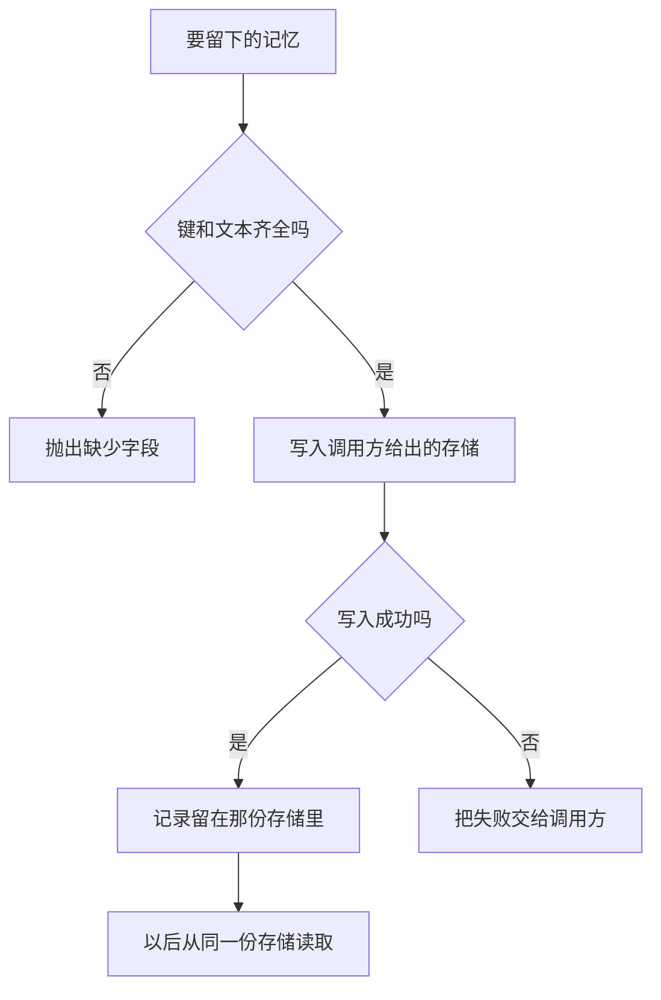

# Memory 存储与检索

存储回答的是记忆写到哪里。写入失败必须让调用方看见。成功写入的文本留在调用方给出的那份存储里，这一轮请求只在稍后读取时才把它抄进去。

## 知识点概述

[长期记忆](/memory/long-term.md) 要能跨会话取回，前提是写和读用的是同一份存储。这份存储可以是调用方持有的字典，也可以换成线程上的状态快照，或跨线程的键值空间。位置不同，调用方要遵守的边界相同：缺字段就拒绝，存储自己失败就把失败交上来。

这一轮请求里没有存储对象，只有读出来、又通过检查的文本。键和原文留在存储里。读到「没有这个键」时返回 `None`，表示查过了、这里没有记录。写入失败不是 `None`，也不是空字符串。调用方把空字符串当成成功，就会以为记忆已经留下。

进程内的字典会跟着这份对象走。调用方改传一个新字典，旧键就不在了。把会话消息落到文件上是后一步，见 [数据库存储](/engineering/database.md)。换位置时不要改掉失败的样子。

## 核心原理



`save_fact` 先检查 `key` 和 `text`，再赋值。检查失败时抛出 `ValueError`，存储保持原样。赋值过程若抛出异常，函数把它包成 `RuntimeError`，并留下原始原因。这样调用方能分开三件事：字段不合法、存储拒绝写入、键本来就不存在。

`load_fact` 对缺少的键返回 `None`。它不把「没有记录」收成空字符串，因为空字符串会和一段空白记忆混在一起。缺少 `key` 仍然是 `ValueError`。

## 最小示例

```python
def save_fact(store: dict[str, str], key: str, text: str) -> None:
    if not key:
        raise ValueError("缺少 key")
    if not text:
        raise ValueError("缺少 text")
    try:
        store[key] = text
    except Exception as error:
        raise RuntimeError(f"写入记忆 {key} 失败") from error


def load_fact(store: dict[str, str], key: str) -> str | None:
    if not key:
        raise ValueError("缺少 key")
    return store.get(key)
```

下面的字典在赋值时拒绝写入，用来把存储故障和普通字典分开。它不访问网络。

```python
class RejectStore(dict[str, str]):
    def __setitem__(self, key: str, value: str) -> None:
        raise OSError("存储拒绝写入")
```

按 `save_fact`，空字典写入 `city` / `杭州` 之后，`load_fact` 从同一份字典得到 `杭州`。另一份空字典上 `load_fact(..., "city")` 得到 `None`。`save_fact(store, "", "杭州")` 抛出 `ValueError`，`store` 不会出现空字符串键。`text` 为空时同样不写入。

`save_fact(RejectStore(), "city", "杭州")` 抛出 `RuntimeError`，原因是那个 `OSError`。这次调用没有留下可以读回的 `杭州`。调用方要捕获的是这次失败，而不是一个看起来像成功的空结果。

## 常见问题

**写入失败时返回空字符串。** 调用方分不清「没写上」和「写上了一段空记忆」。字段问题用 `ValueError`，存储故障用带原因的 `RuntimeError`。

**每次请求新建字典再保存。** 函数返回后，那份字典如果没有交给调用方继续持有，下一次读取就是另一份空存储。存储对象要活得比这一次写入更长，或者换成调用方指定的持久位置。

**把没找到收成和写入失败一样的异常。** 键不存在是读过之后的结果，`load_fact` 返回 `None`。存储打不开才是失败。

**检索被悄悄截断还当成全部结果。** 有的存储在超过条数时只返回一部分，并且不另给溢出信号。调用方若把返回列表当成全集，就会漏掉没出现的记录。本页的读取按键取一条，不把「没有这条」伪装成一份更短的成功列表。

## 知识自测

<QuizPanel topic-id="memory-storage" />

## 参考资料

- [LangGraph Persistence](https://docs.langchain.com/oss/python/langgraph/persistence)：线程状态和跨线程数据是两种位置。进程内的保存器在进程结束时不再留着。本页用调用方传入的对象把这个边界先写清楚。
- [LangGraph Stores](https://docs.langchain.com/oss/python/langgraph/stores)：跨线程记录按命名空间和键写入、读取、删除。文档说明超过条数时结果会被截断且没有溢出信号，所以调用方不能只看返回列表就认为已经拿全。
