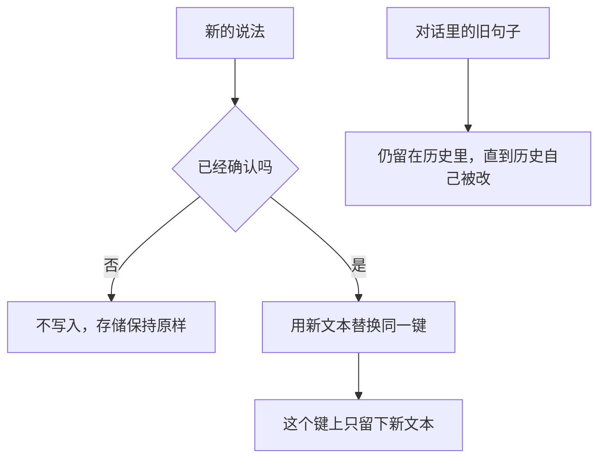

# 记忆生成与更新

更新是让新事实替换同一条旧记忆。未确认的句子不写入。替换之后，这个键上留下的是新文本。对话里曾经说过的旧句子不会因此自动改写。

## 知识点概述

[长期记忆](/memory/long-term.md) 负责跨会话取回，[Memory 存储与检索](/memory/storage.md) 负责写到哪一份存储、失败怎样交上来。这一页决定写进去的内容：什么值得成为记录，以及同一件事再次出现时怎样改掉旧的。

值得留下的是已经确认、以后还要用的事实。一次口误、一个猜测、任务里的中间步骤，都不该占用这个键。`confirmed` 为假时函数抛出 `ValueError`，存储保持原样。

同一键再次写入时，新文本盖住旧文本。有的存储接口把这叫做按键覆盖。有的记忆工具把「替换一段旧文本」交给应用在自己的存储上执行。两种做法都是应用在写，模型只是提出要记的内容。

这一轮请求若仍然带上旧的对话句子，模型会同时看见旧句子和新记忆。更新记录不等于改写历史。历史要不要继续放进请求，由对话历史和上下文工程决定。

## 核心原理



替换看的是键，不是把新句子追加到旧句子后面。追加会让「有糖」和「无糖」一起留在这条记录里，下次取回时两句都在。赋值之后，这个键的值就是新文本。

别的键不受影响。缺键、缺文本、未确认，都在赋值之前失败，所以不会留下半条记录。

## 最小示例

```python
def replace_memory(store: dict[str, str], key: str, text: str, confirmed: bool) -> None:
    if not key:
        raise ValueError("缺少 key")
    if not text:
        raise ValueError("缺少 text")
    if not confirmed:
        raise ValueError(f"未确认，不写入 {key}")
    store[key] = text
```

按这段代码，`store` 一开始是 `{"drink": "有糖"}`。`replace_memory(store, "drink", "无糖", False)` 抛出 `ValueError`，`store["drink"]` 仍是「有糖」。`replace_memory(store, "drink", "无糖", True)` 之后，`store["drink"]` 是「无糖」。这个键上不再有「有糖」。

空键或空文本也会在写入前抛出 `ValueError`。函数不访问网络。若对话历史里还保存着用户说过的「有糖」，那条消息仍在历史列表里。`replace_memory` 没有去改那份列表。下次请求只有在应用把历史也放进去时，才会再看见那句旧话。从这份 `store` 取回 `drink`，得到的是「无糖」。

## 常见问题

**更正之后把新旧两句都留在同一个键上。** 下次取回会同时得到互相矛盾的文本。同一件事用同一个键，新事实直接覆盖。

**未确认的猜测先记下来，以后再改。** 未确认的写入会把错误留在跨会话的存储里。`confirmed` 为假时不要写入。

**改了记忆就认为对话历史里的旧句子也变了。** 两份数据各自保存。记忆键上的值已经是新的。历史消息要由整理历史的那一层决定还发不发。

**用模型的一句「我会记住」代替写入。** 那句话只存在于那一次回复里。没有进入调用方持有的 `store`，下一会话就取不回来。

## 知识自测

<QuizPanel topic-id="memory-update" />

## 参考资料

- [LangGraph Stores](https://docs.langchain.com/oss/python/langgraph/stores)：同一命名空间和键再次写入时，这条记录会被覆盖。本页的 `replace_memory` 用字典赋值表达这件事。
- [Memory tool](https://docs.anthropic.com/en/docs/agents-and-tools/tool-use/memory-tool)：替换文件中的旧文本由应用在自己的存储上执行。本页不复制该工具的命令字段。
