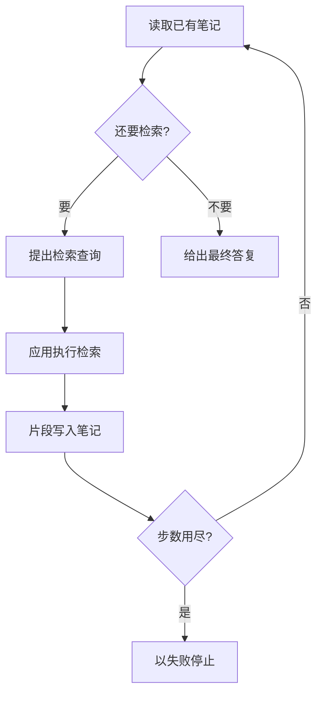

# Agentic RAG

Agentic RAG 里，要不要再查一次由模型决定。真正去检索的仍是应用。循环有步数上限，用尽还没有最终答复时，这次任务失败。

## 知识点概述

[基础 RAG](/rag/basics.md) 里，每次提问都检索，再把片段交给模型写回答。有的问题用模型已经看见的内容就能答，固定再查一次只会多放进无关段落。也有的问题查了一次还缺一个限定条件，需要换一句查询再查。

Asai 等人的框架让模型自己决定当前要不要检索。需要时，由检索器取回片段，模型再继续生成。本页采用这个分工：模型提出查或不查，以及查什么；应用执行检索。论文的实验成绩不在这里引用。

执行方式和 [Tool Calling](/agent/tool-calling.md) 相同。模型返回的是决策，不是数据库结果。查询进了哪份索引、超时多久、空结果怎么写回，都在应用里。停止条件和 [Agent Loop](/agent/loop.md) 相同：步数由应用计数。允许范围内的最后一步若已经是最终答复，仍然成功。步数用在检索上、循环结束时还没有答复，就以失败离开。失败和答复必须能分开。

## 核心原理



`decide` 只看目前的笔记，返回一个决策。`type` 为 `search` 时，应用调用 `search`，把返回的字符串追加到笔记。`type` 为 `answer` 时，把 `content` 交给调用方，循环结束。其他 `type` 抛出 `ValueError`，并且不会写入笔记。

`max_steps` 小于 1 时抛出 `ValueError`，此时还不会调用 `decide`。步数用尽仍没有 `answer`，抛出 `RuntimeError`。笔记留在循环内部，不会被当成答复返回。检索返回空字符串时，它只是一条空白笔记。下一步如果还要求检索，会继续占用步数，直到出现答复或步数失败。

图里的步数判断画在一次检索写回之后。模型若在这一步给出的是答复，函数直接返回，不再走到失败。假模型不访问网络。真实的 `decide` 才会变成一次模型请求，检索函数才会换成你的索引。

## 最小示例

`search_notes` 是本地字典，不是嵌入接口，也不访问网络。查不到的查询返回空字符串。

```python
from collections.abc import Callable
from typing import TypedDict


class Decision(TypedDict):
    type: str
    query: str
    content: str


def search_notes(query: str) -> str:
    notes = {"退款期限": "退款在签收后 7 天内申请。"}
    return notes.get(query, "")


def fake_decide(notes: list[str]) -> Decision:
    if not any(item.strip() for item in notes):
        return {"type": "search", "query": "退款期限", "content": ""}
    return {"type": "answer", "query": "", "content": "签收后 7 天内可以申请退款。"}


def always_search(notes: list[str]) -> Decision:
    return {"type": "search", "query": "退款期限", "content": ""}


def run_agentic_rag(
    decide: Callable[[list[str]], Decision],
    search: Callable[[str], str],
    max_steps: int,
) -> str:
    """模型决定是否检索，应用执行检索，步数用尽则失败。"""
    if max_steps < 1:
        raise ValueError("max_steps must be >= 1")
    notes: list[str] = []
    for _ in range(max_steps):
        decision = decide(notes)
        if decision["type"] == "answer":
            return decision["content"]
        if decision["type"] != "search":
            raise ValueError(f"unknown decision type: {decision['type']}")
        notes.append(search(decision["query"]))
    raise RuntimeError(f"超过最大步数 {max_steps}")
```

按这段控制流，`run_agentic_rag(fake_decide, search_notes, 2)` 第一次决策是检索。应用执行 `search_notes("退款期限")`，笔记里写下「退款在签收后 7 天内申请。」。第二次决策是答复，返回「签收后 7 天内可以申请退款。」。这句是假模型写好的文本，用来对照笔记里的事实，不是另一次检索。

`max_steps` 为 1 时，第一次就是检索，循环没有剩余步数去取得答复，于是抛出 `RuntimeError`。已经写入的笔记不是返回值。`run_agentic_rag(always_search, search_notes, 2)` 检索两次后同样抛出 `RuntimeError`。`max_steps` 为 0 时抛出 `ValueError`。`type` 既不是 `answer` 也不是 `search` 时抛出 `ValueError`，笔记不会增加。

## 常见问题

**在 `decide` 里查库。** 决策函数只返回查或不查，以及查询文本。检索放在应用传入的 `search` 里，权限和超时才留在应用一侧。

**不设步数上限。** 模型可以反复要求用同一句查询再查。没有上限时，循环不会自己结束。上限的具体数字看你的任务，本页不规定一个遍数。

**步数用尽后返回笔记。** 笔记是给下一步决策看的材料。循环因为步数结束时，应抛出 `RuntimeError`，调用方才能把它和成功的答复分开。

**每次都检索固定轮数。** 那样模型没有「现在可以回答」这一步。Agentic RAG 的差别是：模型可以在第一轮就给出答复，也可以在笔记不够时再要一次检索，直到答复出现或步数用尽。

## 知识自测

<QuizPanel topic-id="agentic-rag" />

## 参考资料

- [Self-RAG: Learning to Retrieve, Generate, and Critique through Self-Reflection](https://arxiv.org/abs/2310.11511)：论文让模型决定要不要检索，需要时再调用检索器取回片段。本页只采用这个分工，并另加应用侧的步数上限，不引用实验分数。
- 步数如何和最终答复区分，见 [Agent Loop](/agent/loop.md)。检索作为工具由谁执行，见 [Tool Calling](/agent/tool-calling.md)。固定检索一次的流水线，见 [基础 RAG](/rag/basics.md)。
