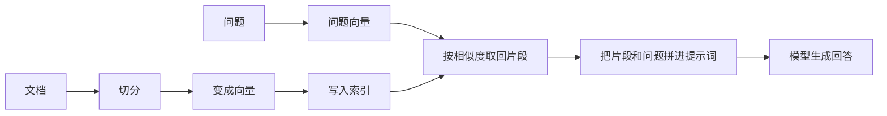

# 基础 RAG

RAG，检索增强生成，先从资料里找出与问题相关的片段，再把这些片段和问题一起交给模型写回答。

## 知识点概述

模型的参数里没有你的内部文档，上下文也放不下全部资料。RAG 不把知识写进参数，而是在每次提问时临时提供几段可能有用的原文。模型仍然负责组织语言。事实应该来自取回的片段。

Lewis 等人在 2020 年的论文里把这个过程用于知识密集型任务：检索外部文档，再让生成模型据此作答。工程实现通常是一条流水线，不一定是 Agent。只有当模型自己决定要不要再检索时，才进入后面的 Agentic RAG。

适合 RAG 的问题，是答案能在一组相对稳定的文档里找到，例如手册、制度和项目说明。如果答案必须来自刚刚发生的计算，应该用工具调用，而不是把计算结果提前写成文档。

## 核心原理

索引和提问是两条路径。索引可以提前做，提问每次都会发生。



切分是因为一整本手册无法放进一次检索比较，也不适合整段塞进提示词。每一块需要足够完整，让人读得懂；又不能长到把无关段落绑在一起。常见的起点是按标题或段落切开，并让相邻块重叠一小部分，避免一句话正好被切断。具体长度取决于文档，不存在一个对所有资料都正确的数字。

向量用来比较「这段文字和问题是否接近」。它不是数据库本身。索引要同时保存向量、原文和来源位置。只有向量时，你无法向用户展示依据。

检索用相似度取回前若干块。余弦相似度是一种常用算法：两个向量方向越接近，值越接近 1。下面的函数只说明计算，不代表你的嵌入模型会输出这些示例数字。

```python
def cosine(left: list[float], right: list[float]) -> float:
    if len(left) != len(right) or not left:
        raise ValueError("vectors must be non-empty and the same length")
    dot = sum(x * y for x, y in zip(left, right, strict=True))
    left_norm = sum(x * x for x in left) ** 0.5
    right_norm = sum(y * y for y in right) ** 0.5
    if left_norm == 0 or right_norm == 0:
        raise ValueError("zero vector")
    return dot / (left_norm * right_norm)
```

生成阶段的提示词至少要包含问题、取回的原文，以及一条约束：只根据给出的片段回答；片段里没有的内容要直接说明资料不足。回答里保留来源，用户才能核对，你也能区分「检索没找到」和「模型没照着片段写」。

## 最小示例

假设已经有三块带向量的笔记。提问时计算问题向量和每一块的相似度，取得分最高的一块，再拼进提示词。这里的向量是手写的，用来看控制流。

```python
chunks = [
    {"source": "手册 A", "text": "退款在签收后 7 天内申请。", "vector": [1.0, 0.0]},
    {"source": "手册 B", "text": "会员积分不过期。", "vector": [0.0, 1.0]},
]

def retrieve(question_vector: list[float], limit: int = 1) -> list[dict[str, str]]:
    ranked = sorted(chunks, key=lambda item: cosine(question_vector, item["vector"]), reverse=True)
    return [{"source": item["source"], "text": item["text"]} for item in ranked[:limit]]

def build_prompt(question: str, found: list[dict[str, str]]) -> str:
    lines = [f"问题：{question}", "资料："]
    lines.extend(f"- {item['source']}：{item['text']}" for item in found)
    lines.append("只根据资料回答。资料没有写到的，就说不知道。")
    return "\n".join(lines)
```

如果问题向量更接近退款那一块，提示词里就应该出现手册 A 的原句。模型之后只看到这段提示词，看不到你没有检索到的手册 B。所以回答错了，要先看 `found` 里有没有所需事实。

## 常见问题

**检索为空仍然要求模型回答。** 它只能靠参数记忆补一段话，并可能编造并不存在的条款。没有命中时，应该返回「资料里没有找到」，而不是继续生成。

**把相似度最高当成一定相关。** 最高分只是这批候选里的相对名次。所有候选都很远时，最高的那个仍然可能无关。是否采纳要看你的数据和阈值实验，不能从本页的示例数字外推。

**只保存向量。** 用户无法核对原文，你也无法在切分策略改变后重建索引。原文和来源位置要一起留下。

**用 RAG 代替权限。** 检索到什么，模型就能在回答里说什么。不该被这个用户看到的文档，应该在检索前过滤掉。

## 知识自测

<QuizPanel topic-id="rag-basics" />

## 参考资料

- [Retrieval-Augmented Generation for Knowledge-Intensive NLP Tasks](https://arxiv.org/abs/2005.11401)：RAG 这一提法的论文。本页只采用「先检索、再生成」的结构，没有引用其中的实验分数。
- 切分、向量索引和混合检索在后续章节有初稿。可以先用这篇把流水线的责任分清，再去读那些初稿。
