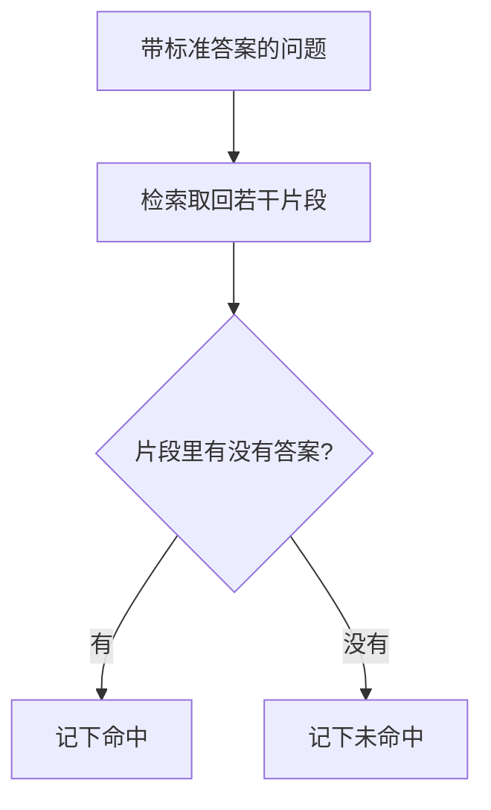

# RAG 评估

检索有没有取到答案，用一小批你已经写好答案的问题来看。每一题检查取回的片段里有没有这句答案，逐条记下有或没有。这批题只把判法走通，这里不算召回率，也不引用别人的准确率。

## 知识点概述

[基础 RAG](/rag/basics.md) 把失败分成两段：片段里没有事实，或片段里有、模型没照着写。两段要分开看。本页只看第一段，也就是检索。生成有没有照着片段写，仍回到那一页的对照方法。

Karpukhin 等人把检索单独拿出来评：取回的那一组片段里，有没有能回答这道题的文字。他们再把许多题统计成一个比例。本页采用逐题的判法，不引用论文里的准确率，也不把比例当成你要填写的成绩。

题由你来写。每题有问题、一句标准答案，以及这次检索取回的若干原文。标准答案用资料里能对上的那一句，不要写成一篇总结。取回了哪些片段，用你自己的 [向量检索](/rag/vector-search.md) 或 [混合检索](/rag/hybrid-search.md)。本页的三题是手写的，片段也是手写的，用来看判断函数，不是一套基准题。

## 核心原理



`mark_retrieval` 对每一题做一次判断。标准答案去掉首尾空白后，只要有一条片段把它当作子串包含，这一题 `found` 为真。一条都没有，则为假。返回值是和题目顺序一致的列表，每条有问题和 `found`。

函数不把命中题数折成比例，也不读论文里的数字。空列表返回空列表。问题或标准答案去掉空白后为空，抛出 `ValueError`。片段列表可以为空，这时 `found` 为假：这次没有取回任何原文。

子串对得上，只说明这些字符出现了。标准答案若短到会在无关句子里出现，这一题也会被记成命中。判完之后打开那条片段，看它是不是在回答这道题。

三道手写题的逐条结果，不能外推成系统的召回率。换一批题、换取回条数，列表都会变。要比较两次改动，就用同一批题、同一种取回方式，再逐条看哪些题从没有变成有，或从有变成没有。

## 最小示例

问题和片段都是编的。函数不调用检索，也不计算百分比。

```python
from typing import TypedDict


class LabeledQuestion(TypedDict):
    question: str
    answer: str
    passages: list[str]


class RetrievalMark(TypedDict):
    question: str
    found: bool


def mark_retrieval(items: list[LabeledQuestion]) -> list[RetrievalMark]:
    """逐题看取回片段里有没有标准答案。不计算比例。"""
    marks: list[RetrievalMark] = []
    for item in items:
        question = item["question"].strip()
        answer = item["answer"].strip()
        if not question or not answer:
            raise ValueError("question and answer are required")
        found = any(answer in passage for passage in item["passages"])
        marks.append({"question": question, "found": found})
    return marks
```

```python
items = [
    {
        "question": "退款期限",
        "answer": "7 天",
        "passages": ["退款在签收后 7 天内申请。"],
    },
    {
        "question": "积分是否过期",
        "answer": "积分不过期",
        "passages": ["运费满 99 元包邮。"],
    },
    {
        "question": "何时开发票",
        "answer": "订单完成后",
        "passages": ["发票在订单完成后开具。", "偏远地区不包邮。"],
    },
]
mark_retrieval(items)
```

按子串规则，第一题的片段含有「7 天」，`found` 为真。第二题的片段是运费那一句，不含「积分不过期」，`found` 为假。第三题的第一条片段含有「订单完成后」，`found` 为真。返回的是这三题的列表。这里没有百分比。

「7 天」能对上，是因为演示句里就有这几个字符。答案若短到无关句子里也会出现，这个判法会把那一题记成命中，所以还要打开片段看。传入空列表得到空列表。标准答案只有空白时抛出 `ValueError`。

## 常见问题

**把这几题折成召回率。** 手写的三题只说明判法。百分比要有明确的题集和取回方式。把这三题折成一个数字，或把它写成系统成绩，都超出了这页示例能支持的范围。

**抄论文里的准确率。** Karpukhin 等人报告的是他们的检索器和数据集。你的手册、切分和取回条数都不同。本页不引用那些数字，也不把它们当成你的目标值。

**只看回答通不顺。** 句子通顺，片段里仍可能没有事实。先看 `found`。为真时，再看模型有没有照着片段写。为假时，先改检索，而不是先改措辞。

**标准答案短到处处都能对上。** 「天」「元」这种片段会在很多句子里出现。答案写成能区分对错的那一句，判完再读原文。子串只是第一道可以手算的筛子。

## 知识自测

<QuizPanel topic-id="rag-evaluation" />

## 参考资料

- [Dense Passage Retrieval for Open-Domain Question Answering](https://arxiv.org/abs/2004.04906)：论文把检索单独评测为取回的片段里有没有能回答问题的文字，并在此基础上统计比例。本页只做逐条判断，不引用该比例或实验准确率。
- 检索和生成如何分工，见 [基础 RAG](/rag/basics.md)。片段如何取回，见 [向量检索](/rag/vector-search.md)。
