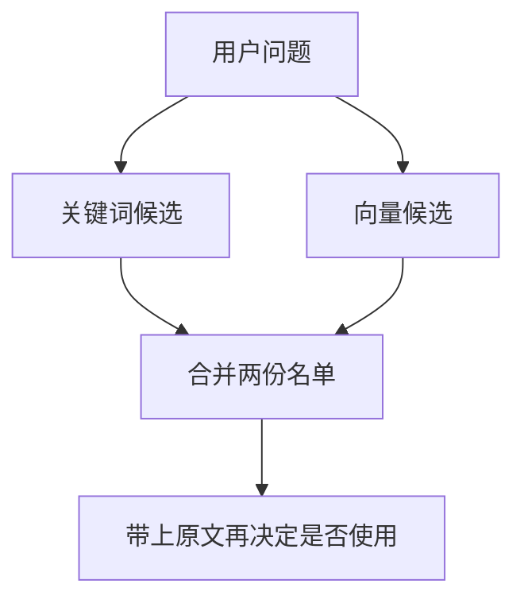

# 混合检索

混合检索走两路：关键词一路按词在不在原文里取出若干条，向量一路按相似度取出若干条。两份候选再合成一份名单。合成时不设一个通用的最佳权重。

## 知识点概述

[向量检索](/rag/vector-search.md) 用相似度取前 K 条。方向接近的句子会靠前。订单号、专名和必须原样出现的数字，可能因为措辞不同而排不进去。关键词一路补的是这件事：原文里有这个词，才进入这路候选。

用户问「满 99 是否包邮」时，句子「运费满 99 元包邮。」里有「99」，关键词一路能把它取到。用户改问「能不能免运费」时，原文并没有这四个字。向量一路才有机会靠意思接近把同一句取回来。两路各拿一份，再合并。这个对照说明分工。下面的名单是手写的，不是某次打分的结果。

Karpukhin 等人把关键词匹配和稠密向量看成互补的两路：换一种说法时，向量仍可能接近；词必须原样出现时，关键词更直接。Weaviate 的文档把混合检索写成这两份结果的融合，并写明融合方式和相对权重都可以配置。权重是按你的资料选的。本页的合并函数不接收权重。

合并名单里仍然只有两路已经取到的条目。两路都没取到的句子，不会在合并时出现。

## 核心原理



两份名单各自已经排好序。合并只看条目在哪一路出现过，不把分数乘上系数：

1. 两路都出现的条目在前，顺序跟关键词名单一致。
2. 只出现在关键词名单里的随后，保持关键词名单的顺序。
3. 只出现在向量名单里的放在最后，保持向量名单的顺序。

两路都出现就放前面，是为了让这份手写结果读得出「两边都提到了谁」。这是例子的读法。你的库可以换成别的合并方式。该不该换，用 [RAG 评估](/rag/evaluation.md) 里那一小批写好答案的问题看，不从这里抄一个比例。

返回的每条带有 `id`、`text` 和 `lanes`。`lanes` 记下它来自哪一路，两路都有时先写 `keyword` 再写 `vector`。真正接到检索结果上时，还要保留 [向量检索](/rag/vector-search.md) 里的来源和位置。本页把字段收短，方便核对合并顺序。

比较前去掉 `id` 和 `text` 的首尾空白。去掉之后为空，或同一路里 `id` 重复，抛出 `ValueError`。同一个 `id` 在两路的原文不一致，也抛出 `ValueError`。两路都是空列表时返回空列表。函数返回新的字典，不改传入的名单。

## 最小示例

两份名单是手写的。关键词名单表示词面命中的顺序，向量名单表示相似度顺序。向量不是嵌入模型的输出。原文是编的演示句子。

```python
from typing import TypedDict


class Candidate(TypedDict):
    id: str
    text: str


class MergedHit(TypedDict):
    id: str
    text: str
    lanes: list[str]


def normalize_lane(items: list[Candidate], lane: str) -> list[Candidate]:
    seen: dict[str, str] = {}
    cleaned: list[Candidate] = []
    for item in items:
        item_id = item["id"].strip()
        text = item["text"].strip()
        if not item_id or not text:
            raise ValueError(f"empty id or text in {lane}")
        if item_id in seen:
            raise ValueError(f"duplicate id in {lane}: {item_id}")
        seen[item_id] = text
        cleaned.append({"id": item_id, "text": text})
    return cleaned


def merge_candidates(keyword: list[Candidate], vector: list[Candidate]) -> list[MergedHit]:
    """合并两路候选。不接收权重。"""
    keyword_rows = normalize_lane(keyword, "keyword")
    vector_rows = normalize_lane(vector, "vector")
    vector_by_id = {row["id"]: row["text"] for row in vector_rows}
    keyword_ids = {row["id"] for row in keyword_rows}
    for row in keyword_rows:
        other = vector_by_id.get(row["id"])
        if other is not None and other != row["text"]:
            raise ValueError(f"text mismatch for {row['id']}")
    merged: list[MergedHit] = []
    # 两路都有的放前面，只为了让这份手写名单读得出谁被两边同时取到。
    for row in keyword_rows:
        if row["id"] in vector_by_id:
            merged.append({"id": row["id"], "text": row["text"], "lanes": ["keyword", "vector"]})
    for row in keyword_rows:
        if row["id"] not in vector_by_id:
            merged.append({"id": row["id"], "text": row["text"], "lanes": ["keyword"]})
    for row in vector_rows:
        if row["id"] not in keyword_ids:
            merged.append({"id": row["id"], "text": row["text"], "lanes": ["vector"]})
    return merged
```

```python
keyword = [
    {"id": "shipping", "text": "运费满 99 元包邮。"},
    {"id": "invoice", "text": "发票在订单完成后开具。"},
    {"id": "refund", "text": "退款在签收后 7 天内申请。"},
]
vector = [
    {"id": "invoice", "text": "发票在订单完成后开具。"},
    {"id": "remote", "text": "偏远地区不包邮。"},
    {"id": "shipping", "text": "运费满 99 元包邮。"},
]
merge_candidates(keyword, vector)
```

按合并规则，返回四条，顺序是 `shipping`、`invoice`、`refund`、`remote`。`shipping` 和 `invoice` 两路都有，`lanes` 是 `keyword` 然后 `vector`，先后跟关键词名单一致。`refund` 只在关键词名单里。`remote` 只在向量名单里，所以排在最后。

两路都传入空列表时，得到空列表。关键词名单为空、向量名单依次是 `remote` 和 `shipping` 时，结果保持这个顺序，`lanes` 只有 `vector`。关键词名单里 `shipping` 出现两次时抛出 `ValueError`。同一个 `shipping` 在两路的原文不同，同样抛出 `ValueError`。`text` 去掉空白后为空，也抛出 `ValueError`。

## 常见问题

**从别处抄一对权重。** 关键词占多少、向量占多少，取决于问题和文档。本页的函数不接收权重。Weaviate 的文档把权重写成可配置项，也没有把它说成一个到处适用的常数。

**只走向量一路。** 相似度照顾换一种说法的情况。订单号和必须原样出现的数字，可能因此进不了前 K 条。关键词这一路就是为这些词留的。

**只走关键词一路。** 原文换了措辞、词对不上时，这一路是空的。向量一路负责把意思接近的句子取进来。两路都要有自己的候选，再合并。

**合并结果只留 id。** 模型和用户要看的是原文。`lanes` 用来事后检查它是被哪一路取到的。接到真实检索时，来源和位置也要留下。

## 知识自测

<QuizPanel topic-id="hybrid-search" />

## 参考资料

- [Hybrid search](https://docs.weaviate.io/weaviate/search/hybrid)：Weaviate 说明混合检索融合向量检索和关键词检索的两份结果，融合方式和相对权重都可以配置。本页不采用其中的示例权重。
- [Dense Passage Retrieval for Open-Domain Question Answering](https://arxiv.org/abs/2004.04906)：论文说明关键词匹配和稠密向量互补。本页只采用这一点，不引用实验准确率。
- 向量这一路如何取前 K 条，见 [向量检索](/rag/vector-search.md)。合并之后若还要细排已经取回的少量候选，见 [Rerank](/rag/rerank.md)。
