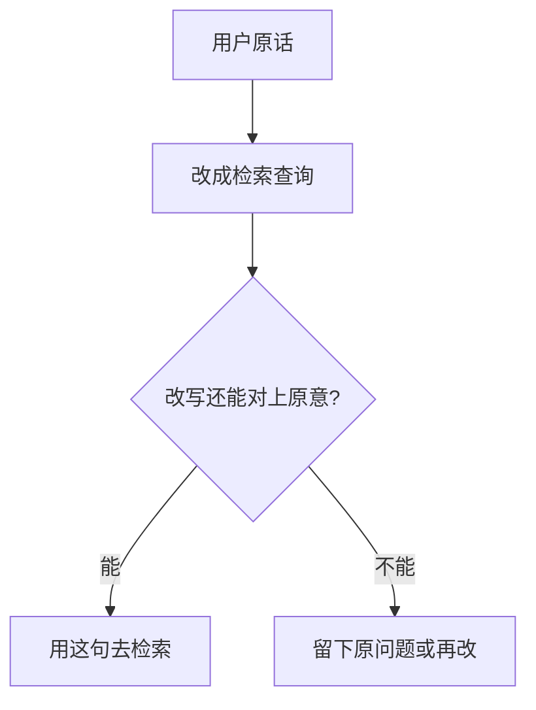

# Query Rewrite

查询改写发生在检索之前。用户的原话里常常有代词，或少了主题和限定条件。改写把这句换成更适合去查的查询。换完的句子先读一遍，确认它还是用户要问的那件事，再拿去检索。

## 知识点概述

[向量检索](/rag/vector-search.md) 拿去比较的是查询本身。查询里只有「它」或「偏远地区呢」，索引里的句子对不上这个说法，相关的段落就进不了候选。改写补的是检索需要的词：上一句在谈什么，这个「它」指哪一件事，缺了哪个范围。

Ma 等人把这一步放在检索之前。原话和真正要查的说法之间有差距，所以先把输入换成检索查询，再去取资料。他们也写到，改出来的查询仍然可能不合适。本页因此把「读一遍」放进流程，不引用论文的实验分数。

改写可以由模型完成，提示词怎么写见 [Prompt Engineering](/fundamentals/prompt-engineering.md)。模型补上的主题可能来自错误的上一句。下面的函数更窄：它只按调用方给的对照表替换占位符，不猜测代词指谁。对照表填错时，函数仍会照填。所以填完要和对话对一下。

## 核心原理



占位符写成 `{主题}` 这种样子，花括号里是名字。`fill_placeholders` 按对照表替换。表里有的名字换成对应的值，值会去掉首尾空白。表里没有的占位符原样留下。替换时看的是原句里的括号，填进去的文字不会再被当成新的占位符。

问题去掉空白后为空，抛出 `ValueError`。对照表里的名字为空，或值去掉空白后为空，也抛出 `ValueError`。名字里面不要再写花括号。

`has_unfilled_placeholder` 只检查一件事：结果是不是空的，或还留着花括号。返回真时，这句还不能拿去检索。返回假，只说明括号填完了，或原句本来就没有占位符。它看不出主题有没有补错。括号填完之后，仍然要读那一句。

上一句是「运费怎么算？」，这一句是「偏远地区呢？」。把 `{主题}` 填成「偏远地区的运费」，得到「偏远地区的运费怎么算？」，这句和上一句对得上。上一句如果其实是「发票怎么开？」，同一句改写就跑题了。函数分不出这两种对话，人读得出来。

对不上时，用原问题再查一次，或改一版再读。不要把跑题的查询送进 [向量检索](/rag/vector-search.md)。

## 最小示例

对照表是手写的。函数不调用模型，也不访问检索。

```python
def fill_placeholders(question: str, bindings: dict[str, str]) -> str:
    """按对照表替换占位符。未登记的占位符原样留下。"""
    if not question.strip():
        raise ValueError("question is empty")
    for name, value in bindings.items():
        if not name or not value.strip():
            raise ValueError("binding needs a name and a non-empty value")
    pieces: list[str] = []
    index = 0
    while index < len(question):
        start = question.find("{", index)
        if start == -1:
            pieces.append(question[index:])
            break
        end = question.find("}", start + 1)
        if end == -1:
            pieces.append(question[index:])
            break
        name = question[start + 1 : end]
        pieces.append(question[index:start])
        if name in bindings:
            pieces.append(bindings[name].strip())
        else:
            pieces.append(question[start : end + 1])
        index = end + 1
    return "".join(pieces)


def has_unfilled_placeholder(query: str) -> bool:
    """还有空的占位符时，这句不能拿去检索。"""
    return (not query.strip()) or ("{" in query) or ("}" in query)
```

```python
fill_placeholders("{主题}包邮吗？", {"主题": "偏远地区"})
fill_placeholders("{主题}包邮吗？", {})
fill_placeholders("运费怎么算？", {})
```

第一句得到「偏远地区包邮吗？」。`has_unfilled_placeholder` 为假，括号已经填完。检索前仍要确认用户问的是不是偏远地区，而不是某一个商品。第二句对照表是空的，结果仍是「{主题}包邮吗？」，检查为真，不能拿去检索。第三句没有占位符，结果就是原问题，检查为假，原问题可以直接用作查询。

问题只有空白时抛出 `ValueError`。对照值只有空白时，同样抛出 `ValueError`。

## 常见问题

**改写完不读就检索。** 改写的目的是补上代词和限定条件。补错了主题，检索会去查另一件事，后面的排序没有机会回到原问题。

**占位符还在就拿去查。** `{主题}` 这种字不会出现在配送说明里。`has_unfilled_placeholder` 为真时先停下来，补全或改回原问题。

**把模型的改写当成用户原意。** 模型根据它看到的上文猜测。上文截断、或同时在谈两件事时，猜测会偏。对照表同样会偏。两种结果都要和对话再对一次。

**原问题已经能查，仍改成另一件事。** 「运费满多少包邮？」本身有词可以查。改写若把它换成一个更宽的问题，候选会散掉。改写是为了补缺失的信息，原句已经清楚时可以保持原句。

## 知识自测

<QuizPanel topic-id="query-rewrite" />

## 参考资料

- [Query Rewriting for Retrieval-Augmented Large Language Models](https://arxiv.org/abs/2305.14283)：论文在检索前增加改写，用来缩小原话和检索所需说法之间的差距。本页不引用实验分数。
- 改写如果交给模型，提示词的写法见 [Prompt Engineering](/fundamentals/prompt-engineering.md)。改完的查询如何取回片段，见 [向量检索](/rag/vector-search.md)。
