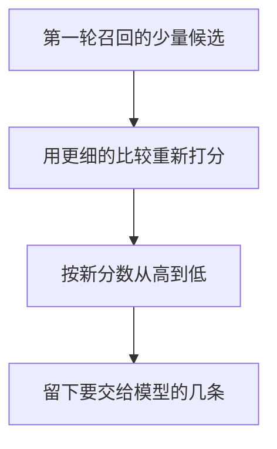

# Rerank

重排是第二次排序。第一轮已经从库里取出少量候选，第二次用更细的比较，只把这几条重新排一遍。没进候选的片段，重排看不见，所以它不能代替第一轮召回。

## 知识点概述

[向量检索](/rag/vector-search.md) 和 [混合检索](/rag/hybrid-search.md) 解决的是从库里取出可能相关的一批。这一批里的名次，往往来自向量相似度或关键词是否出现。两种都比较快，也都会把「有点像」的句子排到前面。

重排换一种比较：同时读问题和这一条原文，再给这几条一个新的顺序。Nogueira 和 Cho 的论文把这一步放在第一轮之后。第一轮先取出候选，第二轮才让模型一起看查询和片段。Cohere 的说明同样把输入定义成一条查询加上一份文档列表，输出是这份列表的新顺序。本页不调用那个接口，也不引用论文或文档里的分数。

第二次比较要读完整句，通常比第一轮更贵。因此只把打算细看的少量候选送进去。具体留几条，取决于你的问题和还能放进提示词的片段数。本页不规定条数，也不把论文实验里的候选规模当成默认值。

下面的函数用「查询词是不是原文的子串」来打分，是为了能手算。它不是交叉编码器，也不是某一家的重排模型。

## 核心原理



输入是已经取回的 `candidates`，不是整个库。`terms` 是从问题里抽出的词。一条候选的分数，等于有多少个词作为子串出现在它的 `text` 里。词表里同一个词写两次，就计两次，所以词表不要重复。

`limit` 小于 0 是非法输入，抛出 `ValueError`。`limit` 为 0，或候选是空的，返回空列表。这时还不检查词，也不打分。需要打分时，词先去掉首尾空白；去掉之后为空，抛出 `ValueError`。词表本身是空的，并且确实要打分时，每条分数都是 0，顺序保持原样。

排序按分数从高到低。分数相同则保持候选原来的相对顺序，同一次输入的结果可以复现。`limit` 大于候选数时，返回全部排好序的候选。返回值带有 `id`、`text` 和这次的 `score`。函数不修改输入列表。

`score` 只说明词出现了几次。它会把「不包邮」算成含有「包邮」。这正是手算比较的限度。真正的重排要读整句，才能分开这两句。

## 最小示例

候选是手写的三句，当作第一轮已经取回的结果。这里没有嵌入，也没有重排接口。

```python
from typing import TypedDict


class Passage(TypedDict):
    id: str
    text: str


class RankedPassage(TypedDict):
    id: str
    text: str
    score: int


def rerank(terms: list[str], candidates: list[Passage], limit: int) -> list[RankedPassage]:
    """按词是否出现，给已经召回的候选重新排序。"""
    if limit < 0:
        raise ValueError("limit must be >= 0")
    if limit == 0 or not candidates:
        return []
    cleaned_terms: list[str] = []
    for term in terms:
        stripped = term.strip()
        if not stripped:
            raise ValueError("term must be non-empty")
        cleaned_terms.append(stripped)
    scored: list[tuple[int, int, Passage]] = []
    for index, item in enumerate(candidates):
        score = sum(1 for term in cleaned_terms if term in item["text"])
        scored.append((score, index, item))
    # 分数相同则保持候选原来的顺序。
    scored.sort(key=lambda row: (-row[0], row[1]))
    return [
        {"id": item["id"], "text": item["text"], "score": score}
        for score, _, item in scored[:limit]
    ]
```

```python
passages = [
    {"id": "fee", "text": "运费满 99 元包邮。"},
    {"id": "invoice", "text": "发票在订单完成后开具。"},
    {"id": "remote", "text": "偏远地区不包邮。"},
]
rerank(["包邮", "偏远"], passages, 2)
```

按子串计数，`fee` 只含「包邮」，分数是 1。`invoice` 两个词都没有，分数是 0。`remote` 含「偏远」，也含「包邮」（它出现在「不包邮」里），分数是 2。`limit` 为 2 时，先是 `remote`，然后是 `fee`。`invoice` 不在结果里。

`rerank(["包邮"], passages, 3)` 里，`fee` 和 `remote` 的分数都是 1，`invoice` 是 0。分数相同的两条保持原来的先后，所以顺序是 `fee`、`remote`、`invoice`。`limit` 为 5 时，三条都返回，顺序仍按分数。`limit` 为 0 时返回空列表，即使词表里有空字符串，也不会在这一步被检查。`limit` 为 -1 时抛出 `ValueError`。`limit` 为 2 并且词表里有空字符串时，也会抛出 `ValueError`。

## 常见问题

**用重排代替第一轮。** 重排的输入是已经取出的候选。答案如果没进这批，更细的比较也看不见它。第一轮负责从库里召回，重排负责把这几条重新排序。

**把整库送去重排。** 第二次比较要同时看问题和原文，通常比第一轮更贵。送进去的应是准备细看的少量候选。具体几条看你的问题和提示词还能放多少段，本页不规定条数。

**把词重叠或文档里的示例分数当成相关度。** 本页的分数只为了手算排序。「不包邮」会含有「包邮」。论文和产品文档里的分数属于他们的实验或示例，不能抄来当阈值。

**重排后只留分数。** 交给模型的是原文。`score` 用来检查这次顺序。来源和位置若第一轮已经带上，重排时要一起留下。

## 知识自测

<QuizPanel topic-id="rerank" />

## 参考资料

- [Passage Re-ranking with BERT](https://arxiv.org/abs/1901.04085)：论文把重排放在第一轮召回之后，让模型同时看查询和片段再排序。本页不引用实验分数，也不采用论文实验里的候选规模。
- [Cohere Rerank](https://docs.cohere.com/docs/reranking)：官方说明重排接收一条查询和一份文档列表，并重新排序这份列表。本页不调用接口，也不引用页面上的示例分数。
- 第一轮如何按相似度取回候选，见 [向量检索](/rag/vector-search.md)。两路候选如何合并，见 [混合检索](/rag/hybrid-search.md)。
