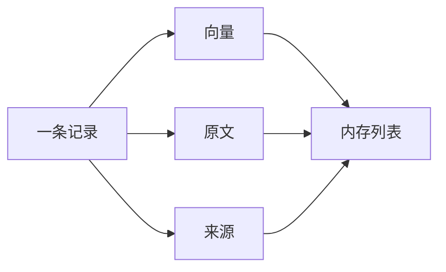

# 向量数据库

向量数据库保存一条条记录。向量用来比较，原文交给模型，来源用来回到那一段。这些记录可以先放在内存列表里。

## 知识点概述

[Embedding](/rag/embedding.md) 把文本变成向量。比较结束之后，提示词里需要原文，用户核对时需要来源。只把向量写进索引，这两件事都做不到。

这里说的向量数据库，指任何能按这个形状存取记录的地方。内存列表就够把流水线跑通。文档变多、逐条比较太慢以后，可以换成带近邻索引的存储。换成哪一种，由部署决定，不是这个概念成立的前提。

Lewis 等人的论文把外部知识放在维基百科的稠密向量索引里，检索取回的是文档。本页沿用这一点：索引要能把原文拿回来。不引用论文的实验分数，也不把论文用过的索引软件说成必须安装的组件。

## 核心原理



一条记录有三样东西。来源再拆成文件名和段号，避免只剩下一个笼统的名字。

- **向量**：嵌入模型的输出，只参与比较
- **原文**：交给模型和用户看的那段话
- **来源**：文件名加上这段在文件中的位置

位置可以是段号、标题或字符区间，同一次索引里规则要一致。`配送说明` 加上段号 0，才能和同一文件里的段号 1 分开。

写入时拒绝空原文、空来源、空向量、负的段号和零向量。零向量没有方向，后面的余弦相似度无法使用它。把这种记录挡在写入时，查找阶段就不会碰到算不了的向量。

列表变长以后，独立服务替换的是存放和查找的方式。取回来的仍然是向量、原文和来源。

## 最小示例

下面的类把记录放在内存列表里。句子是编来演示字段的，不是某家公司的条款。向量也是手写的，不是嵌入模型的输出。

```python
from typing import TypedDict


class VectorRecord(TypedDict):
    source: str
    position: int
    text: str
    vector: list[float]


class MemoryVectorStore:
    def __init__(self) -> None:
        self._records: list[VectorRecord] = []

    def add(self, record: VectorRecord) -> None:
        source = record["source"].strip()
        text = record["text"].strip()
        position = record["position"]
        vector = record["vector"]
        if not source:
            raise ValueError("source is required")
        if not text:
            raise ValueError("text is required")
        if position < 0:
            raise ValueError("position must be >= 0")
        if not vector:
            raise ValueError("vector is required")
        if all(component == 0 for component in vector):
            raise ValueError("zero vector has no direction")
        # 复制向量，调用方随后修改自己的列表时，不会改到已经写入的记录。
        self._records.append(
            {"source": source, "position": position, "text": text, "vector": list(vector)}
        )

    def records(self) -> list[VectorRecord]:
        return [
            {
                "source": item["source"],
                "position": item["position"],
                "text": item["text"],
                "vector": list(item["vector"]),
            }
            for item in self._records
        ]
```

```python
store = MemoryVectorStore()
store.add(
    {"source": "配送说明", "position": 0, "text": "运费满 99 元包邮。", "vector": [1.0, 0.0]}
)
store.add(
    {"source": "配送说明", "position": 1, "text": "发票在订单完成后开具。", "vector": [0.0, 1.0]}
)
```

`store.records()` 按写入顺序返回两条记录。每条都有 `source`、`position`、`text` 和 `vector`。返回的是副本，修改返回值不会改动库里的列表。

`store.add({"source": "文档", "position": 0, "text": "  ", "vector": [1.0, 0.0]})` 会失败，因为去掉空白后原文是空的。来源是空字符串、段号是负数、向量是 `[]` 或 `[0.0, 0.0]` 时，同样失败。

按相似度取前几条是 [向量检索](/rag/vector-search.md) 的事。这一节先把能核对的记录留住。

## 常见问题

**只保存向量。** 回答和核对都需要原文。文件名和段号用来回到那一段。这几项一起写入。

**把某一个外部服务当成必经步骤。** 内存列表已经能保存并取回记录。需要更快的近邻查找时，再换存储。换完以后，取回的仍然是向量、原文和来源。

**来源只写一个笼统的名字。** 同一文件里有很多段。文件名和段号要一起留下，段号、标题或字符区间都可以，只要能区分是哪一段。

**把不同模型的向量放进同一个列表。** 比较只在同一个嵌入空间里有意义。列表可以很简单，里面的向量仍要来自同一个模型。

## 知识自测

<QuizPanel topic-id="vector-database" />

## 参考资料

- [Retrieval-Augmented Generation for Knowledge-Intensive NLP Tasks](https://arxiv.org/abs/2005.11401)：论文用稠密向量索引保存外部文档，检索时取回文档。本页只采用「索引要能拿回原文」这一点，不引用实验分数。
- 向量如何比较，见 [Embedding](/rag/embedding.md)。如何按相似度取前几条，见 [向量检索](/rag/vector-search.md)。
