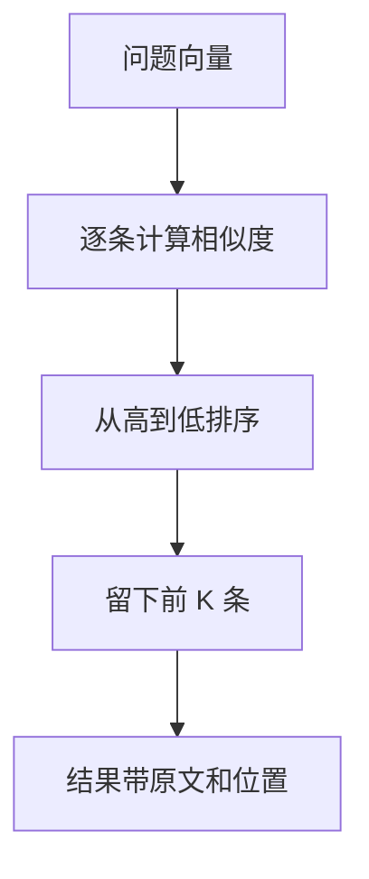

# 向量检索

向量检索用相似度从记录里取出最接近问题的前 K 条，并带着原文和它在文档中的位置回来。K 是这次想交给模型的片段数，要用自己的问题和文档试。

## 知识点概述

[Embedding](/rag/embedding.md) 提供比较函数，[向量数据库](/rag/vector-database.md) 保存向量、原文和来源。检索把两步接上：用问题向量给每条记录打分，取得分最高的前 K 条。

最高分只是这批候选里的相对名次。候选都离问题很远时，第一名仍然可能无关。要不要把这段交给模型，要看取回的原文。

Lewis 等人的论文用最大内积搜索取前 K 篇文档，K 在那次实验里靠开发集选择。本页的最小实现用余弦相似度，逐条比较，方便核对。内积和余弦都是越大越接近。库若返回的是距离，则越小越接近，排序方向要反过来。论文的实验分数，以及他们选过的 K，都不是你的默认值。

## 核心原理



余弦相似度沿用嵌入那一节：方向越齐，值越接近 1。下面把函数再写一遍，示例可以单独读完。

文件名和段号一起才能回到原文。结果里保留 `source`、`position`、`text` 和这次的 `score`。分数用来排序和事后检查。放进提示词的主要是原文和来源。

分数相同时，保持记录原来的先后。同一次输入得到的顺序就可以复现。

K 小于 0 是非法输入，直接拒绝。K 为 0，或记录是空的，返回空列表，此时还不去计算相似度。K 大于记录数时，把全部记录按分数从高到低返回。

## 最小示例

记录里的向量是手写的，用来看排序。这不是嵌入模型的输出。原文是编的演示句子。

```python
from typing import TypedDict


class ChunkRecord(TypedDict):
    source: str
    position: int
    text: str
    vector: list[float]


class SearchHit(TypedDict):
    source: str
    position: int
    text: str
    score: float


def cosine_similarity(left: list[float], right: list[float]) -> float:
    if len(left) != len(right) or not left:
        raise ValueError("vectors must be non-empty and the same length")
    dot = sum(x * y for x, y in zip(left, right, strict=True))
    left_length = sum(x * x for x in left) ** 0.5
    right_length = sum(y * y for y in right) ** 0.5
    if left_length == 0 or right_length == 0:
        raise ValueError("zero vector has no direction")
    return dot / (left_length * right_length)


def top_k(query: list[float], records: list[ChunkRecord], k: int) -> list[SearchHit]:
    if k < 0:
        raise ValueError("k must be >= 0")
    if k == 0 or not records:
        return []
    scored = [
        (cosine_similarity(query, record["vector"]), index, record)
        for index, record in enumerate(records)
    ]
    # 分数相同则保持原来的顺序，同一次输入的结果可以复现。
    scored.sort(key=lambda item: (-item[0], item[1]))
    return [
        {
            "source": record["source"],
            "position": record["position"],
            "text": record["text"],
            "score": score,
        }
        for score, _, record in scored[:k]
    ]
```

```python
records = [
    {"source": "配送说明", "position": 0, "text": "运费满 99 元包邮。", "vector": [1.0, 0.0]},
    {"source": "配送说明", "position": 1, "text": "发票在订单完成后开具。", "vector": [0.0, 1.0]},
    {"source": "配送说明", "position": 2, "text": "偏远地区不包邮。", "vector": [3.0, 4.0]},
]
top_k([1.0, 0.0], records, 2)
```

查询 `[1.0, 0.0]` 与三条记录的相似度分别是 1、0 和 3/5。前两名是段号 0，然后是段号 2。段号 1 不在结果里。结果中的 `source` 和 `position` 仍指向原文的位置，`text` 是对应的那一句。

两条记录的向量都是 `[1.0, 0.0]` 时，分数同为 1，先写入的那条排在前面。`top_k(query, records, 0)` 得到空列表。`k` 为 -1 时抛出 `ValueError`。列表里出现零向量，并且 `k` 大于 0 时，相似度函数会拒绝它。

## 常见问题

**只返回分数。** 模型需要原文，用户需要文件名和段号。分数留在结果里是为了检查排序，不能代替原文。

**把某一次实验的 K 抄来默认使用。** 论文用开发集选择 K。你的 K 取决于问题有多散、一块有多长、提示词还能放多少段。先取一个小的 K，读返回的原文，再增减。

**候选都很远时仍然采用第一名。** 第一名只是这批里最近的。原文和问题无关时，告诉用户资料不足，不要把这段交给模型续写。

**把距离和相似度排反。** 本页的余弦相似度，以及论文里的内积，都是越大越近。库若返回距离，越小越近。写排序前先确认返回值的方向。

## 知识自测

<QuizPanel topic-id="vector-search" />

## 参考资料

- [Retrieval-Augmented Generation for Knowledge-Intensive NLP Tasks](https://arxiv.org/abs/2005.11401)：论文用最大内积搜索取前 K 篇，并用开发集选择 K。本页不引用实验分数，也不把那个 K 当成默认值。
- 余弦相似度的手算示例见 [Embedding](/rag/embedding.md)。记录里为什么要有原文和来源，见 [向量数据库](/rag/vector-database.md)。
